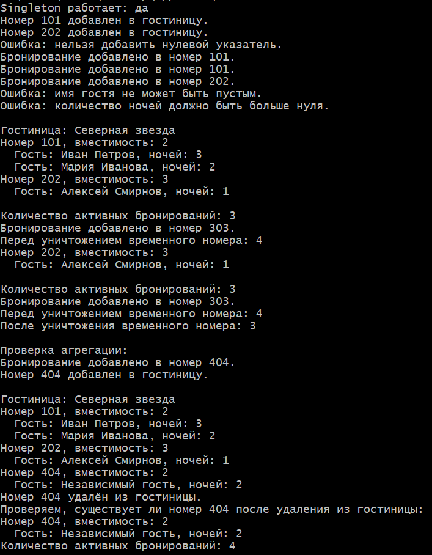

# Лабораторная работа № 1
## «Композиция и агрегация классов. Статические члены»
**Продвинутый уровень, вариант № 8**

**Студент:** Давлетмурзаев Сайд-Эмин Тимурович  
**Группа:** ПИЖ-б-о-25-1  
**Преподаватель:** Белик Ангелина Игоревна
## 1. Цель работы

Изучить композицию и агрегацию классов, статические поля и методы, а также паттерн Singleton на языке C++.

## 2. Теоретическая часть

**Композиция** — отношение «часть–целое», при котором часть уничтожается вместе с целым. В работе бронирования `Booking` принадлежат номеру `Room`.

**Агрегация** — отношение, при котором объекты могут существовать независимо от целого. Гостиница `Hotel` хранит указатели на самостоятельно созданные номера `Room`.

**Статическое поле** принадлежит всему классу, а не отдельному объекту. В программе счётчик `bookingCount_` хранит количество активных бронирований. Статический метод позволяет получить это значение без создания объекта.

**Singleton** — паттерн, обеспечивающий единственный экземпляр класса. В программе `Hotel::getInstance()` возвращает один общий объект гостиницы.

## 3. Постановка задачи

Разработать систему управления гостиницей: класс `Hotel` реализовать как Singleton, связь `Hotel` и `Room` — как агрегацию, а связь `Room` и `Booking` — как композицию. Добавить статический счётчик бронирований, методы для работы с ним и обработку граничных случаев.

## 4. Листинг программы

Файл `main.cpp`:

```cpp
#ifdef _WIN32
#include <windows.h>
#endif

#include <iostream>
#include <memory>
#include <string>
#include <vector>

class Booking {
private:
    std::string guestName_;
    int nights_;
    static int bookingCount_;

public:
    Booking(const std::string& guestName, int nights)
        : guestName_(guestName), nights_(nights) {
        ++bookingCount_;
    }

    ~Booking() {
        --bookingCount_;
    }

    Booking(const Booking&) = delete;
    Booking& operator=(const Booking&) = delete;

    const std::string& getGuestName() const {
        return guestName_;
    }

    int getNights() const {
        return nights_;
    }

    static int getBookingCount() {
        return bookingCount_;
    }

    void print() const {
        std::cout << "Гость: " << guestName_
                  << ", ночей: " << nights_ << '\n';
    }
};

int Booking::bookingCount_ = 0;

class Room {
private:
    int number_;
    int capacity_;
    std::vector<std::unique_ptr<Booking>> bookings_;

public:
    Room(int number, int capacity)
        : number_(number), capacity_(capacity) {}

    Room(const Room&) = delete;
    Room& operator=(const Room&) = delete;

    int getNumber() const {
        return number_;
    }

    void addBooking(const std::string& guestName, int nights) {
        if (guestName.empty()) {
            std::cout << "Ошибка: имя гостя не может быть пустым.\n";
            return;
        }

        if (nights <= 0) {
            std::cout
                << "Ошибка: количество ночей должно быть больше нуля.\n";
            return;
        }

        bookings_.push_back(
            std::make_unique<Booking>(guestName, nights)
        );

        std::cout << "Бронирование добавлено в номер "
                  << number_ << ".\n";
    }

    void print() const {
        std::cout << "Номер " << number_
                  << ", вместимость: " << capacity_ << '\n';

        if (bookings_.empty()) {
            std::cout << "  Бронирований нет.\n";
            return;
        }

        for (const auto& booking : bookings_) {
            std::cout << "  ";
            booking->print();
        }
    }
};

class Hotel {
private:
    std::string name_;
    std::vector<Room*> rooms_;

    explicit Hotel(const std::string& name) : name_(name) {}

    Hotel(const Hotel&) = delete;
    Hotel& operator=(const Hotel&) = delete;

public:
    static Hotel& getInstance() {
        static Hotel instance("Северная звезда");
        return instance;
    }

    void addRoom(Room* room) {
        if (room == nullptr) {
            std::cout
                << "Ошибка: нельзя добавить нулевой указатель.\n";
            return;
        }

        for (const Room* existing : rooms_) {
            if (existing == room) {
                std::cout
                    << "Этот номер уже добавлен в гостиницу.\n";
                return;
            }
        }

        rooms_.push_back(room);

        std::cout << "Номер " << room->getNumber()
                  << " добавлен в гостиницу.\n";
    }

    void removeRoom(Room* room) {
        if (room == nullptr) {
            std::cout
                << "Ошибка: нельзя удалить нулевой указатель.\n";
            return;
        }

        for (auto it = rooms_.begin(); it != rooms_.end(); ++it) {
            if (*it == room) {
                int number = room->getNumber();
                rooms_.erase(it);

                std::cout << "Номер " << number
                          << " удалён из гостиницы.\n";
                return;
            }
        }

        std::cout << "Номер не найден в гостинице.\n";
    }

    void print() const {
        std::cout << "\nГостиница: " << name_ << '\n';

        if (rooms_.empty()) {
            std::cout << "Номера не добавлены.\n";
            return;
        }

        for (const Room* room : rooms_) {
            if (room != nullptr) {
                room->print();
            }
        }
    }
};

int main() {
#ifdef _WIN32
    SetConsoleOutputCP(CP_UTF8);
    SetConsoleCP(CP_UTF8);
#endif

    Hotel& hotel1 = Hotel::getInstance();
    Hotel& hotel2 = Hotel::getInstance();

    std::cout << "Singleton работает: "
              << (&hotel1 == &hotel2 ? "да" : "нет") << '\n';

    Room room101(101, 2);
    Room room202(202, 3);

    hotel1.addRoom(&room101);
    hotel1.addRoom(&room202);
    hotel1.addRoom(nullptr);

    room101.addBooking("Иван Петров", 3);
    room101.addBooking("Мария Иванова", 2);
    room202.addBooking("Алексей Смирнов", 1);
    room202.addBooking("", 2);
    room202.addBooking("Ольга Соколова", 0);

    hotel1.print();

    std::cout << "\nКоличество активных бронирований: "
              << Booking::getBookingCount() << '\n';

    {
        Room temporaryRoom(303, 1);
        temporaryRoom.addBooking("Временный гость", 1);

        std::cout << "Перед уничтожением временного номера: "
                  << Booking::getBookingCount() << '\n';
    }

    std::cout << "После уничтожения временного номера: "
              << Booking::getBookingCount() << '\n';

    std::cout << "\nПроверка агрегации:\n";

    Room independentRoom(404, 2);
    independentRoom.addBooking("Независимый гость", 2);

    hotel1.addRoom(&independentRoom);
    hotel1.print();

    hotel1.removeRoom(&independentRoom);

    std::cout << "Проверяем, существует ли номер 404 после удаления "
                 "из гостиницы:\n";
    independentRoom.print();

    std::cout << "Количество активных бронирований: "
              << Booking::getBookingCount() << '\n';

    return 0;
}
```

## 5. Результаты работы программы

### 5.1. Проверка Singleton и добавление номеров

Программа получает экземпляр `Hotel` дважды и проверяет, что это один объект. Затем добавляет номера в гостиницу и проверяет нулевой указатель.

**Скриншот 1 — результаты работы программы:**



### 5.2. Создание и отображение бронирований

На скриншоте 1 показаны созданные бронирования и вывод информации о гостинице, номерах, гостях и количестве ночей.

### 5.3. Проверка статического счётчика и композиции

На скриншоте 1 показано, что количество активных бронирований увеличивается до 4 при создании бронирования во временном номере и возвращается к 3 после уничтожения номера. Это демонстрирует автоматическое уничтожение объектов `Booking`, которыми владеет `Room`.

### 5.4. Проверка ошибочных данных

На скриншоте 1 также показана обработка граничных случаев: программа отклоняет нулевой указатель, пустое имя гостя и количество ночей, равное нулю.

## 6. Ответы на контрольные вопросы

**1. Что такое композиция? Приведите пример.**  
Композиция — отношение «часть–целое», при котором часть уничтожается вместе с целым. В программе `Room` владеет бронированиями `Booking` через `std::unique_ptr`.

**2. Что такое агрегация? Чем она отличается от композиции?**  
Агрегация позволяет объектам существовать независимо от целого. `Hotel` хранит указатели на `Room`, но не удаляет номера. При композиции время жизни части связано с временем жизни целого.

**3. Как реализовать композицию в C++?**  
Композицию можно реализовать полем-объектом или умным указателем-владельцем. Здесь `Room` хранит `std::unique_ptr<Booking>` в векторе.

**4. Как реализовать агрегацию в C++?**  
Агрегацию можно реализовать ссылками или невладеющими указателями. В программе `Hotel` хранит `Room*`, а сами номера создаются отдельно.

**5. В чём разница между временем жизни частей при композиции и агрегации?**  
При композиции части уничтожаются вместе с целым. При агрегации части могут продолжать существовать после уничтожения объекта, который на них ссылается.

**6. Что такое статическое поле класса?**  
Это поле, общее для всех экземпляров класса. `bookingCount_` хранит общее количество активных бронирований.

**7. Как объявить и определить статическое поле?**  
Поле объявляется с `static`, а в классическом варианте определяется вне класса: `int Booking::bookingCount_ = 0;`.

**8. Что такое статический метод? Можно ли из него обратиться к нестатическим полям?**  
Статический метод вызывается без объекта. Напрямую обратиться к нестатическим полям он не может, поскольку у него нет `this`.

**9. Для чего нужны статические счётчики объектов?**  
Они позволяют учитывать общее количество активных объектов. В программе счётчик увеличивается в конструкторе `Booking` и уменьшается в деструкторе.

**10. Что такое Singleton?**  
Singleton — паттерн, гарантирующий единственный экземпляр класса. Метод `Hotel::getInstance()` возвращает ссылку на один общий объект гостиницы.

**11. Как запретить копирование объекта?**  
Для этого конструктор копирования и оператор присваивания объявляют удалёнными с помощью `= delete`.

**12. В каком порядке вызываются конструкторы и деструкторы при композиции?**  
Сначала создаётся целый объект и его части. При уничтожении сначала выполняется тело деструктора целого, затем уничтожаются его поля в обратном порядке. В данной программе бронирования удаляются через `unique_ptr`.

**13. Можно ли изменить статическое поле из обычного метода?**  
Да. Обычный метод имеет доступ к статическим полям класса, если соблюдены правила доступа.

**14. Почему статические поля определяют вне класса?**  
В классическом варианте C++ объявление в классе сообщает о поле, а определение вне класса создаёт для него хранилище. В C++17 также доступен `inline static`.

**15. Когда использовать композицию, а когда агрегацию?**  
Композицию используют, когда часть принадлежит целому и должна уничтожаться вместе с ним. Агрегацию используют, когда объекты самостоятельны и могут существовать независимо.

## 7. Вывод

В ходе работы была создана система управления гостиницей на C++. Реализованы Singleton, агрегация между `Hotel` и `Room`, композиция между `Room` и `Booking`, а также статический счётчик бронирований. Получены навыки проектирования классов, управления временем жизни объектов и обработки ошибочных данных.

## 8. Ссылка на Git-репозиторий

**GitHub:** https://github.com/saiddavletmurzaev91-boop/cpp-labs
