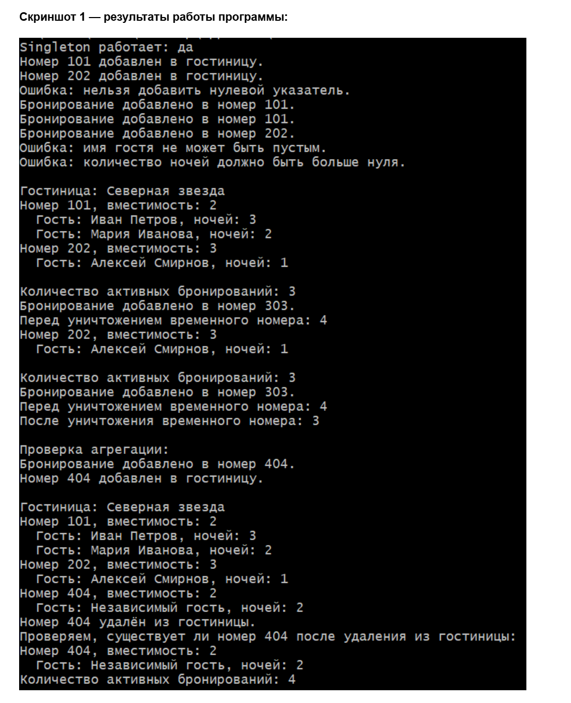

# Лабораторная работа № 2

## Анализ сложности алгоритмов. Шаблоны классов

**Уровень:** продвинутый  
**Вариант:** 8 — `HashMap<K, V>`  
**Студент:** Давлетмурзаев Сайд-Эмин Тимурович  
**Группа:** ПИЖ-б-о-25-1  
**Преподаватель:** Белик Ангелина Игоревна

## 1. Цель работы

Изучить методы анализа временной и пространственной сложности алгоритмов с использованием O-нотации. Освоить создание шаблонных классов на языке C++, реализовать контейнер `HashMap<K, V>`, изучить основные операции с хеш-таблицей и экспериментально сравнить производительность собственной реализации со стандартным контейнером `std::unordered_map`.

## 2. Теоретические сведения

### 2.1. Анализ сложности алгоритмов

Анализ сложности алгоритмов позволяет оценить эффективность программы в зависимости от объёма входных данных.

- **Временная сложность** характеризует количество операций или время выполнения алгоритма.
- **Пространственная сложность** характеризует объём памяти, необходимый для выполнения алгоритма.

### 2.2. О-нотация (Big O)

О-нотация описывает асимптотический рост затрат алгоритма при увеличении размера входных данных. При оценке обычно не учитываются постоянные коэффициенты и менее значимые слагаемые.

| Сложность | Название | Пример |
|---|---|---|
| `O(1)` | Константная | Получение размера контейнера |
| `O(log n)` | Логарифмическая | Бинарный поиск |
| `O(n)` | Линейная | Последовательный просмотр элементов |
| `O(n log n)` | Линейно-логарифмическая | Сортировка слиянием |
| `O(n²)` | Квадратичная | Два вложенных цикла по `n` итераций |

### 2.3. Шаблоны классов

Шаблоны классов позволяют создавать универсальные классы, работающие с различными типами данных. В шаблоне `HashMap<K, V>` параметр `K` задаёт тип ключа, а `V` — тип хранимого значения.

### 2.4. Хеш-таблица

Хеш-таблица использует хеш-функцию для определения корзины, в которой хранится элемент. В этой реализации используется массив корзин, каждая из которых содержит связный список пар «ключ — значение». Такой способ разрешения коллизий называется методом цепочек.

При превышении установленного коэффициента заполнения таблица расширяется, а элементы перераспределяются по новым корзинам. Эта операция называется `rehash`.

## 3. Постановка задачи

Согласно варианту 8 продвинутого уровня необходимо реализовать шаблонный контейнер `HashMap<K, V>` со следующими операциями:

- `put(key, value)` — добавление элемента или обновление значения существующего ключа;
- `get(key)` — получение значения по ключу;
- `containsKey(key)` — проверка наличия ключа;
- `remove(key)` — удаление элемента по ключу;
- `size()` — получение количества элементов.

Необходимо проанализировать сложность операций и экспериментально сравнить производительность собственной реализации с контейнером `std::unordered_map`.

## 4. Листинг программы

Полный исходный код находится в файле [`main.cpp`](main.cpp).

```cpp
#include <iostream>
#include <vector>
#include <list>
#include <string>
#include <functional>
#include <stdexcept>
#include <utility>
#include <unordered_map>
#include <chrono>
#include <iomanip>

#ifdef _WIN32
#include <windows.h>
#endif

template <typename K, typename V>
class HashMap {
private:
    std::vector<std::list<std::pair<K, V>>> buckets_;
    size_t size_;

    size_t getIndex(const K& key) const {
        return std::hash<K>{}(key) % buckets_.size();
    }

    void rehash() {
        size_t newCapacity = buckets_.size() * 2;
        std::vector<std::list<std::pair<K, V>>> newBuckets(
            newCapacity
        );

        for (const auto& bucket : buckets_) {
            for (const auto& item : bucket) {
                size_t index =
                    std::hash<K>{}(item.first) % newCapacity;
                newBuckets[index].push_back(item);
            }
        }

        buckets_ = std::move(newBuckets);
    }

public:
    HashMap() : buckets_(8), size_(0) {}

    void put(const K& key, const V& value) {
        size_t index = getIndex(key);

        for (auto& item : buckets_[index]) {
            if (item.first == key) {
                item.second = value;
                return;
            }
        }

        buckets_[index].push_back({key, value});
        ++size_;

        if (size_ > buckets_.size() * 0.75) {
            rehash();
        }
    }

    V get(const K& key) const {
        size_t index = getIndex(key);

        for (const auto& item : buckets_[index]) {
            if (item.first == key) {
                return item.second;
            }
        }

        throw std::out_of_range("Ключ не найден");
    }

    bool containsKey(const K& key) const {
        size_t index = getIndex(key);

        for (const auto& item : buckets_[index]) {
            if (item.first == key) {
                return true;
            }
        }

        return false;
    }

    bool remove(const K& key) {
        size_t index = getIndex(key);

        for (auto it = buckets_[index].begin();
             it != buckets_[index].end(); ++it) {
            if (it->first == key) {
                buckets_[index].erase(it);
                --size_;
                return true;
            }
        }

        return false;
    }

    size_t size() const {
        return size_;
    }
};

template <typename Function>
long long measureTime(Function function) {
    auto start = std::chrono::high_resolution_clock::now();
    function();
    auto finish = std::chrono::high_resolution_clock::now();

    return std::chrono::duration_cast<
        std::chrono::microseconds
    >(finish - start).count();
}

int main() {
#ifdef _WIN32
    SetConsoleOutputCP(CP_UTF8);
#endif

    std::cout << "=== Лабораторная работа № 2 ===\n";
    std::cout << "Вариант 8. HashMap<K, V>\n\n";

    HashMap<int, std::string> map;

    std::cout << "Основные операции:\n";

    map.put(1, "Иван");
    map.put(2, "Мария");
    map.put(3, "Пётр");

    std::cout << "Размер: " << map.size() << '\n';
    std::cout << "Значение по ключу 2: "
              << map.get(2) << '\n';

    std::cout << "Ключ 3 существует: "
              << (map.containsKey(3) ? "да" : "нет")
              << '\n';

    map.put(2, "Анна");

    std::cout << "После обновления ключа 2: "
              << map.get(2) << '\n';

    map.remove(1);

    std::cout << "Размер после удаления ключа 1: "
              << map.size() << '\n';

    std::cout << "Удаление отсутствующего ключа: "
              << (map.remove(10) ? "успешно" : "ключ не найден")
              << "\n\n";

    std::cout << "Проверка строковых ключей:\n";

    HashMap<std::string, int> stringMap;
    stringMap.put("яблоко", 10);
    stringMap.put("апельсин", 20);

    std::cout << "яблоко = "
              << stringMap.get("яблоко") << '\n';

    std::cout << "Ключ «апельсин» существует: "
              << (stringMap.containsKey("апельсин")
                      ? "да" : "нет")
              << "\n\n";

    std::cout << "=== Сравнение производительности ===\n";

    const int N = 100000;

    HashMap<int, int> customMap;
    std::unordered_map<int, int> standardMap;

    std::cout << "Количество элементов: " << N << "\n\n";

    long long customInsert = measureTime([&]() {
        for (int i = 0; i < N; ++i) {
            customMap.put(i, i * 2);
        }
    });

    long long standardInsert = measureTime([&]() {
        for (int i = 0; i < N; ++i) {
            standardMap[i] = i * 2;
        }
    });

    volatile int customResult = 0;
    volatile int standardResult = 0;

    long long customGet = measureTime([&]() {
        for (int i = 0; i < N; ++i) {
            customResult = customMap.get(i);
        }
    });

    long long standardGet = measureTime([&]() {
        for (int i = 0; i < N; ++i) {
            standardResult = standardMap.at(i);
        }
    });

    volatile size_t customContainsCount = 0;
    volatile size_t standardContainsCount = 0;

    long long customContains = measureTime([&]() {
        for (int i = 0; i < N; ++i) {
            customContainsCount += customMap.containsKey(i);
        }
    });

    long long standardContains = measureTime([&]() {
        for (int i = 0; i < N; ++i) {
            standardContainsCount +=
                standardMap.find(i) != standardMap.end();
        }
    });

    HashMap<int, int> customRemoveMap;
    std::unordered_map<int, int> standardRemoveMap;

    for (int i = 0; i < N; ++i) {
        customRemoveMap.put(i, i);
        standardRemoveMap[i] = i;
    }

    long long customRemove = measureTime([&]() {
        for (int i = 0; i < N; ++i) {
            customRemoveMap.remove(i);
        }
    });

    long long standardRemove = measureTime([&]() {
        for (int i = 0; i < N; ++i) {
            standardRemoveMap.erase(i);
        }
    });

    std::cout << std::left
              << std::setw(24) << "Операция"
              << std::right
              << std::setw(18) << "Своя HashMap (мкс)"
              << std::setw(18) << "STL (мкс)"
              << '\n';

    std::cout << std::string(60, '-') << '\n';

    std::cout << std::left << std::setw(24) << "Вставка"
              << std::right << std::setw(18) << customInsert
              << std::setw(18) << standardInsert << '\n';

    std::cout << std::left << std::setw(24) << "Поиск"
              << std::right << std::setw(18) << customGet
              << std::setw(18) << standardGet << '\n';

    std::cout << std::left << std::setw(24) << "Проверка ключа"
              << std::right << std::setw(18) << customContains
              << std::setw(18) << standardContains << '\n';

    std::cout << std::left << std::setw(24) << "Удаление"
              << std::right << std::setw(18) << customRemove
              << std::setw(18) << standardRemove << "\n\n";

    std::cout << "Итоговые размеры:\n";
    std::cout << "Своя HashMap: " << customMap.size() << '\n';
    std::cout << "std::unordered_map: "
              << standardMap.size() << '\n';

    std::cout << "Своя HashMap после удаления: "
              << customRemoveMap.size() << '\n';

    std::cout << "STL после удаления: "
              << standardRemoveMap.size() << "\n\n";

    std::cout << "=== Сложность операций ===\n";
    std::cout << "put: O(1) в среднем, O(n) в худшем случае\n";
    std::cout << "get: O(1) в среднем, O(n) в худшем случае\n";
    std::cout << "containsKey: O(1) в среднем, "
                 "O(n) в худшем случае\n";
    std::cout << "remove: O(1) в среднем, O(n) в худшем случае\n";
    std::cout << "size: O(1)\n";
    std::cout << "rehash: O(n) за одно перераспределение\n";
    std::cout << "Пространственная сложность: O(n)\n";

    return 0;
}
```

## 5. Результаты работы

В ходе выполнения программы проверены добавление, поиск, обновление и удаление элементов, проверка существования ключа, работа со строковыми ключами и получение размера контейнера.

Экспериментальное сравнение проведено на 100 000 элементах. Время выполнения измеряется в микросекундах и может отличаться при разных запусках.

### 5.1. Скриншот результата

Скриншот сохранён в файле `02-hashmap-results.png`.



### 5.2. Сравнение производительности

Результаты одного из запусков программы:

| Операция | Собственная HashMap, мкс | `std::unordered_map`, мкс |
|---|---:|---:|
| Вставка | 18 616 | 4 822 |
| Поиск | 549 | 368 |
| Проверка ключа | 478 | 358 |
| Удаление | 3 314 | 4 445 |

В данном запуске `std::unordered_map` показал меньшее время вставки, поиска и проверки ключа. Собственная реализация показала меньшее время удаления. Эти результаты относятся к конкретному запуску и не гарантируют такого же соотношения на другом оборудовании.

## 6. Анализ сложности операций

Пусть `n` — количество элементов в контейнере.

| Операция | Средняя временная сложность | Худший случай |
|---|---|---|
| `put` | `O(1)` амортизированно | `O(n)` |
| `get` | `O(1)` | `O(n)` |
| `containsKey` | `O(1)` | `O(n)` |
| `remove` | `O(1)` | `O(n)` |
| `size` | `O(1)` | `O(1)` |
| `rehash` | `O(n)` за одно перераспределение | `O(n)` |

- **`put`** — в среднем добавляет элемент за постоянное время. При коллизиях требуется просмотр цепочки, а при расширении таблицы — перераспределение элементов.
- **`get`** — в среднем находит элемент в нужной корзине за постоянное время. При большом количестве коллизий может потребоваться просмотр всех элементов.
- **`containsKey`** — проверяет наличие ключа по тому же принципу, что и `get`.
- **`remove`** — находит элемент и удаляет его из цепочки. В худшем случае требуется линейный просмотр.
- **`size`** — возвращает сохранённый счётчик элементов, поэтому операция выполняется за `O(1)`.
- **`rehash`** — перераспределяет элементы по новым корзинам, что требует `O(n)` времени.

Пространственная сложность контейнера составляет `O(n)`, поскольку память для хранения элементов и корзин растёт пропорционально количеству элементов.

## 7. Ответы на контрольные вопросы

### 1. Что такое О-нотация (Big O) и зачем она нужна?

О-нотация описывает асимптотический рост сложности алгоритма. Она позволяет оценить изменение временных или пространственных затрат при увеличении объёма данных без учёта постоянных коэффициентов и менее значимых слагаемых.

### 2. Какая сложность у доступа к элементу массива по индексу? Почему?

Сложность равна `O(1)`. Адрес элемента вычисляется непосредственно по индексу, поэтому количество операций не зависит от размера массива.

### 3. Какая сложность у бинарного поиска? Почему?

Сложность бинарного поиска составляет `O(log n)`. На каждой итерации область поиска уменьшается примерно в два раза. Алгоритм применяется к отсортированным данным.

### 4. Что означает сложность `O(n log n)`? Приведите пример алгоритма.

Это линейно-логарифмическая сложность. Она возникает, когда алгоритм обрабатывает порядка `n` элементов на каждом из порядка `log n` уровней. Пример — сортировка слиянием.

### 5. Что такое амортизированный анализ? Приведите пример.

Амортизированный анализ оценивает стоимость последовательности операций, включая редкие дорогостоящие действия. Например, добавление в динамический массив обычно занимает `O(1)`, но иногда расширение массива требует `O(n)`. Амортизированная сложность добавления остаётся `O(1)`.

### 6. Какая сложность у двух вложенных циклов по `n` итераций каждый?

Сложность равна `O(n²)`. Внешний цикл выполняется `n` раз, и для каждой его итерации внутренний цикл также выполняется `n` раз. Общее количество итераций пропорционально `n²`.

### 7. Какая сложность у рекурсивного вычисления чисел Фибоначчи?

У стандартного рекурсивного алгоритма без мемоизации временная сложность экспоненциальная; распространённая верхняя оценка — `O(2^n)`. Повторные вызовы заново вычисляют одни и те же значения. С мемоизацией сложность можно снизить до `O(n)`.

### 8. Что такое шаблоны функций? Как их объявить и использовать?

Шаблоны функций позволяют создавать функции, работающие с разными типами данных. Они объявляются с помощью `template` и параметра типа:

```cpp
template <typename T>
T maximum(T a, T b) {
    return a > b ? a : b;
}
```

Функцию можно вызвать для совместимых типов, например `maximum(3, 7)`.

### 9. Что такое шаблоны классов? Как их объявить и использовать?

Шаблон класса — описание класса, параметры которого определяют используемые типы данных:

```cpp
template <typename T>
class Box {
private:
    T value;

public:
    explicit Box(T v) : value(v) {}

    T get() const {
        return value;
    }
};
```

При создании объекта указывается тип, например `Box<int> box(10)`.

### 10. В чём преимущество шаблонов перед перегрузкой функций?

Шаблоны позволяют повторно использовать одну реализацию для разных типов данных. Это уменьшает дублирование кода и упрощает сопровождение программы. При перегрузке приходится определять отдельные варианты функции для разных типов или наборов параметров.

### 11. Как указать, что шаблонный параметр — тип?

Для объявления параметра типа используют ключевое слово `typename` или `class`:

```cpp
template <typename T>
```

В данном контексте эти варианты эквивалентны.

### 12. Можно ли создать шаблон с несколькими параметрами типов?

Да. Например:

```cpp
template <typename K, typename V>
class HashMap {
    // Реализация контейнера
};
```

Здесь `K` задаёт тип ключа, а `V` — тип значения.

### 13. Как провести экспериментальное измерение времени выполнения?

Нужно зафиксировать время перед выполнением операции и после неё, а затем вычислить разницу. В C++ для этого можно использовать библиотеку `<chrono>`. Для более устойчивой оценки операцию желательно выполнять многократно и сравнивать результаты в одинаковых условиях.

### 14. Почему при измерении времени нужно выполнять операцию многократно?

Однократное измерение может зависеть от фоновых процессов, состояния кэша и работы операционной системы. Повторные измерения помогают уменьшить влияние случайных отклонений и получить более устойчивую оценку.

### 15. Что важнее: сложность алгоритма или константа?

Оба фактора важны. Асимптотическая сложность особенно значима при больших объёмах данных, поскольку определяет скорость роста затрат. Константы и особенности реализации могут заметно влиять на производительность при небольших объёмах данных. Поэтому нужно учитывать и теоретическую сложность, и результаты практических измерений.

## 8. Вывод

В ходе лабораторной работы был реализован шаблонный контейнер `HashMap<K, V>` на языке C++. Разработаны операции добавления, получения и удаления элементов, проверки существования ключа и определения количества элементов.

Проведено тестирование с целочисленными и строковыми ключами. Выполнено экспериментальное сравнение собственной реализации с контейнером `std::unordered_map` на наборе из 100 000 элементов. Для основных операций определены средняя и худшая временная сложность, а также пространственная сложность контейнера.

В результате работы были закреплены навыки применения шаблонов классов, использования хеш-таблиц, анализа алгоритмов с помощью O-нотации и измерения производительности программ.

## 9. Ссылка на Git-репозиторий

[Репозиторий cpp-labs на GitHub](https://github.com/saiddavletmurzaev91-boop/cpp-labs)
