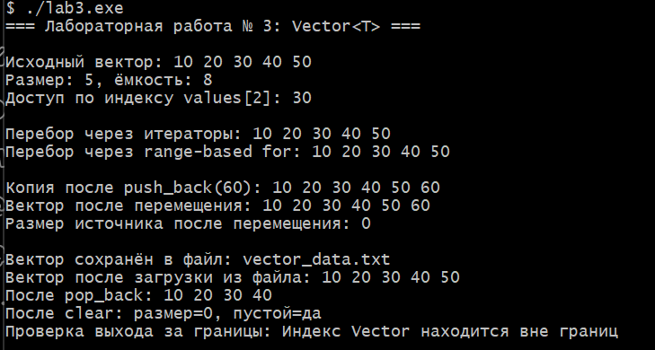

# Лабораторная работа № 3
## Реализация динамического массива (аналог vector). Итераторы

**Студент:** Давлетмурзаев Сайд-Эмин Тимурович  
**Группа:** ПИЖ-б-о-25-1  
**Преподаватель:** Белик Ангелина Игоревна  
**Уровень:** продвинутый  
**Вариант:** 8  
**Язык программирования:** C++17

---

## 1. Цель работы

Реализовать шаблонный класс `Vector<T>`, изучить управление динамической памятью, закрепить правило пяти, реализовать итераторы и дополнительную функциональность варианта 8 — сохранение вектора в файл и загрузку из файла.

## 2. Теоретическая часть

**Динамический массив** — структура данных, элементы которой размещаются в динамической памяти, а размер может изменяться во время выполнения программы.

**Размер (`size`)** — число элементов, фактически хранящихся в контейнере. **Ёмкость (`capacity`)** — количество элементов, для которых уже выделена память. Когда ёмкости недостаточно, массив получает больший блок памяти. В данной реализации ёмкость при расширении удваивается, поэтому добавление в конец выполняется за амортизированное `O(1)`.

**Правило пяти** включает деструктор, конструктор копирования, оператор присваивания копированием, конструктор перемещения и оператор присваивания перемещением. Эти методы нужны классу, который самостоятельно владеет динамической памятью.

**Итераторы** позволяют последовательно обращаться к элементам контейнера. В данной реализации используются указатели `T*` и `const T*`; методы `begin()` и `end()` обеспечивают перебор через цикл с итераторами и range-based `for`.

**Сериализация** — сохранение состояния объекта в файл с возможностью последующего восстановления. Реализованы методы `saveToFile()` и `loadFromFile()`. Для используемого формата тип `T` должен поддерживать потоковые операторы `<<` и `>>`.

## 3. Постановка задачи

Для продвинутого уровня, варианта 8, необходимо реализовать шаблонный динамический массив `Vector<T>` с поддержкой правила пяти и итераторов, а также добавить сериализацию: `saveToFile()` и `loadFromFile()`.

Программа должна демонстрировать добавление элементов, доступ по индексу, перебор итераторами, копирование и перемещение объекта, сохранение и загрузку данных, удаление последнего элемента, очистку контейнера и обработку выхода за границы.

## 4. Листинг программы

Полный исходный код находится в файле [`main.cpp`](main.cpp).

В реализации используются приватные поля `data_`, `size_`, `capacity_`; методы `push_back`, `pop_back`, `reserve`, `clear`, `size`, `capacity`, `empty`; операторы доступа по индексу; итераторы `begin()` и `end()`; специальные методы правила пяти; методы `saveToFile()` и `loadFromFile()`.

## 5. Результаты работы

Программа скомпилирована с ключами `-std=c++17 -Wall -Wextra -pedantic` и выполнена в MSYS2 UCRT64.

Проверены:
- добавление элементов и изменение ёмкости;
- получение элемента по индексу;
- перебор через итераторы и range-based `for`;
- копирование и перемещение вектора;
- сохранение в `vector_data.txt` и последующая загрузка;
- удаление последнего элемента через `pop_back()`;
- очистка через `clear()`;
- обработка обращения к индексу за пределами вектора.

### 5.1. Скриншот результата

## 6. Анализ сложности операций

Пусть `n` — количество элементов вектора.

| Операция | Средняя / амортизированная сложность | Худший случай |
|---|---:|---:|
| `size()` | `O(1)` | `O(1)` |
| `capacity()` | `O(1)` | `O(1)` |
| `empty()` | `O(1)` | `O(1)` |
| `operator[]` | `O(1)` | `O(1)` |
| `begin()`, `end()` | `O(1)` | `O(1)` |
| `push_back()` | `O(1)` амортизированно | `O(n)` при расширении |
| `pop_back()` | `O(1)` | `O(1)` |
| `clear()` | `O(1)` | `O(1)` |
| `reserve()` | `O(1)`, если расширение не нужно | `O(n)` при перераспределении |
| Конструктор копирования | `O(n)` | `O(n)` |
| Присваивание копированием | `O(n)` | `O(n)` |
| Конструктор перемещения | `O(1)` | `O(1)` |
| Присваивание перемещением | `O(1)` | `O(1)` |
| `saveToFile()` | `O(n)` | `O(n)` |
| `loadFromFile()` | `O(n)` | `O(n)` |

Дополнительная память контейнера составляет `O(capacity)`. При перераспределении памяти создаётся новый массив, элементы копируются, а старый массив освобождается.

## 7. Ответы на контрольные вопросы

**1. Почему динамический массив называется динамическим?**  
Потому что его размер может изменяться во время выполнения программы. При необходимости контейнер выделяет дополнительную память.

**2. Что такое ёмкость (`capacity`) и чем она отличается от размера (`size`)?**  
`size` показывает количество хранящихся элементов. `capacity` показывает, сколько элементов помещается в уже выделенную память без её расширения.

**3. Почему при расширении массива ёмкость удваивается, а не увеличивается на фиксированное число?**  
Удвоение уменьшает частоту перераспределений памяти. Благодаря этому `push_back()` имеет амортизированную сложность `O(1)`.

**4. Какова амортизированная сложность `push_back()`? Почему?**  
`O(1)` амортизированно. Большинство вставок выполняется за постоянное время, а редкие расширения требуют копирования элементов и занимают `O(n)`.

**5. Что такое правило трёх? Когда оно применяется?**  
Правило трёх говорит, что классу, которому необходим пользовательский деструктор, конструктор копирования или оператор присваивания копированием, обычно нужны все три. Оно особенно важно для классов, самостоятельно управляющих ресурсами.

**6. Что такое правило пяти? Чем оно отличается от правила трёх?**  
Правило пяти включает методы правила трёх и дополнительно конструктор перемещения и оператор присваивания перемещением. Перемещение позволяет передавать владение ресурсом без копирования всех элементов.

**7. В чём разница между конструктором копирования и оператором присваивания?**  
Конструктор копирования создаёт новый объект на основе существующего. Оператор присваивания копированием заменяет содержимое уже существующего объекта.

**8. Зачем нужна проверка `if (this != &other)` в операторе присваивания?**  
Она защищает от самоприсваивания, когда объект присваивается самому себе. Без проверки можно случайно удалить ресурс до того, как его содержимое будет скопировано.

**9. Что такое итератор? Как он связан с указателем?**  
Итератор — средство доступа к элементам контейнера. В данной реализации обычные указатели `T*` и `const T*` используются как итераторы.

**10. Зачем нужны методы `begin()` и `end()`?**  
`begin()` возвращает итератор на первый элемент, а `end()` — итератор за последним элементом. Они позволяют обходить контейнер стандартным способом.

**11. Как реализовать range-based `for` для своего контейнера?**  
Контейнер должен предоставлять методы `begin()` и `end()`, возвращающие совместимые итераторы. В этой реализации они возвращают указатели на элементы.

**12. Что такое глубокое копирование? Чем оно отличается от поверхностного?**  
Глубокое копирование создаёт собственную копию данных. Поверхностное копирование указателя лишь копирует адрес памяти и может привести к совместному владению одним ресурсом и двойному освобождению.

**13. Что такое семантика перемещения и зачем она нужна?**  
Семантика перемещения позволяет передать ресурсы от временного или другого объекта вместо копирования всех данных. Это уменьшает затраты на операции с динамической памятью.

**14. Почему конструктор перемещения помечается `noexcept`?**  
`noexcept` сообщает, что перемещение не выбрасывает исключений. Это помогает стандартным контейнерам выбирать безопасные и эффективные операции перемещения. В данной реализации конструктор перемещения только передаёт указатель и размеры.

**15. Как правильно освобождать память в деструкторе?**  
Память, выделенную через `new[]`, освобождают оператором `delete[]`. Деструктор `Vector` вызывает `delete[] data_`.

## 8. Вывод

В ходе лабораторной работы реализован шаблонный динамический массив `Vector<T>`. Были закреплены навыки управления динамической памятью, реализации правила пяти и работы с итераторами. Дополнительно реализованы сохранение элементов в файл и загрузка из файла, а также проверка выхода за границы контейнера. Программа скомпилирована и выполнена; основные операции продемонстрированы.

## 9. Репозиторий

Ссылка на GitHub: https://github.com/saiddavletmurzaev91-boop/cpp-labs
