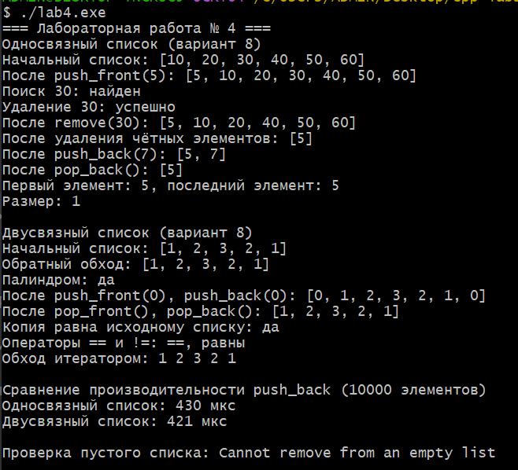

# Лабораторная работа № 4
## Односвязный и двусвязный списки

**Студент:** Давлетмурзаев Сайд-Эмин Тимурович  
**Группа:** ПИЖ-б-о-25-1  
**Вариант:** 8  
**Уровень:** продвинутый  
**Преподаватель:** Белик Ангелина Игоревна

## 1. Цель работы

Реализовать шаблонные классы односвязного и двусвязного списков, освоить операции добавления, удаления, поиска и обхода элементов, реализовать индивидуальные задания варианта 8, изучить управление динамической памятью и сравнить производительность списков.

## 2. Теоретическая часть

Связный список — структура данных, состоящая из узлов, которые могут располагаться в разных участках памяти. Каждый узел содержит значение и указатели на соседние узлы.

**Односвязный список** хранит в каждом узле указатель `next` на следующий узел. У класса имеются указатели `head` на первый узел и `tail` на последний. Наличие `tail` позволяет добавлять элемент в конец за O(1). Удаление последнего элемента требует O(n), поскольку необходимо найти предпоследний узел.

**Двусвязный список** хранит в каждом узле два указателя: `prev` на предыдущий узел и `next` на следующий. Это позволяет обходить список в обоих направлениях и удалять последний узел за O(1), если список не пуст.

**Узел** — элемент списка, содержащий данные и служебные указатели. **`head`** указывает на начало списка, **`tail`** — на конец. Для управления памятью узлы создаются через `new`, а при удалении и очистке освобождаются через `delete`. Деструкторы вызывают `clear()`, чтобы освободить все узлы.

Итераторы предоставляют единый способ последовательного обхода элементов. `begin()` возвращает итератор на первый узел, `end()` обозначает позицию после последнего элемента. Операторы `==` и `!=` сравнивают списки по размеру и последовательности значений.

## 3. Постановка задачи

Продвинутый уровень: реализовать шаблонные классы `SinglyLinkedList<T>` и `DoublyLinkedList<T>` с управлением памятью, копированием и перемещением, итераторами и операторами сравнения. Реализовать удобную инициализацию через `std::initializer_list` (дополнительное требование продвинутого уровня, вариант 8), сравнить производительность операций списков.

Индивидуальное задание варианта 8:
- **Односвязный список:** реализовать `push_front`, `find`, `remove`; удалить все чётные элементы.
- **Двусвязный список:** реализовать `isPalindrome()` для проверки, является ли последовательность палиндромом.

В программе также демонстрируются вставка и удаление с обоих концов, обход в прямом и обратном направлениях, копирование, сравнение и обработка попытки удаления из пустого списка.

## 4. Реализация

Ниже приведён полный исходный код программы из файла [`main.cpp`](main.cpp).

```cpp
#include <chrono>
#include <cstddef>
#include <initializer_list>
#include <iostream>
#include <stdexcept>
#include <utility>

// Односвязный список: каждый узел содержит значение и указатель next.
template <typename T>
class SinglyLinkedList {
private:
    struct Node {
        T data;
        Node* next;
        explicit Node(const T& value) : data(value), next(nullptr) {}
    };

    Node* head_ = nullptr;
    Node* tail_ = nullptr;
    std::size_t size_ = 0;

    void copyFrom(const SinglyLinkedList& other) {
        Node* current = other.head_;
        while (current) {
            push_back(current->data);
            current = current->next;
        }
    }

public:
    class Iterator {
        Node* node_;
    public:
        explicit Iterator(Node* node = nullptr) : node_(node) {}
        T& operator*() const { return node_->data; }
        Iterator& operator++() { node_ = node_->next; return *this; }
        Iterator operator++(int) { Iterator old(*this); ++(*this); return old; }
        bool operator==(const Iterator& other) const { return node_ == other.node_; }
        bool operator!=(const Iterator& other) const { return !(*this == other); }
    };

    SinglyLinkedList() = default;

    // Инициализация списком значений: SinglyLinkedList<int> x{1, 2, 3}.
    SinglyLinkedList(std::initializer_list<T> values) {
        try {
            for (const T& value : values) push_back(value);
        } catch (...) {
            clear();
            throw;
        }
    }

    SinglyLinkedList(const SinglyLinkedList& other) {
        try {
            copyFrom(other);
        } catch (...) {
            clear();
            throw;
        }
    }

    SinglyLinkedList(SinglyLinkedList&& other) noexcept
        : head_(std::exchange(other.head_, nullptr)),
          tail_(std::exchange(other.tail_, nullptr)),
          size_(std::exchange(other.size_, 0)) {}

    ~SinglyLinkedList() { clear(); }

    // Копирующее присваивание обеспечивает безопасное копирование через swap.
    SinglyLinkedList& operator=(const SinglyLinkedList& other) {
        if (this != &other) {
            SinglyLinkedList copy(other);
            swap(copy);
        }
        return *this;
    }

    SinglyLinkedList& operator=(SinglyLinkedList&& other) noexcept {
        if (this != &other) {
            clear();
            head_ = std::exchange(other.head_, nullptr);
            tail_ = std::exchange(other.tail_, nullptr);
            size_ = std::exchange(other.size_, 0);
        }
        return *this;
    }

    void swap(SinglyLinkedList& other) noexcept {
        using std::swap;
        swap(head_, other.head_);
        swap(tail_, other.tail_);
        swap(size_, other.size_);
    }

    // Вставка в начало за O(1).
    void push_front(const T& value) {
        Node* node = new Node(value);
        node->next = head_;
        head_ = node;
        if (!tail_) tail_ = node;
        ++size_;
    }

    // Вставка в конец за O(1), поскольку хранится tail_.
    void push_back(const T& value) {
        Node* node = new Node(value);
        if (!tail_) head_ = tail_ = node;
        else {
            tail_->next = node;
            tail_ = node;
        }
        ++size_;
    }

    void pop_front() {
        if (!head_) throw std::underflow_error("Cannot remove from an empty list");
        Node* old = head_;
        head_ = head_->next;
        delete old;
        --size_;
        if (!head_) tail_ = nullptr;
    }

    // Удаление с конца за O(n): нужно найти предпоследний узел.
    void pop_back() {
        if (!head_) throw std::underflow_error("Cannot remove from an empty list");
        if (head_ == tail_) {
            delete head_;
            head_ = tail_ = nullptr;
        } else {
            Node* current = head_;
            while (current->next != tail_) current = current->next;
            delete tail_;
            tail_ = current;
            tail_->next = nullptr;
        }
        --size_;
    }

    // Удаляет первое вхождение значения; если его нет, возвращает false.
    bool remove(const T& value) {
        if (!head_) return false;
        if (head_->data == value) {
            pop_front();
            return true;
        }
        Node* previous = head_;
        while (previous->next && !(previous->next->data == value))
            previous = previous->next;
        if (!previous->next) return false;
        Node* victim = previous->next;
        previous->next = victim->next;
        if (tail_ == victim) tail_ = previous;
        delete victim;
        --size_;
        return true;
    }

    Node* find(const T& value) const {
        Node* current = head_;
        while (current) {
            if (current->data == value) return current;
            current = current->next;
        }
        return nullptr;
    }

    // Индивидуальное задание варианта 8: удалить все чётные элементы за O(n).
    void removeEven() {
        Node* current = head_;
        Node* previous = nullptr;
        while (current) {
            Node* next = current->next;
            if (current->data % 2 == 0) {
                if (previous) previous->next = next;
                else head_ = next;
                if (tail_ == current) tail_ = previous;
                delete current;
                --size_;
            } else {
                previous = current;
            }
            current = next;
        }
    }

    void clear() noexcept {
        while (head_) {
            Node* next = head_->next;
            delete head_;
            head_ = next;
        }
        tail_ = nullptr;
        size_ = 0;
    }

    std::size_t size() const noexcept { return size_; }
    bool empty() const noexcept { return size_ == 0; }

    T& front() {
        if (!head_) throw std::underflow_error("List is empty");
        return head_->data;
    }
    const T& front() const {
        if (!head_) throw std::underflow_error("List is empty");
        return head_->data;
    }
    T& back() {
        if (!tail_) throw std::underflow_error("List is empty");
        return tail_->data;
    }
    const T& back() const {
        if (!tail_) throw std::underflow_error("List is empty");
        return tail_->data;
    }

    Iterator begin() { return Iterator(head_); }
    Iterator end() { return Iterator(nullptr); }

    void print() const {
        std::cout << '[';
        Node* current = head_;
        while (current) {
            std::cout << current->data;
            if (current->next) std::cout << ", ";
            current = current->next;
        }
        std::cout << "]\n";
    }

    bool operator==(const SinglyLinkedList& other) const {
        if (size_ != other.size_) return false;
        Node* a = head_;
        Node* b = other.head_;
        while (a && b) {
            if (!(a->data == b->data)) return false;
            a = a->next;
            b = b->next;
        }
        return true;
    }

    bool operator!=(const SinglyLinkedList& other) const {
        return !(*this == other);
    }
};

// Двусвязный список: каждый узел хранит prev и next.
template <typename T>
class DoublyLinkedList {
private:
    struct Node {
        T data;
        Node* prev;
        Node* next;
        explicit Node(const T& value) : data(value), prev(nullptr), next(nullptr) {}
    };

    Node* head_ = nullptr;
    Node* tail_ = nullptr;
    std::size_t size_ = 0;

    void copyFrom(const DoublyLinkedList& other) {
        Node* current = other.head_;
        while (current) {
            push_back(current->data);
            current = current->next;
        }
    }

public:
    class Iterator {
        Node* node_;
    public:
        explicit Iterator(Node* node = nullptr) : node_(node) {}
        T& operator*() const { return node_->data; }
        Iterator& operator++() { node_ = node_->next; return *this; }
        Iterator operator++(int) { Iterator old(*this); ++(*this); return old; }
        Iterator& operator--() { node_ = node_->prev; return *this; }
        Iterator operator--(int) { Iterator old(*this); --(*this); return old; }
        bool operator==(const Iterator& other) const { return node_ == other.node_; }
        bool operator!=(const Iterator& other) const { return !(*this == other); }
    };

    DoublyLinkedList() = default;

    DoublyLinkedList(std::initializer_list<T> values) {
        try {
            for (const T& value : values) push_back(value);
        } catch (...) {
            clear();
            throw;
        }
    }

    DoublyLinkedList(const DoublyLinkedList& other) {
        try {
            copyFrom(other);
        } catch (...) {
            clear();
            throw;
        }
    }

    DoublyLinkedList(DoublyLinkedList&& other) noexcept
        : head_(std::exchange(other.head_, nullptr)),
          tail_(std::exchange(other.tail_, nullptr)),
          size_(std::exchange(other.size_, 0)) {}

    ~DoublyLinkedList() { clear(); }

    DoublyLinkedList& operator=(const DoublyLinkedList& other) {
        if (this != &other) {
            DoublyLinkedList copy(other);
            swap(copy);
        }
        return *this;
    }

    DoublyLinkedList& operator=(DoublyLinkedList&& other) noexcept {
        if (this != &other) {
            clear();
            head_ = std::exchange(other.head_, nullptr);
            tail_ = std::exchange(other.tail_, nullptr);
            size_ = std::exchange(other.size_, 0);
        }
        return *this;
    }

    void swap(DoublyLinkedList& other) noexcept {
        using std::swap;
        swap(head_, other.head_);
        swap(tail_, other.tail_);
        swap(size_, other.size_);
    }

    void push_front(const T& value) {
        Node* node = new Node(value);
        node->next = head_;
        if (head_) head_->prev = node;
        else tail_ = node;
        head_ = node;
        ++size_;
    }

    void push_back(const T& value) {
        Node* node = new Node(value);
        node->prev = tail_;
        if (tail_) tail_->next = node;
        else head_ = node;
        tail_ = node;
        ++size_;
    }

    void pop_front() {
        if (!head_) throw std::underflow_error("Cannot remove from an empty list");
        Node* old = head_;
        head_ = head_->next;
        if (head_) head_->prev = nullptr;
        else tail_ = nullptr;
        delete old;
        --size_;
    }

    void pop_back() {
        if (!tail_) throw std::underflow_error("Cannot remove from an empty list");
        Node* old = tail_;
        tail_ = tail_->prev;
        if (tail_) tail_->next = nullptr;
        else head_ = nullptr;
        delete old;
        --size_;
    }

    bool remove(const T& value) {
        Node* current = head_;
        while (current && !(current->data == value)) current = current->next;
        if (!current) return false;
        if (current == head_) {
            pop_front();
            return true;
        }
        if (current == tail_) {
            pop_back();
            return true;
        }
        current->prev->next = current->next;
        current->next->prev = current->prev;
        delete current;
        --size_;
        return true;
    }

    Node* find(const T& value) const {
        Node* current = head_;
        while (current) {
            if (current->data == value) return current;
            current = current->next;
        }
        return nullptr;
    }

    // Индивидуальное задание варианта 8: проверка палиндрома за O(n).
    bool isPalindrome() const {
        Node* left = head_;
        Node* right = tail_;
        for (std::size_t i = 0; i < size_ / 2; ++i) {
            if (!(left->data == right->data)) return false;
            left = left->next;
            right = right->prev;
        }
        return true;
    }

    void clear() noexcept {
        while (head_) {
            Node* next = head_->next;
            delete head_;
            head_ = next;
        }
        tail_ = nullptr;
        size_ = 0;
    }

    std::size_t size() const noexcept { return size_; }
    bool empty() const noexcept { return size_ == 0; }

    T& front() {
        if (!head_) throw std::underflow_error("List is empty");
        return head_->data;
    }
    const T& front() const {
        if (!head_) throw std::underflow_error("List is empty");
        return head_->data;
    }
    T& back() {
        if (!tail_) throw std::underflow_error("List is empty");
        return tail_->data;
    }
    const T& back() const {
        if (!tail_) throw std::underflow_error("List is empty");
        return tail_->data;
    }

    Iterator begin() { return Iterator(head_); }
    Iterator end() { return Iterator(nullptr); }

    void print() const {
        std::cout << '[';
        Node* current = head_;
        while (current) {
            std::cout << current->data;
            if (current->next) std::cout << ", ";
            current = current->next;
        }
        std::cout << "]\n";
    }

    void printReverse() const {
        std::cout << '[';
        Node* current = tail_;
        while (current) {
            std::cout << current->data;
            if (current->prev) std::cout << ", ";
            current = current->prev;
        }
        std::cout << "]\n";
    }

    bool operator==(const DoublyLinkedList& other) const {
        if (size_ != other.size_) return false;
        Node* a = head_;
        Node* b = other.head_;
        while (a && b) {
            if (!(a->data == b->data)) return false;
            a = a->next;
            b = b->next;
        }
        return true;
    }

    bool operator!=(const DoublyLinkedList& other) const {
        return !(*this == other);
    }
};

int main() {
    std::cout << "=== Лабораторная работа № 4 ===\n";
    std::cout << "Односвязный список (вариант 8)\n";

    SinglyLinkedList<int> singly{10, 20, 30, 40, 50, 60};
    std::cout << "Начальный список: ";
    singly.print();

    singly.push_front(5);
    std::cout << "После push_front(5): ";
    singly.print();

    std::cout << "Поиск 30: "
              << (singly.find(30) ? "найден" : "не найден") << '\n';
    std::cout << "Удаление 30: "
              << (singly.remove(30) ? "успешно" : "не найден") << '\n';
    std::cout << "После remove(30): ";
    singly.print();

    singly.removeEven();
    std::cout << "После удаления чётных элементов: ";
    singly.print();

    singly.push_back(7);
    std::cout << "После push_back(7): ";
    singly.print();
    singly.pop_back();
    std::cout << "После pop_back(): ";
    singly.print();
    std::cout << "Первый элемент: " << singly.front()
              << ", последний элемент: " << singly.back() << '\n';
    std::cout << "Размер: " << singly.size() << "\n\n";

    std::cout << "Двусвязный список (вариант 8)\n";
    DoublyLinkedList<int> doubly{1, 2, 3, 2, 1};
    std::cout << "Начальный список: ";
    doubly.print();
    std::cout << "Обратный обход: ";
    doubly.printReverse();
    std::cout << "Палиндром: "
              << (doubly.isPalindrome() ? "да" : "нет") << '\n';

    doubly.push_front(0);
    doubly.push_back(0);
    std::cout << "После push_front(0), push_back(0): ";
    doubly.print();
    doubly.pop_front();
    doubly.pop_back();
    std::cout << "После pop_front(), pop_back(): ";
    doubly.print();

    DoublyLinkedList<int> copy = doubly;
    DoublyLinkedList<int> assigned;
    assigned = copy;
    std::cout << "Копия равна исходному списку: "
              << (copy == doubly ? "да" : "нет") << '\n';
    std::cout << "Операторы == и !=: "
              << (copy == doubly ? "==" : "не равно") << ", "
              << (assigned != doubly ? "!=" : "равны") << '\n';
    std::cout << "Обход итератором: ";
    for (auto it = doubly.begin(); it != doubly.end(); ++it) {
        std::cout << *it << ' ';
    }
    std::cout << "\n\nСравнение производительности push_back (10000 элементов)\n";

    constexpr int amount = 10000;
    auto startS = std::chrono::steady_clock::now();
    SinglyLinkedList<int> testS;
    for (int i = 0; i < amount; ++i) testS.push_back(i);
    auto endS = std::chrono::steady_clock::now();

    auto startD = std::chrono::steady_clock::now();
    DoublyLinkedList<int> testD;
    for (int i = 0; i < amount; ++i) testD.push_back(i);
    auto endD = std::chrono::steady_clock::now();

    const auto singleUs =
        std::chrono::duration_cast<std::chrono::microseconds>(endS - startS).count();
    const auto doubleUs =
        std::chrono::duration_cast<std::chrono::microseconds>(endD - startD).count();

    std::cout << "Односвязный список: " << singleUs << " мкс\n";
    std::cout << "Двусвязный список: " << doubleUs << " мкс\n";

    try {
        SinglyLinkedList<int> emptyList;
        emptyList.pop_front();
    } catch (const std::underflow_error& error) {
        std::cout << "\nПроверка пустого списка: " << error.what() << '\n';
    }

    return 0;
}
```

## 5. Результаты работы

Программа скомпилирована командой:

```bash
g++ -std=c++17 -Wall -Wextra -pedantic main.cpp -o lab4.exe
```

Запуск выполнен командой:

```bash
./lab4.exe
```


На рисунке показаны операции односвязного и двусвязного списков, удаление чётных элементов, проверка палиндрома, итератор, сравнение списков, измерение времени `push_back` и обработка исключения для пустого списка.

В измерении на 10 000 элементов время зависит от среды и текущей нагрузки. Поэтому конкретные значения микросекунд являются результатом одного запуска, а не универсальной характеристикой структур данных.

## 6. Анализ сложности операций

Обозначения: `n` — количество элементов списка.

| Операция | Односвязный список | Двусвязный список |
|---|---:|---:|
| `push_front` | O(1) | O(1) |
| `push_back` при наличии `tail` | O(1) | O(1) |
| `pop_front` | O(1) | O(1) |
| `pop_back` | O(n) | O(1) |
| `find(value)` | O(n) | O(n) |
| `remove(value)` | O(n) | O(n) |
| `removeEven()` | O(n) | — |
| `isPalindrome()` | — | O(n) |
| `front()` / `back()` | O(1) | O(1) |
| `size()` / `empty()` | O(1) | O(1) |
| `clear()` | O(n) | O(n) |
| `print()` | O(n) | O(n) |
| `printReverse()` | — | O(n) |
| `begin()` / `end()` | O(1) | O(1) |
| Сравнение `==` / `!=` | O(n) | O(n) |
| Копирование списка | O(n) | O(n) |
| Перемещение списка | O(1) | O(1) |
| Проверка палиндрома | — | O(n) |
| Обход всех элементов итератором | O(n) | O(n) |

Дополнительная память на один узел: односвязный список хранит один указатель, двусвязный — два. Само значение `T` также занимает память.

## 7. Ответы на контрольные вопросы

**1. Чем связный список отличается от динамического массива?**  
В динамическом массиве элементы хранятся в непрерывной области памяти, поэтому доступ по индексу выполняется за O(1). Узлы списка могут располагаться в разных местах памяти и связаны указателями, поэтому доступ к элементу по позиции требует последовательного обхода за O(n). Вставка в начало списка обычно быстрее, поскольку не нужно сдвигать остальные элементы.

**2. Какие операции в односвязном списке выполняются за O(1)?**  
Вставка в начало, удаление из начала, получение первого элемента, получение размера и проверка пустоты выполняются за O(1). Вставка в конец также выполняется за O(1), если хранится указатель `tail`. Удаление с конца в обычном односвязном списке требует O(n).

**3. Почему удаление из конца односвязного списка требует O(n) времени?**  
У последнего узла нет указателя на предыдущий узел. Чтобы обновить `tail`, нужно пройти от головы до предпоследнего узла. В худшем случае приходится посетить все узлы, поэтому сложность равна O(n).

**4. Какие преимущества даёт хранение указателя `tail` в односвязном списке?**  
`tail` позволяет сразу получить последний узел и добавлять элементы в конец за O(1), не проходя весь список. При удалении последнего элемента поиск предпоследнего узла всё равно занимает O(n).

**5. Чем двусвязный список отличается от односвязного?**  
В односвязном узле хранится указатель только на следующий элемент. В двусвязном узле есть указатели и на следующий, и на предыдущий элементы. Двусвязный список поддерживает движение в обе стороны и упрощает удаление известного узла, но требует дополнительной памяти и более аккуратного обновления указателей.

**6. Какие операции в двусвязном списке выполняются быстрее, чем в односвязном?**  
Удаление последнего узла выполняется за O(1), поскольку указатель `tail` ведёт к последнему узлу, а `prev` — к предпоследнему. Удаление известного узла также выполняется за O(1), если указатель на него уже имеется. Поиск значения в обоих списках занимает O(n).

**7. Что такое «голова» (`head`) и «хвост» (`tail`) списка?**  
`head` — указатель на первый узел. `tail` — указатель на последний узел. В пустом списке оба указателя равны `nullptr`. При изменении начала или конца списка указатели необходимо своевременно обновлять.

**8. Как удалить узел из середины односвязного списка?**  
Нужно найти удаляемый узел и его предшественника. Затем перенаправить указатель предшественника на следующий узел после удаляемого, освободить удаляемый узел через `delete` и уменьшить размер списка. Если удаляется последний узел, необходимо также обновить `tail`.

**9. Как удалить узел из середины двусвязного списка? Почему это проще?**  
Если указатель на узел уже известен, его соседей можно связать напрямую: `prev->next` направить на `next`, а `next->prev` — на `prev`. Затем удалить узел. Это проще, чем в односвязном списке, потому что не нужно отдельно искать предшественника.

**10. Что произойдёт, если забыть обновить `tail` при удалении?**  
`tail` может указывать на уже освобождённую память. Последующее добавление элемента или обращение к хвосту способно вызвать неопределённое поведение, повреждение памяти или аварийное завершение программы.

**11. Как реализовать реверс односвязного списка?**  
Используют три указателя: `previous`, `current` и `next`. На каждом шаге сохраняют следующий узел, меняют направление `current->next` на предыдущий узел и переходят дальше. После обхода `previous` становится новой головой. Сложность алгоритма — O(n), дополнительная память — O(1).

**12. Как обнаружить цикл в связном списке?**  
Можно использовать алгоритм Флойда: медленный указатель перемещается на один узел, быстрый — на два. Если указатели встретятся, цикл существует. Если быстрый указатель достигнет `nullptr`, цикла нет. Время — O(n), дополнительная память — O(1).

**13. В каких случаях стоит использовать список вместо массива?**  
Список подходит, когда часто выполняются вставки и удаления в известных позициях и не нужен быстрый доступ по индексу. Динамический массив обычно предпочтительнее, когда важны быстрый индексный доступ и локальность данных в памяти.

**14. Какая дополнительная память требуется для каждого узла списка?**  
Помимо памяти под значение `T`, односвязный узел хранит один указатель `next`, а двусвязный — два указателя `prev` и `next`. Фактический размер также зависит от выравнивания и архитектуры системы.

**15. Почему доступ по индексу в списке имеет сложность O(n)?**  
Узлы не расположены в памяти непрерывно и не поддерживают прямую адресацию по индексу. Чтобы получить элемент с заданным индексом, приходится последовательно переходить от головы через указатели. В худшем случае посещаются все узлы.

## 8. Вывод

В ходе лабораторной работы реализованы шаблонные односвязный и двусвязный списки. Были изучены операции вставки, удаления, поиска и обхода, реализованы итераторы, сравнение списков, копирование и перемещение объектов. Выполнены индивидуальные задания варианта 8: удаление всех чётных элементов и проверка списка на палиндром. Сравнение времени `push_back` позволило проверить работу операций на наборе из 10 000 элементов. Получены практические навыки работы с указателями, динамической памятью и оценкой алгоритмической сложности.

## 9. Ссылка на Git-репозиторий

https://github.com/saiddavletmurzaev91-boop/cpp-labs
