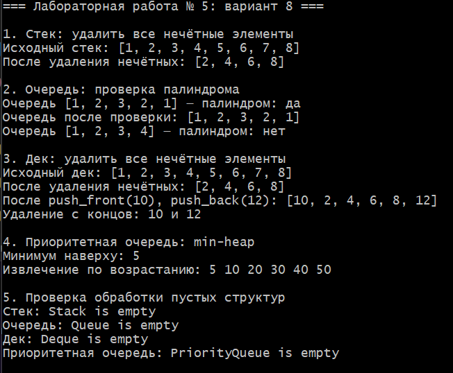

# Лабораторная работа № 5. Стек, очередь, дек, приоритетная очередь

**Выполнил:** Давлетмурзаев Сайд-Эмин Тимурович  
**Группа:** ПИЖ-б-о-25-1  
**Преподаватель:** Белик Ангелина Игоревна  
**Вариант:** 8

## 1. Цель работы

Реализовать стек, очередь, дек и приоритетную очередь, изучить принципы LIFO и FIFO, работу динамического массива, кольцевого буфера, двусвязного списка и бинарной кучи. Научиться применять эти структуры для решения практических задач и анализировать сложность операций.

## 2. Теоретическая часть

- **Стек (Stack)** работает по принципу LIFO: последним добавлен — первым извлечён. В реализации используется динамический массив.
- **Очередь (Queue)** работает по принципу FIFO: первым добавлен — первым извлечён. В реализации используется динамический кольцевой буфер.
- **Дек (Deque)** позволяет добавлять и удалять элементы с обоих концов. В реализации используется двусвязный список.
- **Приоритетная очередь (PriorityQueue)** извлекает элемент с наивысшим приоритетом. В варианте 8 используется min-heap, поэтому первым извлекается минимальный элемент.

## 3. Постановка задачи — вариант 8

1. Реализовать стек и удалить из него все нечётные элементы.
2. Реализовать очередь и проверить, является ли её последовательность палиндромом.
3. Реализовать дек и удалить из него все нечётные элементы.
4. Реализовать приоритетную очередь на основе min-heap вместо max-heap.

Для всех структур реализованы основные операции, проверка пустоты и размера, корректное освобождение памяти и обработка попыток извлечения из пустой структуры. Готовые STL-контейнеры для хранения элементов не используются.

## 4. Реализация

Программа реализует четыре собственные структуры данных без использования STL-контейнеров для хранения элементов. Полный исходный код приведён ниже; отдельный файл [`main.cpp`](main.cpp) содержит тот же листинг.

### 4.1. Полный листинг программы (`main.cpp`)

```cpp
#include <iostream>
#include <stdexcept>
#include <string>
#include <utility>

// Стек на динамическом массиве (LIFO).
template <typename T>
class Stack {
private:
    T* data_;
    std::size_t size_;
    std::size_t capacity_;

    void reserve(std::size_t newCapacity) {
        if (newCapacity <= capacity_) return;
        T* newData = new T[newCapacity];
        for (std::size_t i = 0; i < size_; ++i) newData[i] = data_[i];
        delete[] data_;
        data_ = newData;
        capacity_ = newCapacity;
    }

public:
    explicit Stack(std::size_t capacity = 8)
        : data_(new T[capacity ? capacity : 1]), size_(0),
          capacity_(capacity ? capacity : 1) {}

    Stack(const Stack& other)
        : data_(new T[other.capacity_]), size_(other.size_),
          capacity_(other.capacity_) {
        for (std::size_t i = 0; i < size_; ++i) data_[i] = other.data_[i];
    }

    Stack(Stack&& other) noexcept
        : data_(other.data_), size_(other.size_), capacity_(other.capacity_) {
        other.data_ = nullptr;
        other.size_ = other.capacity_ = 0;
    }

    Stack& operator=(Stack other) noexcept {
        swap(other);
        return *this;
    }

    ~Stack() { delete[] data_; }

    void swap(Stack& other) noexcept {
        std::swap(data_, other.data_);
        std::swap(size_, other.size_);
        std::swap(capacity_, other.capacity_);
    }

    void push(const T& value) {
        if (size_ == capacity_) reserve(capacity_ * 2);
        data_[size_++] = value;
    }

    T pop() {
        if (isEmpty()) throw std::underflow_error("Stack is empty");
        return data_[--size_];
    }

    T& top() {
        if (isEmpty()) throw std::underflow_error("Stack is empty");
        return data_[size_ - 1];
    }

    const T& top() const {
        if (isEmpty()) throw std::underflow_error("Stack is empty");
        return data_[size_ - 1];
    }

    bool isEmpty() const { return size_ == 0; }
    std::size_t size() const { return size_; }

    // Удаляет нечётные числа, сохраняя порядок оставшихся элементов.
    void removeOdd() {
        Stack<T> temp(capacity_);
        while (!isEmpty()) {
            T value = pop();
            if (value % 2 == 0) temp.push(value);
        }
        while (!temp.isEmpty()) push(temp.pop());
    }

    void print() const {
        std::cout << "[";
        for (std::size_t i = 0; i < size_; ++i) {
            if (i) std::cout << ", ";
            std::cout << data_[i];
        }
        std::cout << "]";
    }
};

// Очередь FIFO на кольцевом динамическом буфере.
template <typename T>
class Queue {
private:
    T* data_;
    std::size_t capacity_;
    std::size_t head_;
    std::size_t size_;

    void reserve(std::size_t newCapacity) {
        T* newData = new T[newCapacity];
        for (std::size_t i = 0; i < size_; ++i)
            newData[i] = data_[(head_ + i) % capacity_];
        delete[] data_;
        data_ = newData;
        capacity_ = newCapacity;
        head_ = 0;
    }

public:
    explicit Queue(std::size_t capacity = 8)
        : data_(new T[capacity ? capacity : 1]),
          capacity_(capacity ? capacity : 1), head_(0), size_(0) {}

    Queue(const Queue& other)
        : data_(new T[other.capacity_]), capacity_(other.capacity_),
          head_(0), size_(other.size_) {
        for (std::size_t i = 0; i < size_; ++i)
            data_[i] = other.data_[(other.head_ + i) % other.capacity_];
    }

    Queue(Queue&& other) noexcept
        : data_(other.data_), capacity_(other.capacity_), head_(other.head_),
          size_(other.size_) {
        other.data_ = nullptr;
        other.capacity_ = other.head_ = other.size_ = 0;
    }

    Queue& operator=(Queue other) noexcept {
        swap(other);
        return *this;
    }

    ~Queue() { delete[] data_; }

    void swap(Queue& other) noexcept {
        std::swap(data_, other.data_);
        std::swap(capacity_, other.capacity_);
        std::swap(head_, other.head_);
        std::swap(size_, other.size_);
    }

    void enqueue(const T& value) {
        if (size_ == capacity_) reserve(capacity_ * 2);
        data_[(head_ + size_) % capacity_] = value;
        ++size_;
    }

    T dequeue() {
        if (isEmpty()) throw std::underflow_error("Queue is empty");
        T value = data_[head_];
        head_ = (head_ + 1) % capacity_;
        --size_;
        return value;
    }

    T& front() {
        if (isEmpty()) throw std::underflow_error("Queue is empty");
        return data_[head_];
    }

    const T& front() const {
        if (isEmpty()) throw std::underflow_error("Queue is empty");
        return data_[head_];
    }

    bool isEmpty() const { return size_ == 0; }
    std::size_t size() const { return size_; }

    // Проверяет палиндром и восстанавливает исходную очередь.
    bool isPalindrome() {
        const std::size_t n = size_;
        if (n == 0) return true;
        T* values = new T[n];
        for (std::size_t i = 0; i < n; ++i) {
            values[i] = dequeue();
            enqueue(values[i]);
        }
        bool result = true;
        for (std::size_t i = 0; i < n / 2; ++i) {
            if (!(values[i] == values[n - 1 - i])) {
                result = false;
                break;
            }
        }
        delete[] values;
        return result;
    }

    void print() const {
        std::cout << "[";
        for (std::size_t i = 0; i < size_; ++i) {
            if (i) std::cout << ", ";
            std::cout << data_[(head_ + i) % capacity_];
        }
        std::cout << "]";
    }
};

// Дек на двусвязном списке.
template <typename T>
class Deque {
private:
    struct Node {
        T value;
        Node* prev;
        Node* next;
        explicit Node(const T& v) : value(v), prev(nullptr), next(nullptr) {}
    };
    Node* head_ = nullptr;
    Node* tail_ = nullptr;
    std::size_t size_ = 0;

public:
    Deque() = default;
    Deque(const Deque& other) {
        for (Node* node = other.head_; node; node = node->next) push_back(node->value);
    }
    Deque(Deque&& other) noexcept
        : head_(other.head_), tail_(other.tail_), size_(other.size_) {
        other.head_ = other.tail_ = nullptr;
        other.size_ = 0;
    }
    Deque& operator=(Deque other) noexcept {
        swap(other);
        return *this;
    }
    ~Deque() { clear(); }

    void swap(Deque& other) noexcept {
        std::swap(head_, other.head_);
        std::swap(tail_, other.tail_);
        std::swap(size_, other.size_);
    }
    void clear() {
        while (head_) {
            Node* node = head_;
            head_ = head_->next;
            delete node;
        }
        tail_ = nullptr;
        size_ = 0;
    }
    void push_front(const T& value) {
        Node* node = new Node(value);
        node->next = head_;
        if (head_) head_->prev = node;
        else tail_ = node;
        head_ = node;
        ++size_;
    }
    void push_back(const T& value) {
        Node* node = new Node(value);
        node->prev = tail_;
        if (tail_) tail_->next = node;
        else head_ = node;
        tail_ = node;
        ++size_;
    }
    T pop_front() {
        if (isEmpty()) throw std::underflow_error("Deque is empty");
        Node* node = head_;
        T value = node->value;
        head_ = head_->next;
        if (head_) head_->prev = nullptr;
        else tail_ = nullptr;
        delete node;
        --size_;
        return value;
    }
    T pop_back() {
        if (isEmpty()) throw std::underflow_error("Deque is empty");
        Node* node = tail_;
        T value = node->value;
        tail_ = tail_->prev;
        if (tail_) tail_->next = nullptr;
        else head_ = nullptr;
        delete node;
        --size_;
        return value;
    }
    T& front() {
        if (isEmpty()) throw std::underflow_error("Deque is empty");
        return head_->value;
    }
    T& back() {
        if (isEmpty()) throw std::underflow_error("Deque is empty");
        return tail_->value;
    }
    bool isEmpty() const { return size_ == 0; }
    std::size_t size() const { return size_; }

    // Удаляет нечётные числа, не меняя относительный порядок чётных.
    void removeOdd() {
        Node* node = head_;
        while (node) {
            Node* next = node->next;
            if (node->value % 2 != 0) {
                if (node->prev) node->prev->next = node->next;
                else head_ = node->next;
                if (node->next) node->next->prev = node->prev;
                else tail_ = node->prev;
                delete node;
                --size_;
            }
            node = next;
        }
    }
    void print() const {
        std::cout << "[";
        Node* node = head_;
        while (node) {
            if (node != head_) std::cout << ", ";
            std::cout << node->value;
            node = node->next;
        }
        std::cout << "]";
    }
};

// Приоритетная очередь на массиве, min-heap: минимальный элемент наверху.
template <typename T>
class PriorityQueue {
private:
    T* heap_;
    std::size_t size_;
    std::size_t capacity_;

    void reserve(std::size_t newCapacity) {
        T* newHeap = new T[newCapacity];
        for (std::size_t i = 0; i < size_; ++i) newHeap[i] = heap_[i];
        delete[] heap_;
        heap_ = newHeap;
        capacity_ = newCapacity;
    }
    void heapifyUp(std::size_t index) {
        while (index > 0) {
            std::size_t parent = (index - 1) / 2;
            if (!(heap_[index] < heap_[parent])) break;
            std::swap(heap_[index], heap_[parent]);
            index = parent;
        }
    }
    void heapifyDown(std::size_t index) {
        while (true) {
            std::size_t left = index * 2 + 1;
            std::size_t right = index * 2 + 2;
            std::size_t smallest = index;
            if (left < size_ && heap_[left] < heap_[smallest]) smallest = left;
            if (right < size_ && heap_[right] < heap_[smallest]) smallest = right;
            if (smallest == index) break;
            std::swap(heap_[index], heap_[smallest]);
            index = smallest;
        }
    }

public:
    explicit PriorityQueue(std::size_t capacity = 8)
        : heap_(new T[capacity ? capacity : 1]), size_(0),
          capacity_(capacity ? capacity : 1) {}
    PriorityQueue(const PriorityQueue& other)
        : heap_(new T[other.capacity_]), size_(other.size_),
          capacity_(other.capacity_) {
        for (std::size_t i = 0; i < size_; ++i) heap_[i] = other.heap_[i];
    }
    PriorityQueue(PriorityQueue&& other) noexcept
        : heap_(other.heap_), size_(other.size_), capacity_(other.capacity_) {
        other.heap_ = nullptr;
        other.size_ = other.capacity_ = 0;
    }
    PriorityQueue& operator=(PriorityQueue other) noexcept {
        swap(other);
        return *this;
    }
    ~PriorityQueue() { delete[] heap_; }
    void swap(PriorityQueue& other) noexcept {
        std::swap(heap_, other.heap_);
        std::swap(size_, other.size_);
        std::swap(capacity_, other.capacity_);
    }
    void push(const T& value) {
        if (size_ == capacity_) reserve(capacity_ * 2);
        heap_[size_] = value;
        heapifyUp(size_);
        ++size_;
    }
    T pop() {
        if (isEmpty()) throw std::underflow_error("PriorityQueue is empty");
        T result = heap_[0];
        heap_[0] = heap_[size_ - 1];
        --size_;
        if (size_) heapifyDown(0);
        return result;
    }
    const T& top() const {
        if (isEmpty()) throw std::underflow_error("PriorityQueue is empty");
        return heap_[0];
    }
    bool isEmpty() const { return size_ == 0; }
    std::size_t size() const { return size_; }
};

int main() {
    std::cout << "=== Лабораторная работа № 5: вариант 8 ===\n\n";

    std::cout << "1. Стек: удалить все нечётные элементы\n";
    Stack<int> stack;
    for (int value : {1, 2, 3, 4, 5, 6, 7, 8}) stack.push(value);
    std::cout << "Исходный стек: "; stack.print(); std::cout << '\n';
    stack.removeOdd();
    std::cout << "После удаления нечётных: "; stack.print(); std::cout << "\n\n";

    std::cout << "2. Очередь: проверка палиндрома\n";
    Queue<int> palindromeQueue;
    for (int value : {1, 2, 3, 2, 1}) palindromeQueue.enqueue(value);
    std::cout << "Очередь "; palindromeQueue.print();
    std::cout << " — палиндром: " << (palindromeQueue.isPalindrome() ? "да" : "нет") << '\n';
    std::cout << "Очередь после проверки: "; palindromeQueue.print(); std::cout << '\n';
    Queue<int> regularQueue;
    for (int value : {1, 2, 3, 4}) regularQueue.enqueue(value);
    std::cout << "Очередь "; regularQueue.print();
    std::cout << " — палиндром: " << (regularQueue.isPalindrome() ? "да" : "нет") << "\n\n";

    std::cout << "3. Дек: удалить все нечётные элементы\n";
    Deque<int> deque;
    for (int value : {1, 2, 3, 4, 5, 6, 7, 8}) deque.push_back(value);
    std::cout << "Исходный дек: "; deque.print(); std::cout << '\n';
    deque.removeOdd();
    std::cout << "После удаления нечётных: "; deque.print(); std::cout << '\n';
    deque.push_front(10);
    deque.push_back(12);
    std::cout << "После push_front(10), push_back(12): "; deque.print(); std::cout << '\n';
    std::cout << "Удаление с концов: " << deque.pop_front() << " и " << deque.pop_back() << "\n\n";

    std::cout << "4. Приоритетная очередь: min-heap\n";
    PriorityQueue<int> priorityQueue;
    for (int value : {30, 10, 50, 20, 5, 40}) priorityQueue.push(value);
    std::cout << "Минимум наверху: " << priorityQueue.top() << '\n';
    std::cout << "Извлечение по возрастанию: ";
    while (!priorityQueue.isEmpty()) std::cout << priorityQueue.pop() << ' ';
    std::cout << "\n\n";

    std::cout << "5. Проверка обработки пустых структур\n";
    try {
        while (!stack.isEmpty()) stack.pop();
        stack.pop();
    } catch (const std::underflow_error& e) {
        std::cout << "Стек: " << e.what() << '\n';
    }
    try { regularQueue.dequeue(); regularQueue.dequeue(); regularQueue.dequeue(); regularQueue.dequeue(); regularQueue.dequeue(); }
    catch (const std::underflow_error& e) {
        std::cout << "Очередь: " << e.what() << '\n';
    }
    try { Deque<int> emptyDeque; emptyDeque.pop_back(); }
    catch (const std::underflow_error& e) {
        std::cout << "Дек: " << e.what() << '\n';
    }
    try { PriorityQueue<int> emptyPriorityQueue; emptyPriorityQueue.pop(); }
    catch (const std::underflow_error& e) {
        std::cout << "Приоритетная очередь: " << e.what() << '\n';
    }
    return 0;
}
```

## 5. Результаты работы

Компиляция в MSYS2 UCRT64:

```bash
g++ -std=c++17 -Wall -Wextra -pedantic main.cpp -o lab5.exe
```

Запуск:

```bash
./lab5.exe
```

Скриншот полного вывода программы сохранён в этой папке под именем `05-stack-queue-deque-results.png`:



В выводе демонстрируются удаление нечётных элементов из стека и дека, проверка очереди на палиндром с сохранением её содержимого, извлечение элементов min-heap по возрастанию и обработка ошибок для пустых структур.

## 6. Анализ сложности операций

Обозначение: `n` — количество элементов структуры. Для динамических массивов операции добавления имеют амортизированную сложность `O(1)`; при расширении отдельная операция может занимать `O(n)`.

| Структура | Операция | Сложность |
|---|---|---:|
| Стек | `push` | `O(1)` амортизированно, `O(n)` при расширении |
| Стек | `pop`, `top`, `isEmpty`, `size` | `O(1)` |
| Стек | `removeOdd` | `O(n)` |
| Очередь | `enqueue` | `O(1)` амортизированно, `O(n)` при расширении |
| Очередь | `dequeue`, `front`, `isEmpty`, `size` | `O(1)` |
| Очередь | `isPalindrome` | `O(n)` времени и `O(n)` дополнительной памяти |
| Дек | `push_front`, `push_back`, `pop_front`, `pop_back` | `O(1)` |
| Дек | `front`, `back`, `isEmpty`, `size` | `O(1)` |
| Дек | `removeOdd` | `O(n)` |
| Приоритетная очередь | `push` | `O(log n)` на просеивание вверх; при расширении массива — `O(n)` |
| Приоритетная очередь | `pop` | `O(log n)` |
| Приоритетная очередь | `top`, `isEmpty`, `size` | `O(1)` |

## 7. Ответы на контрольные вопросы

1. **В чём заключается принцип LIFO?** Последний добавленный элемент извлекается первым. Этот принцип реализован в стеке.
2. **В чём заключается принцип FIFO?** Первый добавленный элемент извлекается первым. Так работает обычная очередь.
3. **Чем дек отличается от обычной очереди?** В деке добавлять и удалять элементы можно с обоих концов, а в обычной очереди добавление происходит с конца, удаление — с начала.
4. **Что такое приоритетная очередь и где она применяется?** Это структура, в которой извлечение зависит от приоритета элемента. Она применяется в планировании задач, алгоритмах поиска кратчайших путей и обработке событий.
5. **Как реализовать стек на динамическом массиве?** Хранить массив, текущий размер и ёмкость. При заполнении выделять массив большей ёмкости и копировать элементы.
6. **Как реализовать очередь на кольцевом буфере?** Хранить индекс начала, размер и ёмкость; индексы вычислять по модулю ёмкости. При заполнении расширить буфер и переложить элементы в правильном порядке.
7. **Почему приоритетную очередь обычно реализуют на куче?** Куча позволяет получать верхний элемент за `O(1)`, а добавлять и удалять его за `O(log n)`.
8. **Какова сложность `push` и `pop` в стеке?** `pop` — `O(1)`, `push` — амортизированно `O(1)` при динамическом массиве, но `O(n)` в момент расширения.
9. **Какова сложность `enqueue` и `dequeue` в очереди?** `dequeue` — `O(1)`, `enqueue` — амортизированно `O(1)` с возможным `O(n)` при расширении.
10. **Какова сложность операций в приоритетной очереди и почему?** `top` — `O(1)`, `push` и `pop` — `O(log n)`, поскольку элемент перемещается по высоте бинарной кучи.
11. **Как проверить скобки стеком?** Открывающие скобки помещать в стек; для каждой закрывающей проверять верхушку и извлекать соответствующую открывающую. В конце стек должен быть пуст.
12. **Как реализовать очередь на двух стеках? Какова сложность?** При добавлении помещать элементы в первый стек, а при извлечении переносить элементы во второй, когда он пуст. Операции имеют амортизированную сложность `O(1)`, отдельный перенос может занимать `O(n)`.
13. **Как реализовать дек на двусвязном списке?** Каждый узел хранит значение и ссылки на предыдущий и следующий узлы; указатели на голову и хвост позволяют выполнять операции на концах за `O(1)`.
14. **Как реализовать дек на основе кольцевого буфера?** Хранить массив, индексы начала и конца и размер; при переходе за границу массива использовать остаток от деления на ёмкость.
15. **Как реализовать стек с получением минимума за `O(1)`?** Хранить вместе с каждым элементом минимум на текущем уровне либо использовать дополнительный стек минимумов. Тогда `getMin` выполняется за `O(1)`.

## 8. Вывод

В ходе лабораторной работы реализованы стек на динамическом массиве, очередь на кольцевом буфере, дек на двусвязном списке и приоритетная очередь на бинарной min-heap. Выполнены индивидуальные задания варианта 8. Проверена обработка ошибок при извлечении из пустых структур и рассмотрена вычислительная сложность основных операций.

## 9. Git-репозиторий

https://github.com/saiddavletmurzaev91-boop/cpp-labs
