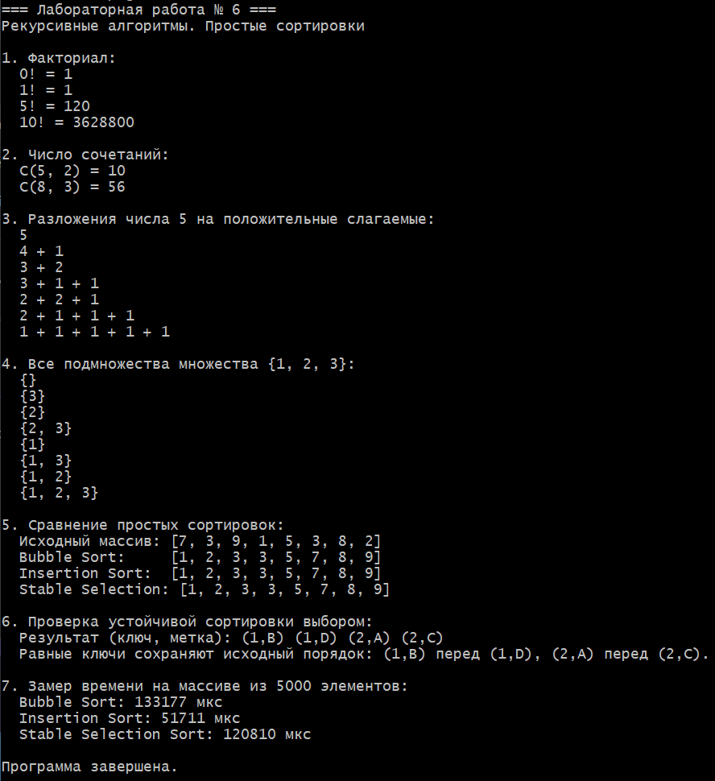

# Лабораторная работа № 6
## Рекурсивные алгоритмы. Простые сортировки

**Студент:** Давлетмурзаев Сайд-Эмин Тимурович  
**Группа:** ПИЖ-б-о-25-1  
**Преподаватель:** Белик Ангелина Игоревна  
**Вариант:** 8  
**Язык программирования:** C++17

## 1. Цель работы

Изучить базовый случай и шаг рекурсии, применить рекурсивные алгоритмы к вычислительным задачам, реализовать простые сортировки и сравнить их сложность и производительность.

## 2. Теоретическая часть

Рекурсия — способ решения задачи, при котором функция вызывает саму себя для решения подзадачи меньшего размера. Рекурсивная функция должна иметь базовый случай, останавливающий дальнейшие вызовы, и рекурсивный шаг, который приближает выполнение к базовому случаю.

В варианте 8 реализуются четыре рекурсивные задачи: факториал, число сочетаний, разложение числа на слагаемые и генерация всех подмножеств.

Пузырьковая сортировка сравнивает соседние элементы и меняет их местами, если они стоят в неправильном порядке. Сортировка вставками вставляет очередной элемент в подходящее место уже обработанной части массива. Сортировка выбором находит минимальный элемент неотсортированной части. В обычной сортировке выбором минимум меняется местами с первым элементом участка; такая версия не всегда устойчива. В устойчивой версии минимум извлекается, а промежуточные элементы сдвигаются на одну позицию вправо.

## 3. Постановка задачи

Вариант 8:

1. Рекурсивно вычислить факториал числа.
2. Рекурсивно вычислить число сочетаний \(C(n,k)\).
3. Рекурсивно вывести разложения числа на положительные слагаемые.
4. Рекурсивно сгенерировать все подмножества заданного множества.
5. Реализовать пузырьковую сортировку, сортировку вставками и сортировку выбором.
6. Реализовать устойчивую версию сортировки выбором.
7. Сравнить время выполнения сортировок на одинаковом массиве.

## 4. Листинг программы

Полный исходный код приведён ниже и сохранён в файле [`main.cpp`](main.cpp).

```cpp
#include <algorithm>
#include <chrono>
#include <iostream>
#include <stdexcept>
#include <utility>
#include <limits>
#include <string>
#include <vector>

using namespace std;

// Задача 1 варианта 8: рекурсивное вычисление факториала.
unsigned long long factorial(int n) {
    if (n < 0) {
        throw invalid_argument("Факториал отрицательного числа не определён");
    }
    if (n <= 1) {
        return 1;
    }
    return static_cast<unsigned long long>(n) * factorial(n - 1);
}

// Задача 2 варианта 8: вычисление числа сочетаний C(n, k).
unsigned long long combinations(int n, int k) {
    if (n < 0 || k < 0 || k > n) {
        throw invalid_argument("Требуется n >= 0 и 0 <= k <= n");
    }
    if (k == 0 || k == n) {
        return 1;
    }
    // Симметрия C(n, k) = C(n, n-k) уменьшает глубину рекурсии.
    if (k > n - k) {
        k = n - k;
    }
    return combinations(n - 1, k - 1) + combinations(n - 1, k);
}

// Задача 3 варианта 8: вывести все разложения n на положительные слагаемые.
// Слагаемые выводятся в невозрастающем порядке, чтобы не дублировать варианты.
void printPartitions(int remaining, int maxPart, vector<int>& current) {
    if (remaining == 0) {
        cout << "  ";
        for (size_t i = 0; i < current.size(); ++i) {
            if (i > 0) {
                cout << " + ";
            }
            cout << current[i];
        }
        cout << '\n';
        return;
    }

    for (int part = min(remaining, maxPart); part >= 1; --part) {
        current.push_back(part);
        printPartitions(remaining - part, part, current);
        current.pop_back();
    }
}

// Задача 4 варианта 8: рекурсивная генерация всех подмножеств.
void generateSubsets(
    const vector<int>& values,
    size_t index,
    vector<int>& current
) {
    if (index == values.size()) {
        cout << "  {";
        for (size_t i = 0; i < current.size(); ++i) {
            if (i > 0) {
                cout << ", ";
            }
            cout << current[i];
        }
        cout << "}\n";
        return;
    }

    // Ветка 1: не включать текущий элемент.
    generateSubsets(values, index + 1, current);

    // Ветка 2: включить текущий элемент.
    current.push_back(values[index]);
    generateSubsets(values, index + 1, current);
    current.pop_back();
}

// Пузырьковая сортировка с остановкой, если обменов больше нет.
void bubbleSort(vector<int>& values) {
    for (size_t i = 0; i + 1 < values.size(); ++i) {
        bool swapped = false;
        for (size_t j = 0; j + 1 < values.size() - i; ++j) {
            if (values[j] > values[j + 1]) {
                swap(values[j], values[j + 1]);
                swapped = true;
            }
        }
        if (!swapped) {
            break;
        }
    }
}

// Сортировка вставками. Сдвиги вместо обменов сохраняют устойчивость.
void insertionSort(vector<int>& values) {
    for (size_t i = 1; i < values.size(); ++i) {
        int key = values[i];
        size_t j = i;
        while (j > 0 && values[j - 1] > key) {
            values[j] = values[j - 1];
            --j;
        }
        values[j] = key;
    }
}

// Устойчивая сортировка выбором: минимум вставляется на место,
// а промежуточные элементы сдвигаются вправо, сохраняя порядок равных.
void stableSelectionSort(vector<int>& values) {
    for (size_t i = 0; i + 1 < values.size(); ++i) {
        size_t minIndex = i;
        for (size_t j = i + 1; j < values.size(); ++j) {
            if (values[j] < values[minIndex]) {
                minIndex = j;
            }
        }

        if (minIndex != i) {
            int minimum = values[minIndex];
            for (size_t j = minIndex; j > i; --j) {
                values[j] = values[j - 1];
            }
            values[i] = minimum;
        }
    }
}

void printVector(const vector<int>& values) {
    cout << '[';
    for (size_t i = 0; i < values.size(); ++i) {
        if (i > 0) {
            cout << ", ";
        }
        cout << values[i];
    }
    cout << ']';
}

template <typename SortFunction>
long long measureMicroseconds(
    const vector<int>& source,
    SortFunction sortFunction
) {
    vector<int> copy = source;
    const auto start = chrono::steady_clock::now();
    sortFunction(copy);
    const auto finish = chrono::steady_clock::now();
    return chrono::duration_cast<chrono::microseconds>(
        finish - start
    ).count();
}

int main() {
    cout << "=== Лабораторная работа № 6 ===\n";
    cout << "Рекурсивные алгоритмы. Простые сортировки\n\n";

    cout << "1. Факториал:\n";
    for (int n : {0, 1, 5, 10}) {
        cout << "  " << n << "! = " << factorial(n) << '\n';
    }

    cout << "\n2. Число сочетаний:\n";
    cout << "  C(5, 2) = " << combinations(5, 2) << '\n';
    cout << "  C(8, 3) = " << combinations(8, 3) << '\n';

    cout << "\n3. Разложения числа 5 на положительные слагаемые:\n";
    vector<int> partition;
    printPartitions(5, 5, partition);

    cout << "\n4. Все подмножества множества {1, 2, 3}:\n";
    const vector<int> setValues{1, 2, 3};
    vector<int> subset;
    generateSubsets(setValues, 0, subset);

    cout << "\n5. Сравнение простых сортировок:\n";
    const vector<int> sample{7, 3, 9, 1, 5, 3, 8, 2};
    vector<int> bubble = sample;
    vector<int> insertion = sample;
    vector<int> selection = sample;

    bubbleSort(bubble);
    insertionSort(insertion);
    stableSelectionSort(selection);

    cout << "  Исходный массив: ";
    printVector(sample);
    cout << "\n  Bubble Sort:     ";
    printVector(bubble);
    cout << "\n  Insertion Sort:  ";
    printVector(insertion);
    cout << "\n  Stable Selection:";
    cout << ' ';
    printVector(selection);
    cout << "\n";

    cout << "\n6. Проверка устойчивой сортировки выбором:\n";
    // Проверка порядка равных ключей на парах (ключ, исходный индекс).
    // Основной алгоритм сортирует int; здесь демонстрируется принцип
    // устойчивости на ключах, имеющих одинаковые значения.
    vector<pair<int, char>> tagged{{2, 'A'}, {1, 'B'}, {2, 'C'}, {1, 'D'}};
    for (size_t i = 0; i + 1 < tagged.size(); ++i) {
        size_t minIndex = i;
        for (size_t j = i + 1; j < tagged.size(); ++j) {
            if (tagged[j].first < tagged[minIndex].first) {
                minIndex = j;
            }
        }
        if (minIndex != i) {
            auto minimum = tagged[minIndex];
            for (size_t j = minIndex; j > i; --j) {
                tagged[j] = tagged[j - 1];
            }
            tagged[i] = minimum;
        }
    }
    cout << "  Результат (ключ, метка): ";
    for (const auto& item : tagged) {
        cout << '(' << item.first << ',' << item.second << ") ";
    }
    cout << "\n  Равные ключи сохраняют исходный порядок: (1,B) перед (1,D), ";
    cout << "(2,A) перед (2,C).\n";

    cout << "\n7. Замер времени на массиве из 5000 элементов:\n";
    vector<int> data(5000);
    unsigned int seed = 42;
    for (int& value : data) {
        seed = seed * 1664525U + 1013904223U;
        value = static_cast<int>((seed >> 8) % 10000U);
    }

    cout << "  Bubble Sort: "
         << measureMicroseconds(data, bubbleSort) << " мкс\n";
    cout << "  Insertion Sort: "
         << measureMicroseconds(data, insertionSort) << " мкс\n";
    cout << "  Stable Selection Sort: "
         << measureMicroseconds(data, stableSelectionSort) << " мкс\n";

    cout << "\nПрограмма завершена.\n";
    return 0;
}
```

## 5. Результаты работы

Для компиляции в MSYS2 UCRT64:

```bash
g++ -std=c++17 -Wall -Wextra -pedantic main.cpp -o lab6.exe
./lab6.exe
```

Программа демонстрирует:
- вычисление факториалов `0!`, `1!`, `5!` и `10!`;
- вычисление `C(5, 2)` и `C(8, 3)`;
- разложения числа 5 на положительные слагаемые;
- все подмножества множества `{1, 2, 3}`;
- результаты трёх сортировок;
- сохранение взаимного порядка элементов с одинаковыми ключами в устойчивой сортировке выбором;
- замер времени сортировок на массиве из 5000 элементов.

**Скриншот:** после запуска программы сохраните изображение консоли в папку `lab-06` под именем `06-recursion-sorting-results.png`, затем добавьте его сюда:

```markdown

```

## 6. Анализ сложности рекурсивных алгоритмов

Пусть \(n\) — аргумент задачи, а \(m\) — количество элементов исходного множества.

| Алгоритм | Временная сложность | Дополнительная память |
|---|---:|---:|
| Факториал | `O(n)` | `O(n)` из-за стека вызовов |
| Число сочетаний без мемоизации | экспоненциальная в общем случае | `O(n)` по глубине рекурсии |
| Разложение числа на слагаемые | пропорциональна числу разложений; число вариантов быстро растёт | `O(n)` по глубине рекурсии |
| Генерация всех подмножеств | `O(m · 2^m)` с учётом вывода элементов | `O(m)` для текущего подмножества и стека |
| Пузырьковая сортировка | лучший случай `O(n)`, средний и худший `O(n²)` | `O(1)` |
| Сортировка вставками | лучший случай `O(n)`, средний и худший `O(n²)` | `O(1)` |
| Устойчивая сортировка выбором | `O(n²)` во всех случаях | `O(1)` |

Число сочетаний реализовано рекурсивной формулой Паскаля: `C(n,k) = C(n-1,k-1) + C(n-1,k)`. Без мемоизации одинаковые подзадачи вычисляются повторно, поэтому время работы растёт экспоненциально. Для больших значений также ограничен диапазон результата типа `unsigned long long`.

## 7. Сравнительная таблица сортировок

| Алгоритм | Лучший случай | Средний случай | Худший случай | Память | Устойчивость |
|---|---:|---:|---:|---:|---|
| Пузырьковая с ранней остановкой | `O(n)` | `O(n²)` | `O(n²)` | `O(1)` | Да |
| Вставками | `O(n)` | `O(n²)` | `O(n²)` | `O(1)` | Да |
| Выбором, устойчивая версия | `O(n²)` | `O(n²)` | `O(n²)` | `O(1)` | Да |

Устойчивая сортировка выбором требует сдвигать промежуточные элементы, поэтому число перемещений может быть больше, чем у обычной сортировки выбором. Время измерения зависит от среды, нагрузки компьютера и входных данных; конкретные микросекунды следует брать из фактического запуска программы.

## 8. Ответы на контрольные вопросы

**1. Что такое рекурсия? Из каких компонентов состоит рекурсивная функция?**  
Рекурсия — способ решения задачи через вызовы той же функции для меньших подзадач. Основные компоненты — базовый случай и рекурсивный шаг.

**2. Что такое базовый случай рекурсии? Почему он важен?**  
Это условие, при котором функция перестаёт вызывать себя. Без него вызовы могут продолжаться до переполнения стека.

**3. Чем отличается прямая рекурсия от косвенной?**  
При прямой рекурсии функция вызывает саму себя. При косвенной одна функция вызывает другую, а та прямо или через цепочку вызовов возвращается к первой.

**4. Что такое хвостовая рекурсия? В чём её преимущество?**  
Хвостовая рекурсия — случай, когда рекурсивный вызов является последней операцией функции. Некоторые компиляторы могут оптимизировать такие вызовы, однако в C++ такая оптимизация не гарантирована.

**5. Какова временная сложность рекурсивного вычисления чисел Фибоначчи? Почему?**  
Наивная рекурсия имеет экспоненциальную сложность порядка `O(2^n)`, потому что повторно вычисляет одни и те же значения.

**6. Как можно оптимизировать рекурсивное вычисление Фибоначчи?**  
Использовать мемоизацию или динамическое программирование, сохраняя уже вычисленные значения. Это позволяет получить линейную временную сложность `O(n)`.

**7. В чём отличие рекурсивной реализации от итеративной?**  
Рекурсивная использует вызовы функций и стек вызовов; итеративная повторяет действия циклами. Итеративная версия часто требует меньше дополнительной памяти.

**8. Какова сложность пузырьковой сортировки? Когда она становится `O(n)`?**  
В среднем и худшем случае — `O(n²)`. С оптимизацией ранней остановкой лучший случай на уже отсортированном массиве равен `O(n)`.

**9. Чем сортировка вставками отличается от сортировки выбором?**  
Вставки сдвигают элементы, чтобы поместить очередной элемент в отсортированную часть. Выбор находит минимум оставшейся части и помещает его в начало этой части.

**10. Какая из простых сортировок является устойчивой? Что это значит?**  
Пузырьковая сортировка и сортировка вставками устойчивы при сравнении строгим оператором `>`. Устойчивая сортировка выбором также сохраняет исходный порядок равных элементов. Устойчивость означает, что равные по ключу элементы не меняются взаимным порядком.

**11. Какая из простых сортировок работает лучше на почти отсортированных данных?**  
Обычно сортировка вставками: число сдвигов мало, и время приближается к `O(n)`.

**12. Как реализовать пузырьковую сортировку с оптимизацией?**  
Использовать флаг обмена на каждом проходе. Если за проход не было обменов, массив уже отсортирован и алгоритм завершается.

**13. Что такое рекурсивный поиск с возвратом (backtracking)?**  
Это перебор вариантов, при котором алгоритм выбирает следующий шаг, рекурсивно исследует его и возвращается назад, если продолжение не подходит или ветка завершена.

**14. Как рекурсивно обойти лабиринт?**  
Проверять границы, стены и посещённые клетки; отметить текущую клетку посещённой; рекурсивно попробовать допустимые направления. Если путь не найден, вернуться к предыдущей клетке.

**15. Какова сложность Ханойских башен? Сколько ходов нужно для перемещения `n` дисков?**  
Минимальное число ходов равно `2^n - 1`, временная сложность — `O(2^n)`.

## 9. Вывод

В ходе лабораторной работы реализованы четыре рекурсивных алгоритма по варианту 8, три простые сортировки и устойчивая версия сортировки выбором. Изучены базовый случай и шаг рекурсии, оценена сложность алгоритмов, выполнено сравнение сортировок по времени. Фактические результаты измерения и скриншот следует добавить после запуска программы в используемой среде.

## 10. Репозиторий

https://github.com/saiddavletmurzaev91-boop/cpp-labs
