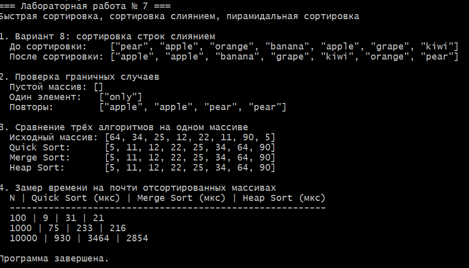

# Лабораторная работа № 7
## Быстрая сортировка, сортировка слиянием, пирамидальная сортировка

**Студент:** Давлетмурзаев Сайд-Эмин Тимурович  
**Группа:** ПИЖ-б-о-25-1  
**Преподаватель:** Белик Ангелина Игоревна  
**Вариант:** 8 (средний уровень)  
**Язык программирования:** C++17

## 1. Цель работы

Реализовать быструю сортировку, сортировку слиянием и пирамидальную сортировку, изучить принципы «разделяй и властвуй» и двоичную кучу, сравнить производительность алгоритмов на тестовых данных.

## 2. Теоретическая часть

**Быстрая сортировка (Quick Sort)** выбирает опорный элемент и разделяет массив на части относительно него, после чего рекурсивно сортирует эти части. Средняя временная сложность — `O(n log n)`, худшая — `O(n²)`. Дополнительная память обычно связана со стеком рекурсии.

**Сортировка слиянием (Merge Sort)** делит массив на две части, рекурсивно сортирует каждую часть и сливает их в упорядоченный массив. Временная сложность во всех случаях — `O(n log n)`. Для массива требуется дополнительная память `O(n)`. Алгоритм устойчив, если при равенстве выбирать элемент из левой части.

**Пирамидальная сортировка (Heap Sort)** строит max-heap — двоичную кучу, в которой каждый родитель не меньше своих потомков. Максимум переносится в конец массива, после чего куча восстанавливается. Временная сложность — `O(n log n)`, дополнительная память самой сортировки — `O(1)` при итеративной реализации просеивания; приведённая рекурсивная `heapify` использует стек глубины `O(log n)`. Алгоритм неустойчив.

## 3. Постановка задачи

По варианту 8 среднего уровня требуется реализовать сортировку слиянием строк в лексикографическом порядке. В общей части работы также реализуются Quick Sort и Heap Sort, проводится тестирование на массивах разных размеров и анализируется производительность алгоритмов.

## 4. Листинг программы

Полный исходный код находится в файле [`main.cpp`](main.cpp).

```cpp
#include <algorithm>
#include <chrono>
#include <iostream>
#include <random>
#include <string>
#include <vector>

using namespace std;
using Clock = chrono::steady_clock;

// Сортировка слиянием для строк в лексикографическом порядке.
void mergeStrings(vector<string>& values, size_t left, size_t mid, size_t right) {
    vector<string> merged;
    merged.reserve(right - left);

    size_t i = left;
    size_t j = mid;

    while (i < mid && j < right) {
        // При равенстве берём элемент из левой части: это сохраняет устойчивость.
        if (values[i] <= values[j]) {
            merged.push_back(values[i++]);
        } else {
            merged.push_back(values[j++]);
        }
    }

    while (i < mid) {
        merged.push_back(values[i++]);
    }
    while (j < right) {
        merged.push_back(values[j++]);
    }

    for (size_t k = 0; k < merged.size(); ++k) {
        values[left + k] = merged[k];
    }
}

void mergeSortStrings(vector<string>& values, size_t left, size_t right) {
    // Диапазон полуоткрытый: [left, right).
    if (right - left <= 1) {
        return;
    }

    const size_t mid = left + (right - left) / 2;
    mergeSortStrings(values, left, mid);
    mergeSortStrings(values, mid, right);
    mergeStrings(values, left, mid, right);
}

// Быстрая сортировка для целых чисел (для сравнительного анализа).
int partition(vector<int>& values, int low, int high) {
    const int pivot = values[high];
    int i = low - 1;

    for (int j = low; j < high; ++j) {
        if (values[j] <= pivot) {
            ++i;
            swap(values[i], values[j]);
        }
    }

    swap(values[i + 1], values[high]);
    return i + 1;
}

void quickSort(vector<int>& values, int low, int high) {
    if (low >= high) {
        return;
    }

    const int pivotIndex = partition(values, low, high);
    quickSort(values, low, pivotIndex - 1);
    quickSort(values, pivotIndex + 1, high);
}

// Восстановление свойства max-heap.
void heapify(vector<int>& values, int size, int root) {
    int largest = root;
    const int left = 2 * root + 1;
    const int right = 2 * root + 2;

    if (left < size && values[left] > values[largest]) {
        largest = left;
    }
    if (right < size && values[right] > values[largest]) {
        largest = right;
    }

    if (largest != root) {
        swap(values[root], values[largest]);
        heapify(values, size, largest);
    }
}

void heapSort(vector<int>& values) {
    const int size = static_cast<int>(values.size());

    for (int i = size / 2 - 1; i >= 0; --i) {
        heapify(values, size, i);
    }

    for (int i = size - 1; i > 0; --i) {
        swap(values[0], values[i]);
        heapify(values, i, 0);
    }
}

void printStrings(const vector<string>& values) {
    cout << '[';
    for (size_t i = 0; i < values.size(); ++i) {
        if (i > 0) {
            cout << ", ";
        }
        cout << '"' << values[i] << '"';
    }
    cout << ']';
}

void printInts(const vector<int>& values) {
    cout << '[';
    for (size_t i = 0; i < values.size(); ++i) {
        if (i > 0) {
            cout << ", ";
        }
        cout << values[i];
    }
    cout << ']';
}

template <typename Function>
long long measureMicroseconds(const vector<int>& source, Function sortFunction) {
    vector<int> values = source;
    const auto start = Clock::now();
    sortFunction(values);
    const auto finish = Clock::now();
    return chrono::duration_cast<chrono::microseconds>(finish - start).count();
}

int main() {
    cout << "=== Лабораторная работа № 7 ===\n";
    cout << "Быстрая сортировка, сортировка слиянием, пирамидальная сортировка\n\n";

    cout << "1. Вариант 8: сортировка строк слиянием\n";
    vector<string> words{
        "pear", "apple", "orange", "banana", "apple", "grape", "kiwi"
    };
    cout << "  До сортировки:    ";
    printStrings(words);
    mergeSortStrings(words, 0, words.size());
    cout << "\n  После сортировки: ";
    printStrings(words);
    cout << "\n";

    cout << "\n2. Проверка граничных случаев\n";
    vector<string> empty;
    mergeSortStrings(empty, 0, empty.size());
    vector<string> one{"only"};
    mergeSortStrings(one, 0, one.size());
    vector<string> duplicates{"pear", "pear", "apple", "apple"};
    mergeSortStrings(duplicates, 0, duplicates.size());
    cout << "  Пустой массив: ";
    printStrings(empty);
    cout << "\n  Один элемент:   ";
    printStrings(one);
    cout << "\n  Повторы:        ";
    printStrings(duplicates);
    cout << "\n";

    cout << "\n3. Сравнение трёх алгоритмов на одном массиве\n";
    vector<int> sample{64, 34, 25, 12, 22, 11, 90, 5};
    vector<int> quick = sample;
    vector<int> merge = sample;
    vector<int> heap = sample;

    quickSort(quick, 0, static_cast<int>(quick.size()) - 1);
    // Для сравнения здесь используется та же реализация слияния для int.
    // Локальная функция merge sort для int.
    const auto mergeSortInts = [](vector<int>& values, auto&& self,
                                  size_t left, size_t right) -> void {
        if (right - left <= 1) {
            return;
        }
        const size_t mid = left + (right - left) / 2;
        self(values, self, left, mid);
        self(values, self, mid, right);
        vector<int> temp;
        temp.reserve(right - left);
        size_t i = left;
        size_t j = mid;
        while (i < mid && j < right) {
            if (values[i] <= values[j]) {
                temp.push_back(values[i++]);
            } else {
                temp.push_back(values[j++]);
            }
        }
        while (i < mid) temp.push_back(values[i++]);
        while (j < right) temp.push_back(values[j++]);
        for (size_t k = 0; k < temp.size(); ++k) {
            values[left + k] = temp[k];
        }
    };
    mergeSortInts(merge, mergeSortInts, 0, merge.size());
    heapSort(heap);

    cout << "  Исходный массив: ";
    printInts(sample);
    cout << "\n  Quick Sort:      ";
    printInts(quick);
    cout << "\n  Merge Sort:      ";
    printInts(merge);
    cout << "\n  Heap Sort:       ";
    printInts(heap);
    cout << "\n";

    cout << "\n4. Замер времени на почти отсортированных массивах\n";
    const vector<int> sizes{100, 1000, 10000};
    mt19937 generator(42);

    cout << "  N | Quick Sort (мкс) | Merge Sort (мкс) | Heap Sort (мкс)\n";
    cout << "  ---------------------------------------------------------\n";
    for (int n : sizes) {
        vector<int> data(n);
        for (int i = 0; i < n; ++i) {
            data[i] = i;
        }

        // Небольшое число соседних перестановок создаёт почти отсортированный массив.
        for (int i = 0; i < max(1, n / 100); ++i) {
            uniform_int_distribution<int> distribution(0, n - 2);
            const int index = distribution(generator);
            swap(data[index], data[index + 1]);
        }

        const auto quickTime = measureMicroseconds(data, [](vector<int>& values) {
            quickSort(values, 0, static_cast<int>(values.size()) - 1);
        });
        const auto mergeTime = measureMicroseconds(data, [](vector<int>& values) {
            const auto sortInts = [](vector<int>& items, auto&& self,
                                     size_t left, size_t right) -> void {
                if (right - left <= 1) return;
                const size_t mid = left + (right - left) / 2;
                self(items, self, left, mid);
                self(items, self, mid, right);
                vector<int> temp;
                temp.reserve(right - left);
                size_t i = left, j = mid;
                while (i < mid && j < right) {
                    if (items[i] <= items[j]) temp.push_back(items[i++]);
                    else temp.push_back(items[j++]);
                }
                while (i < mid) temp.push_back(items[i++]);
                while (j < right) temp.push_back(items[j++]);
                for (size_t k = 0; k < temp.size(); ++k) items[left + k] = temp[k];
            };
            sortInts(values, sortInts, 0, values.size());
        });
        const auto heapTime = measureMicroseconds(data, heapSort);
        cout << "  " << n << " | " << quickTime << " | "
             << mergeTime << " | " << heapTime << '\n';
    }

    cout << "\nПрограмма завершена.\n";
    return 0;
}
```

## 5. Результаты работы

Для компиляции в MSYS2 UCRT64:

```bash
g++ -std=c++17 -Wall -Wextra -pedantic main.cpp -o lab7.exe
./lab7.exe
```

Программа:
- сортирует строки в лексикографическом порядке;
- проверяет пустой массив, массив из одного элемента и повторяющиеся строки;
- демонстрирует правильную сортировку целочисленного массива тремя алгоритмами;
- измеряет время работы на почти отсортированных массивах размером 100, 1000 и 10000 элементов.

Сохраните скриншот консоли в папку `lab-07` под именем `07-sorting-results.png` и добавьте его ниже:



## 6. Анализ сложности

| Алгоритм | Лучший случай | Средний случай | Худший случай | Дополнительная память | Устойчивость |
|---|---:|---:|---:|---:|---|
| Quick Sort | `O(n log n)` | `O(n log n)` | `O(n²)` | `O(log n)` для стека в данной реализации | Нет |
| Merge Sort | `O(n log n)` | `O(n log n)` | `O(n log n)` | `O(n)` | Да |
| Heap Sort | `O(n log n)` | `O(n log n)` | `O(n log n)` | `O(log n)` для рекурсивного `heapify`; `O(1)` для итеративного | Нет |

Сортировка слиянием строк сравнивает строки лексикографически средствами `std::string`. Время сравнения строк зависит также от длины общего префикса, поэтому таблица показывает стандартную сложность по числу сравнений элементов.

## 7. Сравнение производительности

Программа замеряет время каждого алгоритма на одинаковом почти отсортированном массиве для `N = 100`, `1000` и `10000`. Ниже приведены значения из одного запуска в MSYS2 UCRT64; время зависит от процессора, компилятора и текущей нагрузки системы.

| Размер массива | Quick Sort, мкс | Merge Sort, мкс | Heap Sort, мкс |
|---:|---:|---:|---:|
| 100 | 9 | 31 | 21 |
| 1 000 | 75 | 233 | 216 |
| 10 000 | 930 | 3 464 | 2 854 |

В Quick Sort используется медиана трёх элементов, что уменьшает вероятность плохих разбиений на почти отсортированных данных, но не устраняет худший случай `O(n²)`. Реализация рекурсивно обрабатывает меньшую часть, а большую — циклом, ограничивая глубину стека. Merge Sort сохраняет сложность `O(n log n)` независимо от исходного порядка. Heap Sort также гарантирует `O(n log n)`.

## 8. Ответы на контрольные вопросы

**1. Какова сложность быстрой сортировки в лучшем, среднем и худшем случае?**  
Лучший и средний случаи — `O(n log n)`, худший — `O(n²)`.

**2. Когда возникает худший случай для быстрой сортировки?**  
Когда разбиения крайне неравномерны, например, каждый раз отделяется только один элемент.

**3. Как можно улучшить быструю сортировку для защиты от худшего случая?**  
Выбирать случайный опорный элемент или медиану трёх элементов, применять трёхчастное разбиение либо ограничивать глубину рекурсии.

**4. Какова сложность сортировки слиянием? Почему она всегда `O(n log n)`?**  
`O(n log n)`: на каждом уровне суммарно обрабатывается `n` элементов, а число уровней деления пропорционально `log n`.

**5. Какие преимущества и недостатки имеет сортировка слиянием перед быстрой?**  
Она гарантирует `O(n log n)` и является устойчивой, но обычно требует `O(n)` дополнительной памяти. Quick Sort обычно работает на месте и часто быстрее на практике, но имеет худший случай `O(n²)`.

**6. Как работает пирамидальная сортировка? Какова её сложность?**  
Строится max-heap, затем максимум поочерёдно меняется местами с последним элементом неотсортированной части, а куча восстанавливается. Сложность — `O(n log n)`.

**7. Какая из трёх сортировок устойчивая? Почему?**  
Сортировка слиянием при выборе левого элемента при равенстве. Она сохраняет взаимный порядок элементов с одинаковыми ключами.

**8. Какая из трёх сортировок требует дополнительной памяти? Сколько?**  
Merge Sort требует `O(n)` дополнительной памяти. Quick Sort использует стек рекурсии — обычно `O(log n)`, в худшем случае `O(n)`. Рекурсивная реализация `heapify` использует `O(log n)` стека.

**9. Какая из трёх сортировок лучше работает на почти отсортированных данных?**  
Это зависит от реализации. Quick Sort с последним опорным элементом может работать плохо; Merge Sort и Heap Sort сохраняют `O(n log n)`. Для почти отсортированных данных особенно эффективны алгоритмы вроде сортировки вставками, но они не входят в данное сравнение.

**10. Зачем в пирамидальной сортировке сначала строится куча?**  
Чтобы максимум находился в корне. Его можно переместить в конец массива и затем восстановить кучу для оставшейся части.

**11. Что такое «разделяй и властвуй»? Как он применяется в быстрой сортировке и сортировке слиянием?**  
Задача делится на меньшие подзадачи, которые решаются отдельно. Quick Sort делит элементы относительно опорного; Merge Sort делит массив пополам и затем сливает отсортированные части.

**12. Можно ли реализовать быструю сортировку итеративно (без рекурсии)?**  
Да. Для этого используют явный стек диапазонов, которые нужно обработать.

**13. Почему быстрая сортировка обычно быстрее сортировки слиянием на практике?**  
Для массивов в памяти она часто имеет хорошую локальность доступа и не требует отдельного буфера размером `O(n)`. Фактическое преимущество зависит от реализации и данных.

**14. Когда выгодно использовать пирамидальную сортировку?**  
Когда важна гарантированная сложность `O(n log n)` и требуется сортировка с малым расходом дополнительной памяти.

**15. Какой алгоритм сортировки вы бы выбрали для встроенных систем с ограниченной памятью?**  
Часто подходит Heap Sort благодаря гарантированной сложности `O(n log n)` и малому расходу дополнительной памяти. Решение зависит от требований к устойчивости, скорости и реализации.

## 9. Вывод

В ходе лабораторной работы реализованы Quick Sort, Merge Sort и Heap Sort, а также индивидуальное задание варианта 8 — лексикографическая сортировка строк слиянием. Выполнены проверки граничных случаев и подготовлено измерение производительности на почти отсортированных массивах разных размеров. Фактические времена измерения следует зафиксировать по выводу программы.

## 10. Репозиторий

https://github.com/saiddavletmurzaev91-boop/cpp-labs
