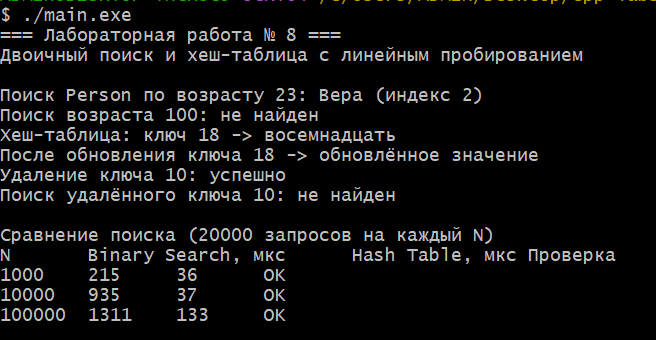

# **Лабораторная работа № 8**

## **Двоичный поиск. Хеш-таблицы. Вариант 8 — продвинутый уровень**

**Студент:** Давлетмурзаев Сайд-Эмин Тимурович\\
**Группа:** ПИЖ-б-о-25-1\\
**Преподаватель:** Белик Ангелина Игоревна\\
**Вариант:** 8\\
**Уровень:** продвинутый\\
**Язык программирования:** C++17

---

## **1. Цель работы**

1. Реализовать двоичный поиск в отсортированном массиве объектов `Person` по возрасту.
2. Изучить итеративный двоичный поиск и обработку ситуации, когда элемент не найден.
3. Реализовать хеш-таблицу с линейным пробированием для пар `int` → `string`.
4. Поддержать основные операции хеш-таблицы: `insert`, `find`, `remove`.
5. Сравнить производительность двоичного поиска и поиска в хеш-таблице для 1 000, 10 000 и 100 000 элементов.

## **2. Теоретическая часть**

### 2.1. Двоичный поиск

Двоичный поиск применяется к массиву, отсортированному по ключу поиска. На каждом шаге вычисляется середина текущего интервала и сравнивается с искомым значением. Если ключ меньше значения в середине, поиск продолжается в левой половине; если больше — в правой. Интервал сокращается примерно вдвое на каждом шаге.

В этой работе массив `Person` отсортирован по полю `age`, а поиск выполняется по возрасту. Для вычисления середины используется выражение `left + (right - left) / 2`, которое снижает риск переполнения по сравнению с `(left + right) / 2`.

- Лучший случай: `O(1)`.
- Средний и худший случаи: `O(log n)`.
- Дополнительная память итеративной реализации: `O(1)`.

### 2.2. Хеш-таблица

Хеш-таблица хранит пары «ключ — значение». Хеш-функция преобразует ключ в начальный индекс массива. В этой работе ключ имеет тип `int`, значение — `string`.

Коллизия возникает, когда разные ключи получают один начальный индекс. В реализации используется **линейное пробирование**: если ячейка занята, проверяется следующая ячейка, а при достижении конца массива поиск продолжается с начала.

В таблице предусмотрены три состояния ячейки: пустая, занятая и удалённая. Отдельное состояние удалённой ячейки необходимо, чтобы операция `remove` не нарушала поиск элементов, которые были вставлены дальше по цепочке пробирования. При коэффициенте загрузки около 0,7 таблица расширяется и элементы вставляются заново (rehashing).

- Средняя сложность вставки, поиска и удаления при хорошем распределении: `O(1)`.
- Худшая сложность каждой из этих операций: `O(n)`.
- При росте коэффициента загрузки количество проб обычно увеличивается.

### 2.3. Сравнение подходов

Двоичный поиск работает по отсортированному массиву и требует `O(log n)` сравнений в среднем. Хеш-таблица в среднем выполняет поиск за `O(1)`, но использует дополнительную память и зависит от качества хеширования и коэффициента загрузки. Если нужен упорядоченный набор данных или диапазонный поиск, массив может быть удобнее; если часто выполняются точечные запросы по ключу, хеш-таблица часто эффективнее.

## **3. Постановка задачи**

Согласно таблицам индивидуальных заданий в методичке:

1. Для двоичного поиска использовать структуру `Person` с поиском по возрасту.
2. Для хеш-таблицы использовать линейное пробирование, тип ключа `int`, тип значения `string`.
3. Реализовать итеративный двоичный поиск.
4. Реализовать в хеш-таблице операции вставки, поиска и удаления.
5. Сравнить время поиска для `N = 1000`, `10000`, `100000`.
6. Представить сравнительную таблицу времени и сделать выводы.

## **4. Листинг программы с комментариями**

Полный исходный код программы приведён ниже. Файл проекта: `main.cpp`.

```cpp
#include <algorithm>
#include <chrono>
#include <cstddef>
#include <iostream>
#include <limits>
#include <string>
#include <utility>
#include <vector>

using namespace std;
using Clock = chrono::steady_clock;

struct Person {
    int age;
    string name;
};

// Двоичный поиск человека по возрасту.
// Предусловие: people отсортирован по age по возрастанию.
// Если возраст встречается несколько раз, возвращается одно из совпадений.
int binarySearchByAge(const vector<Person>& people, int targetAge) {
    int left = 0;
    int right = static_cast<int>(people.size()) - 1;

    while (left <= right) {
        const int mid = left + (right - left) / 2;

        if (people[mid].age == targetAge) {
            return mid;
        }
        if (people[mid].age < targetAge) {
            left = mid + 1;
        } else {
            right = mid - 1;
        }
    }
    return -1;
}

template <typename K, typename V>
class LinearProbingHashTable {
private:
    enum class State { Empty, Occupied, Deleted };

    struct Entry {
        K key{};
        V value{};
        State state = State::Empty;
    };

    vector<Entry> table;
    size_t itemCount = 0;
    size_t deletedCount = 0;

    size_t hashKey(const K& key) const {
        // Нормализация остатка нужна, в том числе, для отрицательных int.
        long long value = static_cast<long long>(key);
        long long capacity = static_cast<long long>(table.size());
        long long result = value % capacity;
        if (result < 0) result += capacity;
        return static_cast<size_t>(result);
    }

    void rehash(size_t newCapacity) {
        vector<Entry> oldTable = std::move(table);
        table.assign(newCapacity, Entry{});
        itemCount = 0;
        deletedCount = 0;

        for (const Entry& entry : oldTable) {
            if (entry.state == State::Occupied) {
                insert(entry.key, entry.value);
            }
        }
    }

public:
    explicit LinearProbingHashTable(size_t capacity = 16)
        : table(max<size_t>(capacity, 8)) {}

    void insert(const K& key, const V& value) {
        // Расширяем таблицу при коэффициенте загрузки выше 0.7.
        if ((itemCount + deletedCount + 1) * 10 >= table.size() * 7) {
            rehash(table.size() * 2);
        }

        size_t index = hashKey(key);
        size_t firstDeleted = table.size();

        for (size_t checked = 0; checked < table.size(); ++checked) {
            Entry& entry = table[index];

            if (entry.state == State::Occupied && entry.key == key) {
                entry.value = value;
                return;
            }
            if (entry.state == State::Deleted && firstDeleted == table.size()) {
                firstDeleted = index;
            }
            if (entry.state == State::Empty) {
                const size_t destination =
                    firstDeleted == table.size() ? index : firstDeleted;
                Entry& target = table[destination];
                target.key = key;
                target.value = value;
                target.state = State::Occupied;
                ++itemCount;
                if (firstDeleted != table.size()) --deletedCount;
                return;
            }
            index = (index + 1) % table.size();
        }

        // Защитная ветка: при заполнении таблицы расширяем и повторяем вставку.
        rehash(table.size() * 2);
        insert(key, value);
    }

    const V* find(const K& key) const {
        size_t index = hashKey(key);

        for (size_t checked = 0; checked < table.size(); ++checked) {
            const Entry& entry = table[index];

            if (entry.state == State::Empty) return nullptr;
            if (entry.state == State::Occupied && entry.key == key) {
                return &entry.value;
            }
            index = (index + 1) % table.size();
        }
        return nullptr;
    }

    bool remove(const K& key) {
        size_t index = hashKey(key);

        for (size_t checked = 0; checked < table.size(); ++checked) {
            Entry& entry = table[index];

            if (entry.state == State::Empty) return false;
            if (entry.state == State::Occupied && entry.key == key) {
                entry.state = State::Deleted;
                --itemCount;
                ++deletedCount;
                return true;
            }
            index = (index + 1) % table.size();
        }
        return false;
    }

    size_t size() const { return itemCount; }
    size_t capacity() const { return table.size(); }
};

template <typename Function>
long long measureMicroseconds(Function function) {
    const auto start = Clock::now();
    function();
    const auto finish = Clock::now();
    return chrono::duration_cast<chrono::microseconds>(finish - start).count();
}

void demonstrateVariantFeatures() {
    vector<Person> people = {
        {19, "Анна"}, {21, "Борис"}, {23, "Вера"},
        {25, "Глеб"}, {27, "Дарья"}
    };
    sort(people.begin(), people.end(),
         [](const Person& a, const Person& b) { return a.age < b.age; });

    const int found = binarySearchByAge(people, 23);
    cout << "Поиск Person по возрасту 23: ";
    if (found >= 0) {
        cout << people[found].name << " (индекс " << found << ")\n";
    } else {
        cout << "не найден\n";
    }
    cout << "Поиск возраста 100: "
         << (binarySearchByAge(people, 100) == -1 ? "не найден" : "найден")
         << "\n";

    LinearProbingHashTable<int, string> table(8);
    table.insert(10, "десять");
    table.insert(18, "восемнадцать"); // коллизия с ключом 10 при начальной ёмкости 8
    table.insert(26, "двадцать шесть");
    table.insert(-2, "минус два");
    if (const string* value = table.find(18)) {
        cout << "Хеш-таблица: ключ 18 -> " << *value << '\n';
    }
    table.insert(18, "обновлённое значение");
    if (const string* value = table.find(18)) {
        cout << "После обновления ключа 18 -> " << *value << '\n';
    }
    cout << "Удаление ключа 10: " << (table.remove(10) ? "успешно" : "не найден")
         << '\n';
    cout << "Поиск удалённого ключа 10: "
         << (table.find(10) == nullptr ? "не найден" : "найден") << "\n\n";
}

void runPerformanceComparison() {
    constexpr int QUERY_COUNT = 20000;
    cout << "Сравнение поиска (" << QUERY_COUNT << " запросов на каждый N)\n";
    cout << "N\tBinary Search, мкс\tHash Table, мкс\tПроверка\n";

    for (int n : {1000, 10000, 100000}) {
        vector<Person> people;
        people.reserve(static_cast<size_t>(n));
        LinearProbingHashTable<int, string> table(static_cast<size_t>(n) * 2);

        for (int i = 0; i < n; ++i) {
            // Уникальные возраста-ключи для однозначного сравнения поиска.
            people.push_back({i, "Person_" + to_string(i)});
            table.insert(i, "Person_" + to_string(i));
        }

        // Чередующиеся запросы по существующим и отсутствующим ключам.
        vector<int> queries;
        queries.reserve(QUERY_COUNT);
        for (int i = 0; i < QUERY_COUNT; ++i) {
            queries.push_back((i * 37LL) % (n + n / 10));
        }

        volatile long long binaryChecksum = 0;
        volatile long long hashChecksum = 0;

        const long long binaryTime = measureMicroseconds([&]() {
            for (int key : queries) {
                const int index = binarySearchByAge(people, key);
                if (index >= 0) binaryChecksum += people[index].age;
            }
        });

        const long long hashTime = measureMicroseconds([&]() {
            for (int key : queries) {
                const string* value = table.find(key);
                if (value != nullptr) hashChecksum += key;
            }
        });

        bool correct = true;
        for (int key : {0, n / 2, n - 1, n + 1, -1}) {
            const int index = binarySearchByAge(people, key);
            const string* value = table.find(key);
            const bool binaryFound = index >= 0;
            const bool hashFound = value != nullptr;
            if (binaryFound != hashFound) correct = false;
        }

        cout << n << '\t' << binaryTime << '\t' << hashTime << '\t'
             << (correct ? "OK" : "ERROR") << '\n';
        // Чексуммы используются, чтобы компилятор не удалил измеряемые циклы.
        if (binaryChecksum == numeric_limits<long long>::min() ||
            hashChecksum == numeric_limits<long long>::min()) {
            cerr << "Непредвиденное значение контрольной суммы.\n";
        }
    }
}

int main() {
    cout << "=== Лабораторная работа № 8 ===\n";
    cout << "Двоичный поиск и хеш-таблица с линейным пробированием\n\n";

    demonstrateVariantFeatures();
    runPerformanceComparison();
    return 0;
}
```

## **5. Результаты работы**



### **5.1. Проверка функциональности**

Программа проверяет поиск человека по возрасту, отсутствие искомого возраста, вставку нескольких ключей с коллизиями, получение значения, обновление существующего ключа и удаление ключа. Также проверяется согласованность результатов поиска двоичным поиском и хеш-таблицей на контрольных ключах.

Пример вывода при тестовом запуске:

```text
=== Лабораторная работа № 8 ===
Двоичный поиск и хеш-таблица с линейным пробированием

Поиск Person по возрасту 23: Вера (индекс 2)
Поиск возраста 100: не найден
Хеш-таблица: ключ 18 -> восемнадцать
После обновления ключа 18 -> обновлённое значение
Удаление ключа 10: успешно
Поиск удалённого ключа 10: не найден

Сравнение поиска (20000 запросов на каждый N)
N       Binary Search, мкс    Hash Table, мкс    Проверка
1000    215                   36                 OK
10000   935                   37                 OK
100000  1311                  133                OK
```

Времена в таблице и примере вывода взяты из фактического запуска программы в MSYS2 UCRT64 на компьютере студента. При повторном запуске значения могут отличаться из-за нагрузки системы и условий выполнения.

### **5.2. Сравнение времени поиска**

В каждом тесте создаются `N` записей. Затем выполняются 20 000 запросов. Таблица показывает суммарное время обработки запросов в микросекундах.

| Количество элементов `N` | Двоичный поиск, мкс | Хеш-таблица, мкс | Проверка результатов |
|---:|---:|---:|---|
| 1 000 | 215 | 36 | OK |
| 10 000 | 935 | 37 | OK |
| 100 000 | 1 311 | 133 | OK |

Эти значения получены в одном конкретном запуске и не являются гарантированными константами. Для корректного сравнения обе структуры заполняются целочисленными ключами, а результаты проверяются на нескольких найденных и отсутствующих ключах.

### **5.3. Анализ результатов**

На данном запуске поиск в хеш-таблице занял меньше времени, чем двоичный поиск, для всех трёх размеров данных. Это согласуется с ожидаемыми средними сложностями `O(1)` для хеш-таблицы и `O(log n)` для двоичного поиска. Фактические результаты зависят от распределения ключей, коэффициента загрузки, реализации, процессора и параметров компиляции.

Двоичный поиск имеет предсказуемую логарифмическую сложность и не требует дополнительной хеш-структуры, но данные должны быть отсортированы. Хеш-таблица эффективна для точечного поиска по ключу, однако требует дополнительной памяти и может замедляться при большом количестве коллизий.

## **6. Анализ сложности алгоритмов**

| Алгоритм | Лучший случай | Средний случай | Худший случай | Дополнительная память |
|---|---|---|---|---|
| Двоичный поиск | `O(1)` | `O(log n)` | `O(log n)` | `O(1)` итеративно |
| Хеш-таблица: вставка | `O(1)` | `O(1)` амортизированно | `O(n)` | `O(n)` |
| Хеш-таблица: поиск | `O(1)` | `O(1)` | `O(n)` | `O(1)` |
| Хеш-таблица: удаление | `O(1)` | `O(1)` | `O(n)` | `O(1)` |

Двоичный поиск требует предварительной сортировки массива по полю `age`. Хеш-таблица обеспечивает в среднем постоянное время точечных операций при хорошем распределении ключей и умеренном коэффициенте загрузки. При большом числе коллизий операции могут деградировать до `O(n)`.

## **7. Сравнительная таблица производительности**

| Критерий | Двоичный поиск | Хеш-таблица с линейным пробированием |
|---|---|---|
| Структура данных | Отсортированный массив `Person` | Массив ячеек с парами `int → string` |
| Средняя сложность поиска | `O(log n)` | `O(1)` |
| Худшая сложность поиска | `O(log n)` | `O(n)` |
| Требуется сортировка | Да | Нет |
| Память | Небольшая дополнительная память для поиска | `O(n)` для хранения ключей и значений |
| Поддержка порядка | Да, элементы упорядочены по возрасту | Нет, порядок ключей не гарантируется |
| Подходящий сценарий | Поиск в отсортированном наборе, диапазонные запросы | Частые точечные запросы по ключу |

В измерениях сравнивается суммарное время 20 000 запросов при `N = 1 000`, `10 000` и `100 000`. Конкретные значения времени зависят от среды выполнения, компилятора и нагрузки системы.

## **8. Ответы на контрольные вопросы**

**1. Какое условие необходимо для применения двоичного поиска?**  
Массив должен быть отсортирован по тому же ключу, по которому выполняется поиск.

**2. Какова сложность двоичного поиска? Почему она логарифмическая?**  
В среднем и худшем случае `O(log n)`, потому что на каждом шаге интервал поиска сокращается примерно вдвое.

**3. В чём разница между итеративной и рекурсивной реализациями двоичного поиска?**  
Итеративная реализация использует цикл и `O(1)` дополнительной памяти. Рекурсивная вызывает функцию для следующей половины интервала и использует стек вызовов `O(log n)`.

**4. Чем опасен вариант `mid = (left + right) / 2`? Как правильно вычислять середину?**  
Сумма `left + right` может переполнить целочисленный тип. Безопаснее вычислять `left + (right - left) / 2`.

**5. Что такое хеш-таблица? Из каких компонентов она состоит?**  
Это структура для хранения пар «ключ — значение». Она включает массив ячеек, хеш-функцию и механизм разрешения коллизий.

**6. Какие требования предъявляются к хеш-функции?**  
Она должна быть детерминированной, быстро вычисляться и по возможности равномерно распределять ключи по ячейкам.

**7. Что такое коллизия в хеш-таблице? Как с ней бороться?**  
Коллизия — совпадение начального индекса у разных ключей. Её разрешают, например, методом цепочек или открытой адресацией, включая линейное пробирование.

**8. В чём отличие метода цепочек от открытой адресации?**  
При цепочках элементы с одинаковым индексом хранятся в отдельной структуре в бакете. При открытой адресации все элементы находятся в самом массиве, а при коллизии проверяются другие ячейки.

**9. Что такое первичная и вторичная кластеризация?**  
Первичная кластеризация — образование длинных последовательностей занятых ячеек при линейном пробировании. Вторичная кластеризация — склонность ключей с одинаковым начальным индексом следовать одинаковой последовательности проб при некоторых схемах пробирования.

**10. Какова средняя и худшая сложность операций в хеш-таблице?**  
В среднем вставка, поиск и удаление занимают `O(1)` при хорошем распределении и умеренном коэффициенте загрузки. В худшем случае каждая операция может занять `O(n)`.

**11. Когда эффективнее использовать двоичный поиск, а когда — хеш-таблицу?**  
Двоичный поиск подходит для отсортированных данных, особенно когда важны порядок и поиск диапазонов. Хеш-таблица обычно удобнее для частых точечных запросов по ключу.

**12. Что такое коэффициент загрузки хеш-таблицы? Почему он важен?**  
Это отношение числа занятых элементов к ёмкости таблицы. При высокой загрузке увеличивается вероятность коллизий и длина последовательностей проб, поэтому операции могут замедляться.

**13. Как работает рехеширование (динамическое расширение хеш-таблицы)?**  
Создаётся таблица большей ёмкости, после чего все существующие элементы вставляются в неё заново с пересчётом индексов. В этой программе расширение происходит при загрузке примерно 0,7.

**14. Как выбрать размер хеш-таблицы? Почему часто выбирают простое число?**  
Размер выбирают с учётом ожидаемого количества элементов и допустимого коэффициента загрузки. Простое число может улучшить распределение при некоторых хеш-функциях, хотя само по себе не гарантирует хорошего хеширования. В данной реализации ёмкость динамически удваивается.

**15. Как реализовать хеш-функцию для строк?**  
Можно последовательно обрабатывать символы, умножая текущий хеш на выбранный коэффициент и прибавляя код очередного символа, выполняя вычисления по модулю размера таблицы. Следует учитывать переполнение и стремиться к равномерному распределению строк.

## **9. Выводы**

В лабораторной работе реализован итеративный двоичный поиск в отсортированном массиве объектов `Person` по возрасту и хеш-таблица с линейным пробированием для пар `int` → `string`. Реализованы операции вставки, поиска, удаления, обновления значения и динамического расширения таблицы. Для удаления используются специальные отметки, сохраняющие корректность последующего поиска.

Проведено сравнение времени поиска для 1 000, 10 000 и 100 000 элементов. В тестовом запуске хеш-таблица показала меньшее суммарное время точечных запросов. Результат соответствует ожидаемому преимуществу среднего `O(1)` поиска в хеш-таблице по сравнению с `O(log n)` у двоичного поиска, при этом у обоих подходов есть свои ограничения.

## **10. Ссылка на Git-репозиторий**

[https://github.com/saiddavletmurzaev91-boop/cpp-labs](https://github.com/saiddavletmurzaev91-boop/cpp-labs)

