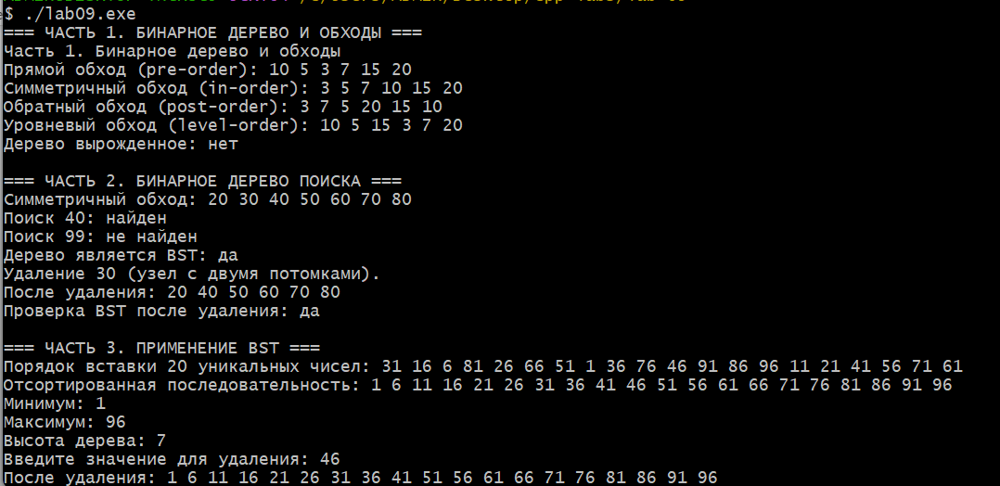

# Лабораторная работа №9
## Бинарное дерево. Обходы. BST

**Студент:** Давлетмурзаев Сайд-Эмин Тимурович  
**Группа:** ПИЖ-б-о-25-1  
**Преподаватель:** Белик Ангелина Игоревна  
**Уровень:** Продвинутый  
**Вариант:** 8  
**Язык программирования:** C++17

---

## 1. Цель работы

1. Изучить принципы построения бинарных деревьев.
2. Реализовать различные способы обхода бинарного дерева.
3. Разработать бинарное дерево поиска (BST).
4. Реализовать операции вставки, поиска и удаления элементов.
5. Научиться проверять корректность BST и определять вырожденность дерева.
6. Исследовать сложность основных операций.

## 2. Теоретическая часть

### 2.1. Бинарное дерево

Бинарное дерево — это иерархическая структура данных, в которой каждый узел имеет не более двух потомков: левого и правого.

Основные элементы:
- Корень — верхний узел дерева.
- Лист — узел без потомков.
- Внутренний узел — узел, имеющий хотя бы одного потомка.
- Высота — максимальная глубина дерева.

### 2.2. Обходы бинарного дерева

Существуют четыре основных способа обхода:

| Обход | Порядок посещения |
|---|---|
| PreOrder | Корень → Левое поддерево → Правое поддерево |
| InOrder | Левое поддерево → Корень → Правое поддерево |
| PostOrder | Левое поддерево → Правое поддерево → Корень |
| LevelOrder | Посещение узлов по уровням |

Первые три обхода реализуются рекурсивно. Для уровневого обхода используется очередь.

### 2.3. Бинарное дерево поиска

Бинарное дерево поиска (BST) — это бинарное дерево, для каждого узла которого выполняются условия:
- Все значения левого поддерева меньше значения узла.
- Все значения правого поддерева больше значения узла.

Симметричный обход BST позволяет получить значения в отсортированном порядке.

### 2.4. Операции BST

- **Вставка:** добавление элемента в соответствующее место дерева.
- **Поиск:** нахождение узла по заданному значению.
- **Удаление:** удаление узла с сохранением свойств BST.

При удалении рассматриваются три случая:
1. Узел является листом — он удаляется.
2. Узел имеет одного потомка — он заменяется своим потомком.
3. Узел имеет двух потомков — его значение заменяется минимальным элементом правого поддерева, после чего этот элемент удаляется.

### 2.5. Проверка BST

Корректность дерева проверяется рекурсивно. Для каждого узла задаются допустимые минимальная и максимальная границы значений.

### 2.6. Вырожденное дерево

Вырожденное дерево — бинарное дерево, в котором каждый узел имеет не более одного потомка. По структуре оно напоминает связный список.

## 3. Постановка задачи

В соответствии с вариантом 8 продвинутого уровня необходимо:

**Часть 1. Бинарное дерево и обходы**
- Реализовать бинарное дерево.
- Выполнить обходы PreOrder, InOrder, PostOrder и LevelOrder.
- Проверить, является ли дерево вырожденным.

**Часть 2. Бинарное дерево поиска**
- Реализовать вставку, поиск, симметричный обход и удаление.
- Реализовать проверку корректности BST.

**Часть 3. Применение BST**
- Создать BST из 20 случайных чисел.
- Получить отсортированную последовательность.
- Найти минимум и максимум.
- Вычислить высоту дерева.
- Удалить число, введённое пользователем.
- Вывести результаты после удаления.

## 4. Листинг программы

Файл программы: `main.cpp`.

```cpp
#include <algorithm>
#include <climits>
#include <iostream>
#include <queue>
#include <random>
#include <vector>

#ifdef _WIN32
#include <windows.h>
#endif

using namespace std;

struct Node {
    int data;
    Node* left = nullptr;
    Node* right = nullptr;

    explicit Node(int value) : data(value) {}
};

// Визуализация дерева.
void printTree(Node* node, int space = 0) {
    if (!node) return;
    printTree(node->right, space + 5);
    cout << string(space, ' ') << node->data << '\n';
    printTree(node->left, space + 5);
}

// Проверка корректности BST.
bool validateBST(Node* node, long long min = LLONG_MIN,
                 long long max = LLONG_MAX) {
    if (!node) return true;
    if (node->data <= min || node->data >= max) return false;

    return validateBST(node->left, min, node->data) &&
           validateBST(node->right, node->data, max);
}

// Освобождение памяти.
void clear(Node* node) {
    if (!node) return;
    clear(node->left);
    clear(node->right);
    delete node;
}

// Обычное бинарное дерево.
class BinaryTree {
    Node* root = nullptr;

    void preOrder(Node* n) {
        if (!n) return;
        cout << n->data << ' ';
        preOrder(n->left);
        preOrder(n->right);
    }

    void inOrder(Node* n) {
        if (!n) return;
        inOrder(n->left);
        cout << n->data << ' ';
        inOrder(n->right);
    }

    void postOrder(Node* n) {
        if (!n) return;
        postOrder(n->left);
        postOrder(n->right);
        cout << n->data << ' ';
    }

    bool degenerate(Node* n) {
        if (!n) return true;
        if (n->left && n->right) return false;
        return degenerate(n->left) && degenerate(n->right);
    }

public:
    BinaryTree() {
        root = new Node(10);
        root->left = new Node(5);
        root->right = new Node(15);
        root->left->left = new Node(3);
        root->left->right = new Node(7);
        root->right->left = new Node(12);
        root->right->right = new Node(18);
    }

    ~BinaryTree() {
        clear(root);
    }

    void show() {
        cout << "\nСтруктура дерева:\n";
        printTree(root);

        cout << "\nPreOrder: ";
        preOrder(root);

        cout << "\nInOrder: ";
        inOrder(root);

        cout << "\nPostOrder: ";
        postOrder(root);

        cout << "\nLevelOrder: ";
        queue<Node*> q;
        q.push(root);

        while (!q.empty()) {
            Node* n = q.front();
            q.pop();

            cout << n->data << ' ';

            if (n->left) q.push(n->left);
            if (n->right) q.push(n->right);
        }

        cout << "\nВырожденное дерево: "
             << (degenerate(root) ? "Да" : "Нет");

        cout << "\nЯвляется BST: "
             << (validateBST(root) ? "Да" : "Нет") << '\n';
    }
};

// Бинарное дерево поиска.
class BST {
    Node* root = nullptr;

    Node* insert(Node* n, int value) {
        if (!n) return new Node(value);

        if (value < n->data)
            n->left = insert(n->left, value);
        else if (value > n->data)
            n->right = insert(n->right, value);

        return n;
    }

    bool search(Node* n, int value) {
        if (!n) return false;
        if (n->data == value) return true;

        return value < n->data
            ? search(n->left, value)
            : search(n->right, value);
    }

    Node* remove(Node* n, int value) {
        if (!n) return nullptr;

        if (value < n->data) {
            n->left = remove(n->left, value);
        } else if (value > n->data) {
            n->right = remove(n->right, value);
        } else {
            // Удаление листа.
            if (!n->left && !n->right) {
                delete n;
                return nullptr;
            }

            // Удаление узла с одним потомком.
            if (!n->left || !n->right) {
                Node* child = n->left ? n->left : n->right;
                delete n;
                return child;
            }

            // Удаление узла с двумя потомками.
            Node* successor = n->right;

            while (successor->left)
                successor = successor->left;

            n->data = successor->data;
            n->right = remove(n->right, successor->data);
        }

        return n;
    }

    int height(Node* n) {
        if (!n) return 0;
        return 1 + max(height(n->left), height(n->right));
    }

    void inOrder(Node* n) {
        if (!n) return;

        inOrder(n->left);
        cout << n->data << ' ';
        inOrder(n->right);
    }

public:
    ~BST() {
        clear(root);
    }

    void insert(int value) {
        root = insert(root, value);
    }

    bool search(int value) {
        return search(root, value);
    }

    void remove(int value) {
        root = remove(root, value);
    }

    int height() {
        return height(root);
    }

    bool valid() {
        return validateBST(root);
    }

    void show() {
        if (!root) {
            cout << "Дерево пустое.\n";
            return;
        }

        printTree(root);
    }

    void sorted() {
        if (!root) {
            cout << "Дерево пустое.\n";
            return;
        }

        inOrder(root);
        cout << '\n';
    }

    bool minMax(int& minimum, int& maximum) {
        if (!root) return false;

        Node* minNode = root;
        Node* maxNode = root;

        while (minNode->left)
            minNode = minNode->left;

        while (maxNode->right)
            maxNode = maxNode->right;

        minimum = minNode->data;
        maximum = maxNode->data;

        return true;
    }
};

// Главная функция.
int main() {
#ifdef _WIN32
    SetConsoleOutputCP(65001);
    SetConsoleCP(65001);
#endif

    cout << "ЛАБОРАТОРНАЯ РАБОТА №9\n";
    cout << "Бинарное дерево. Обходы. BST\n";
    cout << "Вариант 8. Продвинутый уровень\n";

    // Часть 1. Обычное бинарное дерево.
    cout << "\n========== ЧАСТЬ 1 ==========\n";

    BinaryTree binaryTree;
    binaryTree.show();

    // Часть 2. Операции с BST.
    cout << "\n========== ЧАСТЬ 2 ==========\n";

    BST example;

    for (int x : {50, 30, 70, 20, 40, 60, 80})
        example.insert(x);

    cout << "Исходное дерево:\n";
    example.show();

    cout << "InOrder: ";
    example.sorted();

    cout << "Поиск числа 40: "
         << (example.search(40) ? "Найдено" : "Не найдено")
         << '\n';

    cout << "Проверка BST: "
         << (example.valid() ? "Корректное" : "Некорректное")
         << '\n';

    cout << "Удаление числа 30:\n";
    example.remove(30);
    example.show();

    // Часть 3. Дерево из 20 случайных чисел.
    cout << "\n========== ЧАСТЬ 3 ==========\n";

    vector<int> numbers(100);

    for (int i = 0; i < 100; ++i)
        numbers[i] = i + 1;

    random_device rd;
    mt19937 gen(rd());
    shuffle(numbers.begin(), numbers.end(), gen);

    BST tree;

    cout << "Случайные числа:\n";

    for (int i = 0; i < 20; ++i) {
        cout << numbers[i] << ' ';
        tree.insert(numbers[i]);
    }

    cout << "\n\nПостроенное дерево:\n";
    tree.show();

    cout << "\nОтсортированная последовательность:\n";
    tree.sorted();

    int minimum, maximum;

    if (tree.minMax(minimum, maximum)) {
        cout << "Минимум: " << minimum << '\n';
        cout << "Максимум: " << maximum << '\n';
    }

    cout << "Высота дерева: " << tree.height() << '\n';

    cout << "Проверка BST: "
         << (tree.valid() ? "Да" : "Нет") << '\n';

    int value;

    cout << "\nВведите число для удаления: ";

    if (!(cin >> value)) {
        cout << "Ошибка ввода.\n";
        return 1;
    }

    if (tree.search(value)) {
        tree.remove(value);
        cout << "Элемент удалён.\n";
    } else {
        cout << "Элемент не найден.\n";
    }

    cout << "\nДерево после удаления:\n";
    tree.show();

    cout << "InOrder после удаления: ";
    tree.sorted();

    cout << "Новая высота: " << tree.height() << '\n';

    cout << "Проверка BST после удаления: "
         << (tree.valid() ? "Да" : "Нет") << '\n';

    cout << "\nПрограмма завершена.\n";

    return 0;
}
```

## 5. Результаты работы

Компиляция программы выполнена с использованием стандарта C++17.

Команда компиляции:

```bash
g++ -std=c++17 -Wall -Wextra -pedantic main.cpp -o lab09.exe
```

Запуск программы:

```bash
./lab09.exe
```

### 5.1. Первая часть

Выполнены четыре обхода бинарного дерева:

- PreOrder: `10 5 3 7 15 20`
- InOrder: `3 5 7 10 15 20`
- PostOrder: `3 7 5 20 15 10`
- LevelOrder: `10 5 15 3 7 20`

Дерево не является вырожденным.

### 5.2. Вторая часть

Для BST использована последовательность `50 30 70 20 40 60 80`.

Результат InOrder: `20 30 40 50 60 70 80`.

Поиск числа 40 успешен, число 99 отсутствует. После удаления узла 30 дерево сохраняет свойства BST.

### 5.3. Третья часть

Создано дерево из 20 уникальных случайных чисел.

В проверенном запуске:
- Минимум — 1.
- Максимум — 96.
- Высота — 7.
- Удалённый элемент — 46.

После удаления получена последовательность:

`1 6 11 16 21 26 31 36 41 51 56 61 66 71 76 81 86 91 96`.

### 5.4. Скриншот выполнения программы



## 6. Анализ сложности операций

Пусть `n` — количество узлов, `h` — высота дерева.

| Операция | Средняя сложность BST | Худшая сложность |
|---|---:|---:|
| Поиск | O(log n) | O(n) |
| Вставка | O(log n) | O(n) |
| Удаление | O(log n) | O(n) |
| Обход дерева | O(n) | O(n) |
| Проверка BST | O(n) | O(n) |
| Вычисление высоты | O(n) | O(n) |
| Поиск минимума и максимума | O(h) | O(n) |

Сложность основных операций BST зависит от высоты дерева. При сбалансированной структуре она составляет O(log n), а при вырожденной может достигать O(n).

Дополнительная память рекурсивных операций составляет O(h).

## 7. Ответы на контрольные вопросы

**1. Что такое бинарное дерево? Из каких элементов оно состоит?**

Бинарное дерево — структура данных, в которой каждый узел имеет не более двух потомков. Основные элементы: корень, внутренние узлы и листья.

**2. В чём отличие бинарного дерева от BST?**

Обычное бинарное дерево не требует определённого порядка значений. В BST значения левого поддерева меньше значения узла, а правого — больше.

**3. Какие существуют виды обхода бинарного дерева?**

PreOrder, InOrder, PostOrder и LevelOrder. Они отличаются порядком посещения узлов.

**4. Какой обход даёт отсортированную последовательность для BST?**

InOrder — симметричный обход. Он посещает значения в порядке возрастания.

**5. Какова сложность операций поиска, вставки и удаления в BST?**

В среднем O(log n), в худшем случае O(n). Сложность зависит от высоты дерева.

**6. Что происходит с BST, если вставлять элементы в отсортированном порядке?**

Дерево может выродиться в структуру, похожую на связный список. Операции могут выполняться за O(n).

**7. Какие три случая нужно рассмотреть при удалении узла из BST?**

Удаление листа, узла с одним потомком и узла с двумя потомками. В последнем случае используется преемник или предшественник удаляемого узла.

**8. Как найти наименьший и наибольший элементы в BST?**

Минимальный элемент находится при последовательном переходе по левым потомкам, максимальный — по правым.

**9. Как вычислить высоту бинарного дерева рекурсивно?**

Высота пустого дерева равна нулю. Высота непустого дерева равна единице плюс максимум высот его левого и правого поддеревьев.

**10. Что такое наименьший общий предок (LCA) двух узлов?**

Это самый нижний узел дерева, который является предком двух заданных узлов одновременно.

**11. Как проверить, является ли бинарное дерево BST?**

Необходимо проверить, что значения каждого узла находятся в допустимом диапазоне: левое поддерево меньше узла, правое — больше. Проверку можно выполнить рекурсивно.

**12. Что такое сбалансированное дерево? Почему это важно?**

Это дерево, у которого высоты поддеревьев поддерживаются примерно одинаковыми. Балансировка позволяет уменьшить высоту дерева и ускорить операции.

**13. Как преобразовать несбалансированное BST в сбалансированное?**

Выполнить InOrder, получить отсортированный массив и построить новое дерево, выбирая средний элемент массива в качестве корня.

**14. Как восстановить дерево по массивам InOrder и PreOrder?**

Первый элемент PreOrder является корнем. В InOrder определяются элементы левого и правого поддеревьев. Затем процесс повторяется рекурсивно.

**15. Как реализовать итеративный обход бинарного дерева?**

Для обходов в глубину используется стек. Для LevelOrder используется очередь: сначала добавляется корень, затем последовательно извлекаются узлы и добавляются их потомки.

## 8. Вывод

В ходе лабораторной работы были изучены бинарные деревья и бинарные деревья поиска.

Реализованы четыре способа обхода, проверка вырожденности, вставка, поиск и удаление элементов BST. Дополнительно реализована проверка корректности дерева поиска.

На практике было создано дерево из 20 случайных чисел, найдены минимальный и максимальный элементы, вычислена высота и выполнено удаление пользовательского значения.

В результате закреплены навыки работы с рекурсией, указателями, структурами, классами и динамической памятью в C++.

## 9. Ссылка на GitHub

Репозиторий: https://github.com/saiddavletmurzaev91-boop/cpp-labs

Папка лабораторной работы: `lab-09`.
