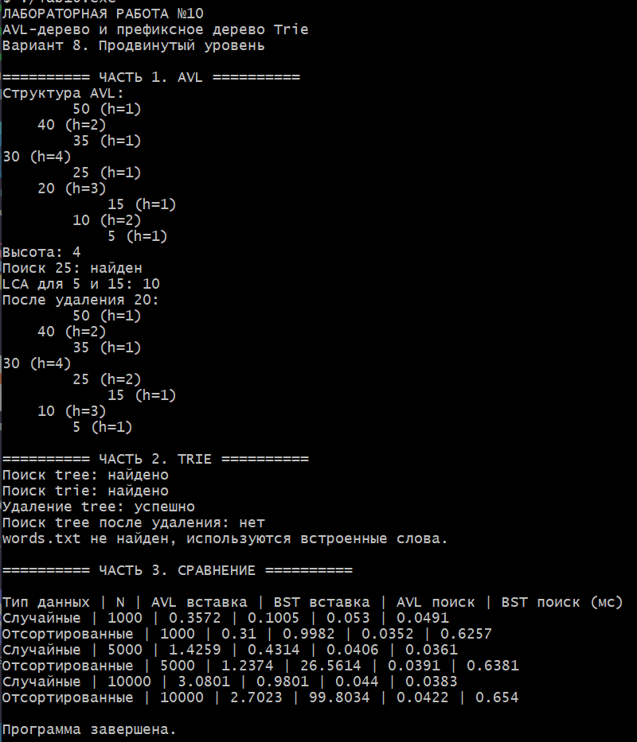
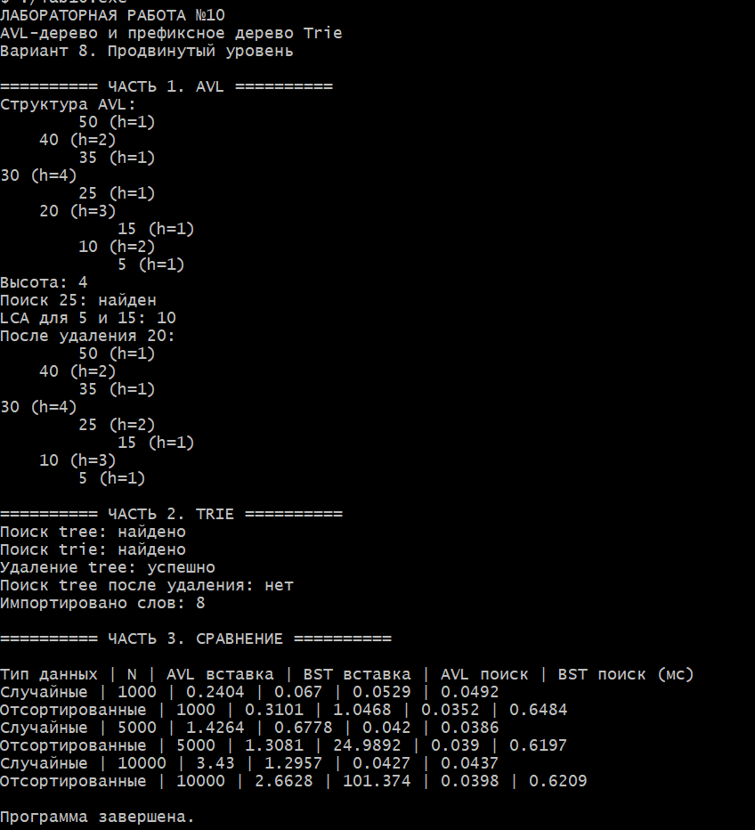

# Лабораторная работа №10
## AVL-дерево. Префиксное дерево (Trie)

**Выполнил:** Давлетмурзаев Сайд-Эмин Тимурович  
**Группа:** ПИЖ-б-о-25-1  
**Преподаватель:** Белик Ангелина Игоревна  
**Вариант:** 8  
**Уровень:** продвинутый  
**Язык программирования:** C++17

---

## 1. Цель работы

1. Реализовать самобалансирующееся AVL-дерево с операциями вставки, удаления и поиска.
2. Освоить механизмы балансировки: малые и большие повороты.
3. Изучить префиксное дерево Trie для хранения и поиска строк.
4. Реализовать вставку, поиск и удаление слов в Trie.
5. Реализовать дополнительные задания варианта 8: поиск наименьшего общего предка (LCA) в AVL-дереве и импорт слов из файла в Trie.
6. Сравнить производительность AVL-дерева и обычного BST на случайных и отсортированных данных.

## 2. Теоретическая часть

### 2.1. Бинарное дерево поиска (BST)

BST — бинарное дерево, в котором ключи левого поддерева меньше ключа узла, а ключи правого поддерева больше. Средняя сложность поиска и вставки при достаточно равномерной форме дерева составляет `O(log n)`. При вставке уже отсортированных значений обычное BST может выродиться в цепочку, и операции будут выполняться за `O(n)`.

### 2.2. AVL-дерево

AVL-дерево — самобалансирующееся бинарное дерево поиска. Для каждого узла разность высот левого и правого поддеревьев по модулю не превышает единицу.

Фактор баланса вычисляется по формуле:

`BF(node) = height(node.left) - height(node.right)`

Допустимые значения фактора баланса: `-1`, `0`, `1`. Если после вставки или удаления баланс нарушается, выполняются повороты:

- **Правый поворот (LL)** — когда левое поддерево перегружено влево.
- **Левый поворот (RR)** — когда правое поддерево перегружено вправо.
- **Левый-правый поворот (LR)** — сначала левый поворот левого потомка, затем правый поворот узла.
- **Правый-левый поворот (RL)** — сначала правый поворот правого потомка, затем левый поворот узла.

Высота AVL-дерева остаётся логарифмической относительно количества узлов, поэтому поиск, вставка и удаление имеют сложность `O(log n)`.

### 2.3. Префиксное дерево Trie

Trie — структура данных для хранения строк, в которой путь от корня соответствует последовательности символов. Узел отмечается как конец слова, если по этому пути хранится целое слово.

В данной реализации переходы между узлами хранятся в `unordered_map<char, TrieNode*>`. Вставка и поиск обрабатывают символы строки последовательно. Для слова длины `L` ожидаемая сложность этих операций составляет `O(L)` при среднем времени доступа к хеш-таблице.

## 3. Постановка задачи

### Часть 1. AVL-дерево

Реализовать вставку, балансировку, поиск и удаление. Дополнительное задание варианта 8 — найти наименьшего общего предка (LCA) двух заданных узлов.

### Часть 2. Trie

Реализовать вставку, поиск и удаление слов. Дополнительное задание варианта 8 — импортировать слова из текстового файла.

### Часть 3. Сравнительный анализ

Реализовать AVL и обычное BST и сравнить время вставки и поиска для `N = 1000`, `5000`, `10000` на случайных и отсортированных данных. Результаты вывести в таблицу.

## 4. Реализация программы

Исходный файл: `main.cpp`. Программа использует стандарт C++17. Для корректного отображения русского текста в консоли Windows устанавливается кодовая страница UTF-8.

```cpp

#include <algorithm>
#include <chrono>
#include <cctype>
#include <fstream>
#include <iostream>
#include <random>
#include <string>
#include <unordered_map>
#include <vector>

#ifdef _WIN32
#include <windows.h>
#endif

using namespace std;
using Clock = chrono::steady_clock;

// ======================== AVL TREE ========================

struct AVLNode {
    int key, height = 1;
    AVLNode *left = nullptr, *right = nullptr;
    explicit AVLNode(int v) : key(v) {}
};

class AVLTree {
    AVLNode* root = nullptr;

    int h(AVLNode* n) { return n ? n->height : 0; }
    int bf(AVLNode* n) { return h(n->left) - h(n->right); }

    void update(AVLNode* n) {
        n->height = 1 + max(h(n->left), h(n->right));
    }

    AVLNode* rightRotate(AVLNode* y) {
        AVLNode* x = y->left;
        y->left = x->right;
        x->right = y;
        update(y);
        update(x);
        return x;
    }

    AVLNode* leftRotate(AVLNode* x) {
        AVLNode* y = x->right;
        x->right = y->left;
        y->left = x;
        update(x);
        update(y);
        return y;
    }

    AVLNode* balance(AVLNode* n) {
        if (!n) return n;
        update(n);
        if (bf(n) > 1) {
            if (bf(n->left) < 0)
                n->left = leftRotate(n->left);
            return rightRotate(n);
        }
        if (bf(n) < -1) {
            if (bf(n->right) > 0)
                n->right = rightRotate(n->right);
            return leftRotate(n);
        }
        return n;
    }

    AVLNode* insert(AVLNode* n, int key) {
        if (!n) return new AVLNode(key);
        if (key < n->key) n->left = insert(n->left, key);
        else if (key > n->key) n->right = insert(n->right, key);
        else return n;
        return balance(n);
    }

    AVLNode* minNode(AVLNode* n) {
        while (n->left) n = n->left;
        return n;
    }

    AVLNode* erase(AVLNode* n, int key) {
        if (!n) return nullptr;
        if (key < n->key) n->left = erase(n->left, key);
        else if (key > n->key) n->right = erase(n->right, key);
        else {
            if (!n->left || !n->right) {
                AVLNode* child = n->left ? n->left : n->right;
                delete n;
                return child;
            }
            AVLNode* successor = minNode(n->right);
            n->key = successor->key;
            n->right = erase(n->right, successor->key);
        }
        return balance(n);
    }

    bool contains(AVLNode* n, int key) {
        if (!n) return false;
        if (n->key == key) return true;
        return contains(key < n->key ? n->left : n->right, key);
    }

    AVLNode* findLCA(AVLNode* n, int a, int b) {
        if (a < n->key && b < n->key)
            return findLCA(n->left, a, b);
        if (a > n->key && b > n->key)
            return findLCA(n->right, a, b);
        return n;
    }

    void print(AVLNode* n, int depth) {
        if (!n) return;
        print(n->right, depth + 4);
        cout << string(depth, ' ') << n->key
             << " (h=" << n->height << ")\n";
        print(n->left, depth + 4);
    }

    void clear(AVLNode* n) {
        if (!n) return;
        clear(n->left);
        clear(n->right);
        delete n;
    }

public:
    ~AVLTree() { clear(root); }
    void insert(int x) { root = insert(root, x); }
    void remove(int x) { root = erase(root, x); }
    bool search(int x) { return contains(root, x); }
    int height() { return h(root); }

    int lca(int a, int b) {
        if (!search(a) || !search(b)) return -1;
        return findLCA(root, a, b)->key;
    }

    void show() {
        if (!root) cout << "Дерево пустое\n";
        else print(root, 0);
    }
};

// ======================== ORDINARY BST ========================

struct BSTNode {
    int key;
    BSTNode *left = nullptr, *right = nullptr;
    explicit BSTNode(int v) : key(v) {}
};

class BST {
    BSTNode* root = nullptr;

public:
    ~BST() { clear(); }

    void insert(int x) {
        BSTNode** p = &root;
        while (*p) {
            if (x < (*p)->key) p = &(*p)->left;
            else if (x > (*p)->key) p = &(*p)->right;
            else return;
        }
        *p = new BSTNode(x);
    }

    bool search(int x) {
        BSTNode* p = root;
        while (p) {
            if (p->key == x) return true;
            p = x < p->key ? p->left : p->right;
        }
        return false;
    }

    void clear() {
        vector<BSTNode*> s;
        if (root) s.push_back(root);
        while (!s.empty()) {
            BSTNode* n = s.back();
            s.pop_back();
            if (n->left) s.push_back(n->left);
            if (n->right) s.push_back(n->right);
            delete n;
        }
        root = nullptr;
    }
};

// ======================== PREFIX TREE: TRIE ========================

struct TrieNode {
    unordered_map<char, TrieNode*> next;
    bool end = false;
};

class Trie {
    TrieNode* root = new TrieNode();

    string normalize(string s) {
        for (char& c : s)
            c = static_cast<char>(tolower(static_cast<unsigned char>(c)));
        return s;
    }

    void clear(TrieNode* n) {
        for (auto& p : n->next) clear(p.second);
        delete n;
    }

public:
    ~Trie() { clear(root); }

    void insert(string word) {
        TrieNode* p = root;
        for (char c : normalize(word)) {
            if (!p->next.count(c)) p->next[c] = new TrieNode();
            p = p->next[c];
        }
        p->end = true;
    }

    bool search(string word) {
        TrieNode* p = root;
        for (char c : normalize(word)) {
            if (!p->next.count(c)) return false;
            p = p->next[c];
        }
        return p->end;
    }

    bool remove(string word) {
        word = normalize(word);
        TrieNode* p = root;
        vector<TrieNode*> path{root};

        for (char c : word) {
            if (!p->next.count(c)) return false;
            p = p->next[c];
            path.push_back(p);
        }

        if (!p->end) return false;
        p->end = false;

        for (int i = static_cast<int>(word.size()); i > 0; --i) {
            TrieNode* n = path[i];
            if (n->end || !n->next.empty()) break;
            path[i - 1]->next.erase(word[i - 1]);
            delete n;
        }
        return true;
    }

    int importFile(const string& filename) {
        ifstream file(filename);
        if (!file) return -1;
        string word;
        int count = 0;
        while (file >> word) {
            insert(word);
            ++count;
        }
        return count;
    }
};

// ======================== BENCHMARKS ========================

template<class Tree>
double insertTime(const vector<int>& data) {
    Tree tree;
    auto start = Clock::now();
    for (int x : data) tree.insert(x);
    return chrono::duration<double, milli>(Clock::now() - start).count();
}

template<class Tree>
double searchTime(const vector<int>& data,
                  const vector<int>& queries) {
    Tree tree;
    for (int x : data) tree.insert(x);

    volatile int found = 0;
    auto start = Clock::now();
    for (int x : queries) found += tree.search(x);

    return chrono::duration<double, milli>(Clock::now() - start).count();
}

void benchmarks() {
    mt19937 gen(random_device{}());
    cout << "\nТип данных | N | AVL вставка | BST вставка"
         << " | AVL поиск | BST поиск (мс)\n";

    for (int n : {1000, 5000, 10000}) {
        vector<int> randomData(n), sortedData(n);
        for (int i = 0; i < n; ++i)
            randomData[i] = sortedData[i] = i + 1;

        shuffle(randomData.begin(), randomData.end(), gen);

        vector<int> queries;
        for (int i = 1; i <= min(n, 1000); ++i)
            queries.push_back(i);

        for (int type = 0; type < 2; ++type) {
            const auto& data = type == 0 ? randomData : sortedData;
            cout << (type == 0 ? "Случайные" : "Отсортированные")
                 << " | " << n
                 << " | " << insertTime<AVLTree>(data)
                 << " | " << insertTime<BST>(data)
                 << " | " << searchTime<AVLTree>(data, queries)
                 << " | " << searchTime<BST>(data, queries) << '\n';
        }
    }
}

// ======================== MAIN ========================

int main() {
#ifdef _WIN32
    SetConsoleOutputCP(65001);
    SetConsoleCP(65001);
#endif

    cout << "ЛАБОРАТОРНАЯ РАБОТА №10\n"
         << "AVL-дерево и префиксное дерево Trie\n"
         << "Вариант 8. Продвинутый уровень\n";

    cout << "\n========== ЧАСТЬ 1. AVL ==========\n";
    AVLTree avl;
    for (int x : {30, 20, 40, 10, 25, 35, 50, 5, 15})
        avl.insert(x);

    cout << "Структура AVL:\n";
    avl.show();
    cout << "Высота: " << avl.height() << '\n';
    cout << "Поиск 25: " << (avl.search(25) ? "найден" : "нет") << '\n';
    cout << "LCA для 5 и 15: " << avl.lca(5, 15) << '\n';

    avl.remove(20);
    cout << "После удаления 20:\n";
    avl.show();

    cout << "\n========== ЧАСТЬ 2. TRIE ==========\n";
    Trie trie;
    for (string s : {"tree", "trie", "algorithm", "data", "structure"})
        trie.insert(s);

    cout << "Поиск tree: " << (trie.search("tree") ? "найдено" : "нет") << '\n';
    cout << "Поиск trie: " << (trie.search("trie") ? "найдено" : "нет") << '\n';
    cout << "Удаление tree: " << (trie.remove("tree") ? "успешно" : "нет") << '\n';
    cout << "Поиск tree после удаления: "
         << (trie.search("tree") ? "найдено" : "нет") << '\n';

    int count = trie.importFile("words.txt");
    if (count >= 0)
        cout << "Импортировано слов: " << count << '\n';
    else
        cout << "words.txt не найден, используются встроенные слова.\n";

    cout << "\n========== ЧАСТЬ 3. СРАВНЕНИЕ ==========\n";
    benchmarks();

    cout << "\nПрограмма завершена.\n";
    return 0;
}
```

## 5. Результаты работы

Программа была скомпилирована командой:

```bash
g++ -std=c++17 -Wall -Wextra -pedantic main.cpp -o lab10.exe
```

Запуск:

```bash
./lab10.exe
```

Компиляция прошла успешно. Компилятор выдал предупреждение `-Wunused-but-set-variable` для переменной `found` в функции `searchTime`; это предупреждение не препятствовало сборке и запуску программы.

## 5.1. Скриншоты

### Результат первого запуска



### Результат импорта слов из файла



### 5.2. Проверка AVL-дерева

Выполнены следующие операции:

- построение AVL-дерева на тестовом наборе ключей;
- вывод структуры и высоты дерева;
- поиск ключа `25` — ключ найден;
- поиск LCA для ключей `5` и `15` — результат `10`;
- удаление ключа `20` и повторный вывод структуры.

### 5.3. Проверка Trie

Проверены вставка, поиск и удаление слов. После удаления слова `tree` повторный поиск подтвердил его отсутствие.

Дополнительное задание проверено с помощью файла `words.txt`. В файл помещены восемь слов: `apple`, `application`, `banana`, `computer`, `programming`, `tree`, `trie`, `algorithm`. Программа сообщила: `Импортировано слов: 8`.

### 5.4. Сравнение производительности

Ниже приведён пример одного запуска программы. Время измеряется в миллисекундах. Поскольку измерения зависят от оборудования и текущей нагрузки, при повторном запуске значения могут отличаться.

| Тип данных | N | AVL, вставка (мс) | BST, вставка (мс) | AVL, поиск (мс) | BST, поиск (мс) |
|---|---:|---:|---:|---:|---:|
| Случайные | 1 000 | 0.2404 | 0.0670 | 0.0529 | 0.0492 |
| Отсортированные | 1 000 | 0.3101 | 1.0468 | 0.0352 | 0.6484 |
| Случайные | 5 000 | 1.4264 | 0.6778 | 0.0420 | 0.0386 |
| Отсортированные | 5 000 | 1.3081 | 24.9892 | 0.0390 | 0.6197 |
| Случайные | 10 000 | 3.4300 | 1.2957 | 0.0427 | 0.0437 |
| Отсортированные | 10 000 | 2.6628 | 101.3740 | 0.0398 | 0.6209 |

**Анализ:** на случайных данных обычное BST в данном запуске показало меньшее время вставки, чем AVL. На отсортированных данных BST вырождается, поэтому время вставки резко возрастает с увеличением `N`. AVL поддерживает баланс и сохраняет логарифмическую высоту. Время поиска в таблице следует интерпретировать с учётом того, что тестовые запросы — первые до 1000 целых ключей, а не случайная выборка по всему диапазону.

## 6. Анализ сложности операций

| Структура | Операция | Средняя/ожидаемая сложность | Худший случай |
|---|---|---:|---:|
| BST | Поиск | `O(log n)` | `O(n)` |
| BST | Вставка | `O(log n)` | `O(n)` |
| AVL | Поиск | `O(log n)` | `O(log n)` |
| AVL | Вставка | `O(log n)` | `O(log n)` |
| AVL | Удаление | `O(log n)` | `O(log n)` |
| AVL | LCA (включая проверку существования обоих ключей) | `O(log n)` | `O(log n)` |
| Trie | Поиск слова длины `L` | `O(L)` ожидаемо | зависит от реализации переходов |
| Trie | Вставка слова длины `L` | `O(L)` ожидаемо | зависит от реализации переходов |
| Trie | Удаление слова длины `L` | `O(L)` ожидаемо | зависит от реализации переходов |
| Trie | Импорт `W` слов общей длины `S` | `O(S)` ожидаемо | зависит от реализации переходов |

Память BST и AVL составляет `O(n)` для `n` узлов. Память Trie зависит от количества уникальных префиксов и переходов; в худшем случае она пропорциональна суммарной длине сохранённых строк.

## 7. Сравнительная таблица BST, AVL и Trie

| Характеристика | BST | AVL | Trie |
|---|---|---|---|
| Основное назначение | Хранение упорядоченных ключей | Упорядоченные ключи с гарантированной балансировкой | Хранение строк по префиксам |
| Поиск | `O(log n)` в среднем, `O(n)` в худшем случае | `O(log n)` | `O(L)` ожидаемо |
| Вставка | `O(log n)` в среднем, `O(n)` в худшем случае | `O(log n)` | `O(L)` ожидаемо |
| Удаление | `O(log n)` в среднем, `O(n)` в худшем случае | `O(log n)` | `O(L)` ожидаемо |
| Память | `O(n)` | `O(n)` | зависит от числа префиксов и переходов |
| Работа с префиксами строк | Не специализировано | Не специализировано | Поддерживается структурой |

`n` — количество ключей или узлов; `L` — длина строки.

## 8. Ответы на контрольные вопросы

**1. Что такое AVL-дерево? В чём его отличие от обычного BST?**  
AVL-дерево — самобалансирующееся бинарное дерево поиска. В отличие от обычного BST, оно после вставки и удаления восстанавливает баланс поворотами, поэтому высота остаётся `O(log n)`.

**2. Что такое фактор баланса? Как он вычисляется?**  
Фактор баланса узла — разность высот его левого и правого поддеревьев: `BF = height(left) - height(right)`. Для сбалансированного AVL-узла значение находится в диапазоне от `-1` до `1`.

**3. Какие существуют типы поворотов в AVL-дереве?**  
Малые повороты: правый и левый. Большие повороты: левый-правый и правый-левый.

**4. Когда применяется правый поворот? Левый поворот?**  
Правый поворот применяется при чрезмерной высоте левого поддерева и левом наклоне левого потомка. Левый поворот применяется при чрезмерной высоте правого поддерева и правом наклоне правого потомка.

**5. Когда применяется левый-правый поворот? Правый-левый?**  
Левый-правый поворот применяется при дисбалансе влево, когда левый потомок перегружен вправо. Правый-левый — при дисбалансе вправо, когда правый потомок перегружен влево.

**6. Какова сложность операций в AVL-дереве?**  
Поиск, вставка и удаление выполняются за `O(log n)` в худшем случае.

**7. Почему AVL-дерево называется самобалансирующимся?**  
Потому что после изменения дерева программа проверяет факторы баланса узлов и автоматически выполняет необходимые повороты.

**8. Как часто происходит балансировка при вставке?**  
Проверка и обновление высоты выполняются на пути от добавленного узла к корню. Если обнаружен дисбаланс, для восстановления структуры выполняется один соответствующий одиночный или двойной поворот в первом нарушившем баланс узле на этом пути.

**9. Чем AVL-дерево отличается от красно-чёрного дерева?**  
AVL строже поддерживает баланс высот, поэтому часто обеспечивает более быстрый поиск. Красно-чёрное дерево допускает менее строгий баланс и обычно требует меньше перестроений при частых вставках и удалениях. Обе структуры гарантируют логарифмическую высоту.

**10. В каких случаях AVL-дерево эффективнее BST?**  
Когда важна предсказуемая скорость поиска и входные данные могут поступать в отсортированном или почти отсортированном порядке. Обычное BST в таком случае может выродиться.

**11. Что такое Trie (префиксное дерево)? Для решения каких задач оно используется?**  
Trie — дерево, в котором путь от корня задаёт последовательность символов. Оно используется для словарей, поиска строк, проверки префиксов, автодополнения и подсказок при вводе.

**12. Какова сложность поиска в Trie? От чего она зависит?**  
Поиск слова длины `L` требует пройти его символы, поэтому сложность составляет `O(L)` при ожидаемом `O(1)` доступе к переходу по символу. Она зависит прежде всего от длины строки и способа хранения переходов.

**13. Какая структура данных эффективнее для строк: Trie или хеш-таблица?**  
Зависит от задачи. Хеш-таблица удобна для точного поиска целой строки и обычно требует меньше узлов. Trie удобнее для поиска по префиксу и автодополнения. Универсально лучшей структуры нет.

**14. Как реализовать автодополнение с помощью Trie?**  
По символам введённого префикса переходят от корня к соответствующему узлу. Затем обходят его поддерево и собирают слова, помеченные как завершённые.

**15. Каковы недостатки Trie? Какой объём памяти он требует?**  
Trie может занимать много памяти из-за большого количества узлов и указателей, особенно если общие префиксы у строк короткие. Объём памяти зависит от количества уникальных префиксов и используемого алфавита; в худшем случае он пропорционален суммарной длине всех слов.

## 9. Выводы

В ходе лабораторной работы были реализованы AVL-дерево и префиксное дерево Trie. Для AVL реализованы вставка, поиск, удаление, балансировка и поиск наименьшего общего предка. Для Trie реализованы вставка, поиск, удаление и импорт слов из файла. Дополнительно проведено сравнение времени вставки и поиска в AVL и обычном BST на случайных и отсортированных наборах из 1 000, 5 000 и 10 000 элементов.

Эксперимент показал, что обычное BST может существенно замедляться на отсортированных данных из-за вырождения, тогда как AVL сохраняет сбалансированную структуру. Trie обеспечивает операции со строками, зависящие от длины слова, и подходит для задач, связанных с префиксами.

## 10. Ссылка на Git-репозиторий

[https://github.com/saiddavletmurzaev91-boop/cpp-labs](https://github.com/saiddavletmurzaev91-boop/cpp-labs)

Путь к работе в репозитории: `lab-10/`.

