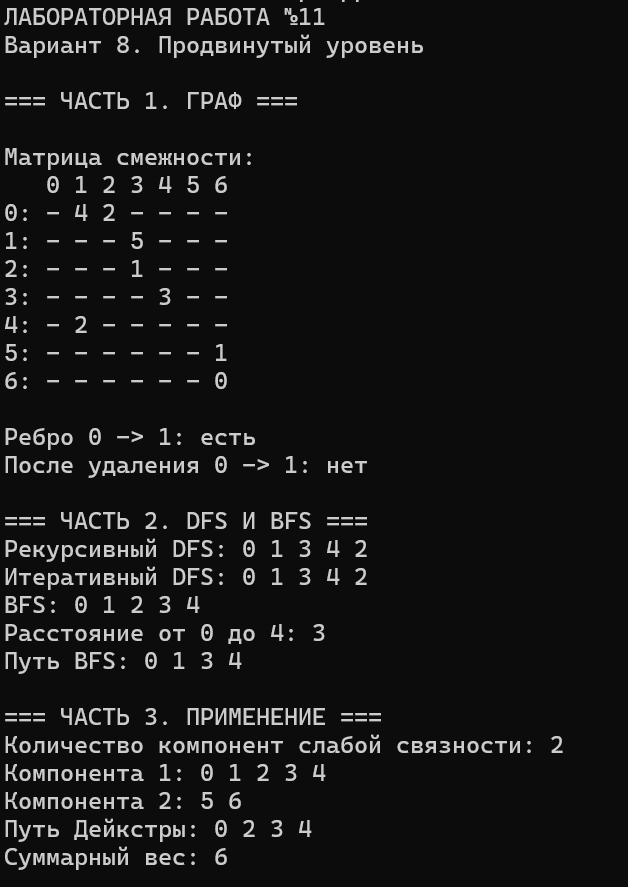

# Лабораторная работа №11
## Представление графов. DFS и BFS

**Студент:** Давлетмурзаев Сайд-Эмин Тимурович  
**Группа:** ПИЖ-б-о-25-1  
**Вариант:** 8  
**Уровень:** Продвинутый  
**Преподаватель:** Белик Ангелина Игоревна

---

## 1. Цель работы

1. Изучить способы представления графов в памяти компьютера.
2. Освоить алгоритмы обхода графа: поиск в глубину (DFS) и поиск в ширину (BFS).
3. Научиться применять DFS и BFS для поиска компонент связности и кратчайших путей.
4. Проанализировать сложность алгоритмов.
5. Изучить особенности работы с ориентированными взвешенными графами.

## 2. Теоретическая часть

**Граф** — математическая структура, состоящая из вершин и рёбер, соединяющих эти вершины.

Основные понятия:

- **Вершина** — элемент графа.
- **Ребро** — связь между двумя вершинами.
- **Ориентированный граф** — граф, в котором рёбра имеют направление.
- **Взвешенный граф** — граф, рёбрам которого присвоены числовые значения.
- **Путь** — последовательность вершин, соединённых рёбрами.
- **Цикл** — путь, начинающийся и заканчивающийся в одной вершине.

### 2.1. Матрица смежности

Матрица смежности — квадратная матрица размером V × V, в которой элемент `[i][j]` хранит информацию о наличии ребра из вершины i в вершину j.

Для взвешенного графа в ячейке хранится вес ребра. Если ребра нет, используется специальное значение.

Преимущества:
- Быстрая проверка наличия ребра — O(1).
- Простое добавление и удаление ребра.
- Удобное представление плотных графов.

Недостаток — большой расход памяти O(V²).

### 2.2. Список смежности

Список смежности — структура, в которой для каждой вершины хранится список связанных с ней вершин.

Преимущества:
- Экономия памяти для разреженных графов.
- Удобный перебор соседей.

Недостаток — проверка наличия ребра может занимать O(deg(u)).

### 2.3. Поиск в глубину (DFS)

DFS (Depth-First Search) — алгоритм обхода графа, который последовательно исследует одну ветвь до тех пор, пока не достигнет вершины без непосещённых соседей. После этого происходит возврат к предыдущим вершинам.

Реализуется рекурсивно или с помощью стека.

### 2.4. Поиск в ширину (BFS)

BFS (Breadth-First Search) — алгоритм обхода графа, который сначала посещает ближайшие соседние вершины, а затем переходит на следующие уровни.

Для реализации используется очередь.

BFS позволяет находить кратчайший путь по количеству рёбер в невзвешенном графе.

## 3. Постановка задачи

Согласно варианту 8 необходимо:

**Часть 1. Представление графа**
- Использовать матрицу смежности.
- Реализовать ориентированный взвешенный граф.
- Реализовать добавление и удаление рёбер.
- Реализовать проверку наличия ребра.
- Реализовать вывод матрицы смежности.

**Часть 2. Обход графа**
- Реализовать рекурсивный DFS.
- Реализовать BFS.
- Найти расстояние между двумя заданными вершинами.

**Часть 3. Применение обходов**
- Создать граф.
- Выполнить DFS и BFS.
- Найти компоненты связности.
- Найти кратчайший путь с помощью BFS.

В рамках продвинутого уровня дополнительно реализованы итеративный DFS и алгоритм Дейкстры для поиска пути с минимальным суммарным весом.

## 4. Реализация программы

Программа написана на языке C++ с использованием стандартной библиотеки.

Основной файл проекта: `main.cpp`.

В программе реализованы:
- Класс `Graph`.
- Матрица смежности для хранения весов рёбер.
- Добавление и удаление рёбер.
- Проверка наличия ребра.
- Вывод матрицы смежности.
- Рекурсивный DFS.
- Итеративный DFS.
- BFS.
- Поиск расстояния между вершинами.
- Поиск компонент слабой связности.
- Алгоритм Дейкстры.

Для просмотра полного исходного кода откройте файл [`main.cpp`](main.cpp).

## 5. Результаты работы

В ходе выполнения программы был создан ориентированный взвешенный граф из семи вершин.

Результаты выполнения:

| Операция | Результат |
|---|---|
| Рекурсивный DFS | 0 1 3 4 2 |
| Итеративный DFS | 0 1 3 4 2 |
| BFS | 0 1 2 3 4 |
| Расстояние от 0 до 4 | 3 |
| Количество компонент слабой связности | 2 |
| Путь Дейкстры | 0 → 2 → 3 → 4 |
| Суммарный вес пути | 6 |

### 5.1. Скриншот выполнения программы



### 5.2. Анализ результатов

Рекурсивный и итеративный DFS дали одинаковый порядок обхода: 0, 1, 3, 4, 2.

BFS обнаружил вершины в порядке 0, 1, 2, 3, 4.

Расстояние от вершины 0 до вершины 4 составляет 3 ребра. Найденный BFS путь: 0 → 1 → 3 → 4.

Алгоритм Дейкстры нашёл путь 0 → 2 → 3 → 4 с суммарным весом 6.

Важно: BFS минимизирует количество рёбер, а алгоритм Дейкстры — суммарный вес пути. Поэтому найденные ими пути могут различаться.

Граф содержит две компоненты слабой связности:
- Первая: 0, 1, 2, 3, 4.
- Вторая: 5, 6.

## 6. Анализ сложности алгоритмов

Обозначения:
- V — количество вершин.
- E — количество рёбер.

Для матрицы смежности:

| Операция | Сложность |
|---|---|
| Хранение графа | O(V²) |
| Проверка наличия ребра | O(1) |
| Добавление ребра | O(1) |
| Удаление ребра | O(1) |
| Перебор соседей вершины | O(V) |
| DFS | O(V²) |
| BFS | O(V²) |
| Поиск компонент слабой связности | O(V²) |
| Алгоритм Дейкстры с матрицей смежности | O(V²) |

Матрица смежности удобна для проверки наличия ребра и работы с плотными графами. Однако обходы с её использованием требуют просмотра всей строки матрицы для каждой обработанной вершины.

## 7. Ответы на контрольные вопросы

**1. Что такое граф? Из каких элементов он состоит?**

Граф — это структура данных, состоящая из множества вершин и множества рёбер, которые соединяют вершины.

**2. Чем отличается ориентированный граф от неориентированного?**

В ориентированном графе рёбра имеют направление. В неориентированном графе связи между вершинами не имеют направления.

**3. Что такое матрица смежности? Каковы её достоинства и недостатки?**

Матрица смежности — квадратная матрица, в которой хранится информация о связях между вершинами. Её достоинства — быстрая проверка наличия ребра и простота реализации. Недостаток — расход памяти O(V²).

**4. Что такое список смежности? Каковы его достоинства и недостатки?**

Список смежности — структура, в которой для каждой вершины хранится список её соседей. Он экономит память на разреженных графах, но проверка наличия ребра может занимать больше времени.

**5. В каких случаях лучше использовать матрицу смежности, а в каких — список смежности?**

Матрицу смежности лучше использовать для плотных графов и быстрой проверки рёбер. Список смежности предпочтительнее для разреженных графов, где количество рёбер значительно меньше V².

**6. Какова сложность проверки наличия ребра в матрице смежности? В списке смежности?**

В матрице смежности — O(1). В списке смежности — O(deg(u)), где deg(u) — количество соседей вершины u.

**7. Какова сложность перебора всех соседей вершины в матрице смежности? В списке смежности?**

В матрице смежности — O(V), в списке смежности — O(deg(u)).

**8. Что такое поиск в глубину (DFS)? Как он работает?**

DFS — алгоритм обхода графа, который исследует одну ветвь максимально глубоко, прежде чем вернуться назад. Для реализации используется рекурсия или стек.

**9. Какие задачи решаются с помощью DFS?**

DFS применяется для поиска компонент связности, проверки наличия циклов, поиска путей, топологической сортировки, а также поиска мостов и точек сочленения.

**10. Что такое поиск в ширину (BFS)? Как он работает?**

BFS — алгоритм обхода графа по уровням. Сначала посещаются все ближайшие вершины, затем вершины следующего уровня. Для реализации используется очередь.

**11. Какие задачи решаются с помощью BFS?**

BFS используется для поиска кратчайшего пути в невзвешенном графе, определения расстояний между вершинами, поиска компонент связности и проверки достижимости вершин.

**12. В чём отличие рекурсивной реализации DFS от итеративной?**

Рекурсивная реализация использует системный стек вызовов функций. Итеративная реализация использует явно созданный стек. Обе выполняют поиск в глубину, но отличаются способом управления обходом.

**13. Почему BFS находит кратчайший путь в невзвешенном графе, а DFS — нет?**

BFS обходит граф по уровням и сначала посещает вершины, находящиеся на минимальном расстоянии от начальной вершины. DFS может сначала пройти по длинному пути, поэтому не гарантирует нахождение кратчайшего пути.

**14. Как найти компоненты связности графа с помощью DFS?**

Необходимо создать массив посещённых вершин и последовательно проверять все вершины графа. Если вершина ещё не посещена, запускается DFS, который посещает все достижимые вершины. Каждый такой запуск определяет отдельную компоненту связности.

Для ориентированного графа способ определения компонент необходимо уточнять. В данной программе определяются компоненты слабой связности.

**15. Как проверить наличие цикла в графе с помощью DFS?**

При обходе необходимо отслеживать посещённые вершины и предков в дереве DFS. Если обнаруживается ребро к уже посещённой вершине, которая не является предком в дереве обхода, можно обнаружить цикл. Для ориентированного графа обычно используют состояния вершин: непосещённая, активная и завершённая.

## 8. Вывод

В ходе лабораторной работы были изучены способы представления графов и освоены алгоритмы DFS и BFS.

Была реализована программа на C++, использующая матрицу смежности для хранения ориентированного взвешенного графа.

Реализованы рекурсивный и итеративный DFS, BFS, поиск расстояния между вершинами, определение компонент слабой связности и алгоритм Дейкстры.

Полученные результаты соответствуют ожидаемому поведению реализованных алгоритмов. Поставленная цель лабораторной работы достигнута.

## 9. Ссылка на Git-репозиторий

[GitHub — cpp-labs](https://github.com/saiddavletmurzaev91-boop/cpp-labs)

---

**Структура папки:**

```text
lab-11/
├── main.cpp
├── README.md
├── result-01.png
└── lab11.exe
```
