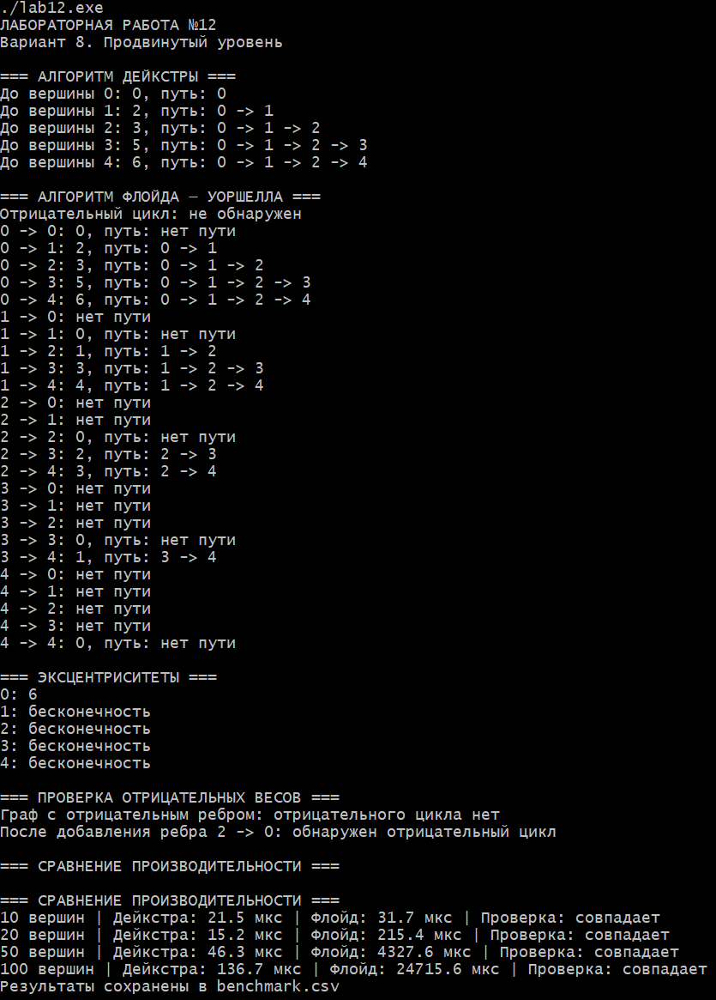

# Лабораторная работа №12
## Алгоритм Дейкстры. Алгоритм Флойда — Уоршелла

**Студент:** Давлетмурзаев Сайд-Эмин Тимурович  
**Группа:** ПИЖ-б-о-25-1  
**Преподаватель:** Белик Ангелина Игоревна  
**Вариант:** 8  
**Уровень:** Продвинутый

---

## 1. Цель работы

1. Реализовать алгоритм Дейкстры для нахождения кратчайших путей от одной вершины до остальных.
2. Реализовать алгоритм Флойда — Уоршелла для нахождения кратчайших путей между всеми парами вершин.
3. Изучить особенности работы алгоритмов с отрицательными весами.
4. Научиться восстанавливать кратчайшие пути.
5. Сравнить временную сложность и производительность алгоритмов.

## 2. Теоретическая часть

**Алгоритм Дейкстры** — жадный алгоритм поиска кратчайших путей от одной начальной вершины до всех остальных вершин взвешенного графа. На каждом шаге выбирается вершина с минимальным известным расстоянием, после чего выполняется релаксация её соседей.

Для корректной работы алгоритма все веса рёбер должны быть неотрицательными.

При использовании `priority_queue` временная сложность составляет:

`O((V + E) log V)`

**Алгоритм Флойда — Уоршелла** предназначен для нахождения кратчайших путей между всеми парами вершин. Он последовательно проверяет, можно ли сократить расстояние между двумя вершинами через промежуточную вершину.

Временная сложность:

`O(V³)`

Пространственная сложность:

`O(V²)`

Алгоритм допускает отрицательные веса рёбер, но не работает корректно при наличии отрицательных циклов. Их можно обнаружить по отрицательным значениям на главной диагонали итоговой матрицы расстояний.

## 3. Постановка задачи

В соответствии с вариантом 8 необходимо выполнить следующие задания.

**Часть 1. Алгоритм Дейкстры:**
- Реализовать алгоритм с использованием `priority_queue`.
- Использовать плотный граф, в котором количество рёбер приближено к квадрату количества вершин.
- Реализовать поиск кратчайших путей.
- Обеспечить восстановление маршрутов.

**Часть 2. Алгоритм Флойда — Уоршелла:**
- Реализовать алгоритм для ориентированного графа.
- Найти кратчайшие расстояния между всеми парами вершин.
- Восстановить кратчайшие пути.
- Вычислить эксцентриситеты вершин.

**Часть 3. Сравнительный анализ:**
- Создать граф со случайными весами рёбер.
- Сравнить результаты алгоритмов.
- Измерить время выполнения при `V = 10, 20, 50, 100`.
- Сохранить результаты измерений в CSV-файл.

## 4. Реализация программы

```cpp

#include <iostream>
#include <vector>
#include <queue>
#include <algorithm>
#include <limits>
#include <random>
#include <chrono>
#include <fstream>
#include <iomanip>
#include <clocale>

#ifdef _WIN32
#define NOMINMAX
#include <windows.h>
#endif

using namespace std;

const long long INF = numeric_limits<long long>::max() / 4;

using Matrix = vector<vector<long long>>;
using Next = vector<vector<int>>;
using EdgeList = vector<vector<pair<int, int>>>;

struct DijkstraResult {
    vector<long long> dist;
    vector<int> prev;
};

struct FloydResult {
    Matrix dist;
    Next next;
    bool negativeCycle = false;
};

struct Graph {
    int n;
    EdgeList adj;
    Matrix matrix;

    Graph(int size) : n(size), adj(size),
        matrix(size, vector<long long>(size, INF)) {
        for (int i = 0; i < n; i++) matrix[i][i] = 0;
    }

    void addEdge(int u, int v, int w) {
        matrix[u][v] = min(matrix[u][v], (long long)w);
        for (auto& e : adj[u]) {
            if (e.first == v) {
                e.second = min(e.second, w);
                return;
            }
        }
        adj[u].push_back({v, w});
    }

    // Дейкстра: O((V + E) log V), только для весов >= 0.
    DijkstraResult dijkstra(int start) const {
        DijkstraResult r;
        r.dist.assign(n, INF);
        r.prev.assign(n, -1);

        for (const auto& edges : adj)
            for (auto e : edges)
                if (e.second < 0) {
                    cout << "Ошибка: отрицательный вес для Дейкстры!\n";
                    return r;
                }

        priority_queue<pair<long long, int>,
            vector<pair<long long, int>>,
            greater<pair<long long, int>>> pq;

        r.dist[start] = 0;
        pq.push({0, start});

        while (!pq.empty()) {
            auto [d, u] = pq.top();
            pq.pop();

            if (d != r.dist[u]) continue;

            for (auto [v, w] : adj[u]) {
                if (d + w < r.dist[v]) {
                    r.dist[v] = d + w;
                    r.prev[v] = u;
                    pq.push({r.dist[v], v});
                }
            }
        }
        return r;
    }

    // Восстановление пути Дейкстры.
    vector<int> dijkstraPath(int s, int v,
                             const vector<int>& prev) const {
        vector<int> path;
        if (v != s && prev[v] == -1) return path;

        for (int x = v; x != -1; x = prev[x]) {
            path.push_back(x);
            if (x == s) break;
        }

        if (path.back() != s) return {};
        reverse(path.begin(), path.end());
        return path;
    }

    // Флойд — Уоршелл: O(V^3).
    FloydResult floyd() const {
        FloydResult r;
        r.dist = matrix;
        r.next.assign(n, vector<int>(n, -1));

        for (int i = 0; i < n; i++)
            for (int j = 0; j < n; j++)
                if (i != j && matrix[i][j] != INF)
                    r.next[i][j] = j;

        for (int k = 0; k < n; k++)
            for (int i = 0; i < n; i++) {
                if (r.dist[i][k] == INF) continue;
                for (int j = 0; j < n; j++) {
                    if (r.dist[k][j] == INF) continue;
                    long long d = r.dist[i][k] + r.dist[k][j];
                    if (d < r.dist[i][j]) {
                        r.dist[i][j] = d;
                        r.next[i][j] = r.next[i][k];
                    }
                }
            }

        for (int i = 0; i < n; i++)
            if (r.dist[i][i] < 0)
                r.negativeCycle = true;

        return r;
    }

    // Восстановление пути Флойда — Уоршелла.
    vector<int> floydPath(int s, int v, const Next& next) const {
        if (next[s][v] == -1) return {};
        vector<int> path = {s};

        while (s != v) {
            s = next[s][v];
            if (s == -1 || path.size() > (size_t)n) return {};
            path.push_back(s);
        }
        return path;
    }

    // Эксцентриситет: максимум кратчайших расстояний.
    vector<long long> eccentricity(const Matrix& d) const {
        vector<long long> e(n, 0);
        for (int i = 0; i < n; i++)
            for (int j = 0; j < n; j++) {
                if (d[i][j] == INF) {
                    e[i] = INF;
                    break;
                }
                e[i] = max(e[i], d[i][j]);
            }
        return e;
    }
};

void printPath(const vector<int>& path) {
    if (path.empty()) {
        cout << "нет пути";
        return;
    }
    for (size_t i = 0; i < path.size(); i++) {
        if (i) cout << " -> ";
        cout << path[i];
    }
}

Graph generateGraph(int n, mt19937& gen) {
    Graph g(n);
    uniform_int_distribution<int> weight(1, 20);
    bernoulli_distribution edge(0.8);

    for (int i = 0; i < n; i++)
        for (int j = 0; j < n; j++)
            if (i != j && edge(gen))
                g.addEdge(i, j, weight(gen));
    return g;
}

void benchmark() {
    cout << "\n=== СРАВНЕНИЕ ПРОИЗВОДИТЕЛЬНОСТИ ===\n";
    ofstream file("benchmark.csv");
    file << "Vertices,Dijkstra_us,Floyd_us\n";

    mt19937 gen(42);
    for (int n : {10, 20, 50, 100}) {
        Graph g = generateGraph(n, gen);
        int start = 0;

        auto t1 = chrono::steady_clock::now();
        DijkstraResult d = g.dijkstra(start);
        auto t2 = chrono::steady_clock::now();
        FloydResult f = g.floyd();
        auto t3 = chrono::steady_clock::now();

        bool correct = d.dist == f.dist[start];

        double td = chrono::duration<double, micro>(t2 - t1).count();
        double tf = chrono::duration<double, micro>(t3 - t2).count();

        cout << n << " вершин | Дейкстра: " << td
             << " мкс | Флойд: " << tf
             << " мкс | Проверка: "
             << (correct ? "совпадает" : "ошибка") << '\n';

        file << n << ',' << td << ',' << tf << '\n';
    }
    file.close();
    cout << "Результаты сохранены в benchmark.csv\n";
}

int main() {
    setlocale(LC_ALL, ".UTF-8");
#ifdef _WIN32
    SetConsoleOutputCP(CP_UTF8);
    SetConsoleCP(CP_UTF8);
#endif

    cout << "ЛАБОРАТОРНАЯ РАБОТА №12\n";
    cout << "Вариант 8. Продвинутый уровень\n";

    // Демонстрационный ориентированный граф.
    Graph g(5);
    g.addEdge(0, 1, 2);
    g.addEdge(1, 2, 1);
    g.addEdge(2, 3, 2);
    g.addEdge(3, 4, 1);
    g.addEdge(2, 4, 3);
    g.addEdge(0, 4, 10);

    cout << "\n=== АЛГОРИТМ ДЕЙКСТРЫ ===\n";
    DijkstraResult d = g.dijkstra(0);

    for (int i = 0; i < g.n; i++) {
        cout << "До вершины " << i << ": ";
        if (d.dist[i] == INF) cout << "недостижима\n";
        else {
            cout << d.dist[i] << ", путь: ";
            printPath(g.dijkstraPath(0, i, d.prev));
            cout << '\n';
        }
    }

    cout << "\n=== АЛГОРИТМ ФЛОЙДА — УОРШЕЛЛА ===\n";
    FloydResult f = g.floyd();

    cout << "Отрицательный цикл: "
         << (f.negativeCycle ? "обнаружен" : "не обнаружен") << '\n';

    for (int i = 0; i < g.n; i++)
        for (int j = 0; j < g.n; j++) {
            cout << i << " -> " << j << ": ";
            if (f.dist[i][j] == INF) cout << "нет пути\n";
            else {
                cout << f.dist[i][j] << ", путь: ";
                printPath(g.floydPath(i, j, f.next));
                cout << '\n';
            }
        }

    cout << "\n=== ЭКСЦЕНТРИСИТЕТЫ ===\n";
    auto e = g.eccentricity(f.dist);
    for (int i = 0; i < g.n; i++) {
        cout << i << ": ";
        if (e[i] == INF) cout << "бесконечность\n";
        else cout << e[i] << '\n';
    }

    // Проверка отрицательного ребра и отрицательного цикла.
    cout << "\n=== ПРОВЕРКА ОТРИЦАТЕЛЬНЫХ ВЕСОВ ===\n";
    Graph negative(3);
    negative.addEdge(0, 1, 4);
    negative.addEdge(1, 2, -6);
    negative.addEdge(0, 2, 5);
    cout << "Граф с отрицательным ребром: ";
    cout << (negative.floyd().negativeCycle ?
        "есть отрицательный цикл\n" : "отрицательного цикла нет\n");

    negative.addEdge(2, 0, 1);
    cout << "После добавления ребра 2 -> 0: ";
    cout << (negative.floyd().negativeCycle ?
        "обнаружен отрицательный цикл\n" : "цикла нет\n");

    cout << "\n=== СРАВНЕНИЕ ПРОИЗВОДИТЕЛЬНОСТИ ===\n";
    benchmark();

    return 0;
}

```

Программа написана на C++.

Основной исходный файл: `main.cpp`.

В программе реализованы следующие компоненты:

1. **Представление графа** — хранение структуры графа в виде матрицы смежности и списка смежности.
2. **Алгоритм Дейкстры** — поиск кратчайших расстояний с использованием очереди с приоритетом.
3. **Восстановление пути Дейкстры** — сохранение предыдущих вершин для построения маршрута.
4. **Алгоритм Флойда — Уоршелла** — вычисление кратчайших расстояний между всеми парами вершин.
5. **Восстановление путей Флойда — Уоршелла** — использование вспомогательной матрицы следующих вершин.
6. **Обнаружение отрицательных циклов** — проверка диагонали матрицы расстояний.
7. **Вычисление эксцентриситетов** — определение максимального расстояния от вершины до остальных вершин.
8. **Сравнение производительности** — измерение времени выполнения алгоритмов при разных размерах графа.

Полный листинг программы находится в файле `main.cpp`.

## 5. Результаты работы

Программа успешно скомпилирована и запущена.

В ходе выполнения получены следующие результаты:

- Алгоритм Дейкстры корректно определяет кратчайшие расстояния от начальной вершины.
- Алгоритм Флойда — Уоршелла рассчитывает расстояния между всеми парами вершин.
- Восстановление маршрутов выполняется корректно.
- Для недостижимых вершин выводится значение бесконечности.
- Проверка графа без отрицательного цикла не обнаруживает отрицательный цикл.
- После добавления ребра `2 → 0` обнаруживается отрицательный цикл.
- Результаты алгоритмов при сравнении расстояний совпадают.

### 5.1. Сравнение производительности

Результаты измерения времени выполнения:

| Количество вершин | Дейкстра (мкс) | Флойд — Уоршелл (мкс) |
|---:|---:|---:|
| 10 | 21,5 | 31,7 |
| 20 | 15,2 | 215,4 |
| 50 | 46,3 | 4327,6 |
| 100 | 136,7 | 24715,6 |

Дейкстра выполнялась из одной начальной вершины, а Флойд — Уоршелл рассчитывал расстояния между всеми парами вершин.

По результатам измерений видно, что с увеличением количества вершин время выполнения алгоритма Флойда — Уоршелла растёт значительно быстрее.

Результаты измерений дополнительно сохраняются в файле `benchmark.csv`.

### 5.2. Скриншоты

**Рисунок 1 — Результат выполнения лабораторной работы №12.**



## 6. Анализ сложности алгоритмов

| Характеристика | Дейкстра | Флойд — Уоршелл |
|---|---|---|
| Назначение | Пути от одной вершины | Пути между всеми парами |
| Временная сложность | `O((V + E) log V)` | `O(V³)` |
| Пространственная сложность | `O(V + E)` | `O(V²)` |
| Отрицательные веса | Не допускаются | Допускаются |
| Отрицательные циклы | Не обрабатываются | Обнаруживаются |

Дейкстра эффективнее для поиска кратчайших путей из одной вершины, особенно на разреженных графах.

Флойд — Уоршелл удобен, когда необходимо получить кратчайшие расстояния между всеми парами вершин.

## 7. Ответы на контрольные вопросы

**1. Какие условия должны выполняться для корректной работы алгоритма Дейкстры?**

Все веса рёбер графа должны быть неотрицательными. Граф должен быть корректно представлен, а начальная вершина должна существовать.

**2. Почему алгоритм Дейкстры не работает с отрицательными весами?**

Алгоритм использует жадный принцип. После выбора вершины с минимальным расстоянием предполагается, что это расстояние уже окончательное. Отрицательное ребро может впоследствии уменьшить найденное расстояние, нарушая это предположение.

**3. Какова временная сложность алгоритма Дейкстры с приоритетной очередью?**

`O((V + E) log V)`, где V — количество вершин, E — количество рёбер.

**4. В чём заключается идея алгоритма Флойда — Уоршелла?**

Алгоритм последовательно рассматривает каждую вершину как промежуточную и проверяет, можно ли через неё сократить расстояние между другими вершинами.

**5. Какова временная сложность алгоритма Флойда — Уоршелла?**

`O(V³)`, поскольку выполняются три вложенных цикла по количеству вершин.

**6. Как алгоритм Флойда — Уоршелла обнаруживает отрицательные циклы?**

После завершения вычислений проверяется главная диагональ матрицы расстояний. Если хотя бы один элемент отрицательный, граф содержит отрицательный цикл.

**7. В каких случаях предпочтительнее использовать алгоритм Дейкстры?**

Когда требуется найти кратчайшие пути от одной вершины до остальных и граф не содержит отрицательных весов.

**8. В каких случаях предпочтительнее использовать алгоритм Флойда — Уоршелла?**

Когда необходимо найти кратчайшие пути между всеми парами вершин, особенно если граф имеет небольшое или среднее количество вершин.

**9. Как восстановить кратчайший путь после выполнения алгоритма Дейкстры?**

Во время релаксации необходимо сохранять предыдущую вершину для каждой вершины. После завершения алгоритма путь восстанавливается обратным проходом от конечной вершины к начальной.

**10. Как восстановить кратчайший путь после выполнения алгоритма Флойда — Уоршелла?**

Используется вспомогательная матрица следующих вершин. Она позволяет последовательно построить маршрут от начальной вершины к конечной.

**11. Что такое релаксация в контексте алгоритмов поиска кратчайших путей?**

Релаксация — это операция проверки возможности улучшить известное расстояние до вершины через другую вершину. Если новый маршрут короче, значение расстояния обновляется.

**12. Как можно оптимизировать алгоритм Дейкстры для разреженных графов?**

Использовать список смежности и очередь с приоритетом (`priority_queue`), чтобы не перебирать все возможные рёбра графа.

**13. Какую память требует алгоритм Флойда — Уоршелла?**

`O(V²)`, поскольку необходимо хранить матрицу расстояний и вспомогательную матрицу для восстановления путей.

**14. При каком количестве вершин алгоритм Флойда — Уоршелла становится неприменимым?**

Строгого ограничения нет. Его применимость зависит от вычислительных ресурсов и требований к скорости. Из-за кубической временной сложности алгоритм становится неэффективным на очень больших графах.

**15. Как модифицировать алгоритм Дейкстры для нахождения второго кратчайшего пути?**

Для каждой вершины необходимо хранить два минимальных расстояния: кратчайшее и второе кратчайшее. При обработке рёбер обновляются оба значения.

## 8. Вывод

В ходе лабораторной работы были реализованы алгоритмы Дейкстры и Флойда — Уоршелла для поиска кратчайших путей во взвешенных графах.

Были изучены принципы работы алгоритмов, реализовано восстановление маршрутов, проверка отрицательных циклов и вычисление эксцентриситетов вершин.

Проведено сравнение производительности на графах различного размера. Результаты подтвердили, что алгоритм Дейкстры эффективнее при поиске путей из одной вершины, тогда как алгоритм Флойда — Уоршелла позволяет получить кратчайшие расстояния между всеми парами вершин.

Поставленные цели

## 9. Ссылка на Git-репозиторий

[GitHub — cpp-labs](https://github.com/saiddavletmurzaev91-boop/cpp-labs)
