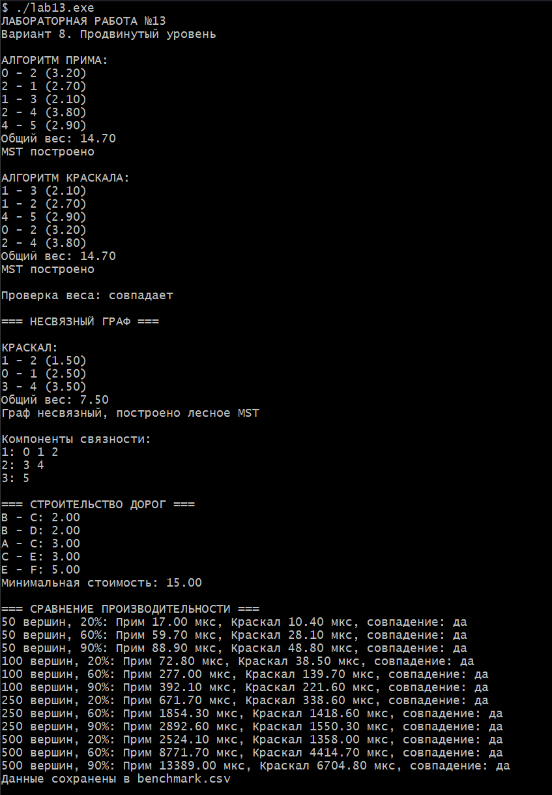

# Лабораторная работа №13
## Алгоритмы Прима и Краскала. Минимальное остовное дерево

**Студент:** Давлетмурзаев Сайд-Эмин Тимурович  
**Группа:** ПИЖ-б-о-25-1  
**Преподаватель:** Белик Ангелина Игоревна  
**Вариант:** 8  
**Уровень:** Продвинутый

---

## 1. Цель работы

1. Изучить понятие минимального остовного дерева (MST).
2. Реализовать алгоритм Прима с использованием `priority_queue`.
3. Реализовать алгоритм Краскала с использованием DSU.
4. Научиться работать с вещественными весами рёбер.
5. Сравнить производительность алгоритмов на графах различной плотности.
6. Применить MST для решения практической задачи построения сети дорог.

## 2. Теоретическая часть

**Минимальное остовное дерево (MST)** — это остовное дерево связного взвешенного графа с минимальной суммой весов рёбер.

Основные свойства:
- содержит все вершины исходного графа;
- не содержит циклов;
- имеет ровно V − 1 ребро;
- обладает минимальной суммой весов.

**Алгоритм Прима** — жадный алгоритм, который начинает с выбранной вершины и постепенно добавляет минимальные рёбра, соединяющие построенное дерево с ещё не включёнными вершинами.

В данной работе используется `priority_queue`.

Сложность: `O((V + E) log V)`.

**Алгоритм Краскала** — алгоритм, который сортирует рёбра по возрастанию веса и добавляет их в остовное дерево, если они не образуют цикл.

Для проверки циклов используется DSU.

**DSU (Disjoint Set Union)** — структура данных для работы с непересекающимися множествами. Она поддерживает операции поиска представителя множества и объединения двух множеств.

Сложность алгоритма Краскала: `O(E log E)`.

## 3. Постановка задачи

Для варианта 8 необходимо:

**Алгоритм Прима:**
- использовать `priority_queue`;
- реализовать поиск MST с указанной начальной вершиной.

**Алгоритм Краскала:**
- использовать DSU;
- поддерживать вещественные веса рёбер.

**Практическая задача:**
- построить минимальную сеть дорог между городами;
- вывести список дорог и общую стоимость;
- при несвязном графе вывести компоненты связности.

**Сравнение производительности:**
- проверить графы различного размера;
- использовать плотность 20%, 60% и 90%;
- измерить время выполнения обоих алгоритмов.

## 4. Реализация программы

```cpp

#include <iostream>
#include <vector>
#include <queue>
#include <algorithm>
#include <numeric>
#include <random>
#include <chrono>
#include <fstream>
#include <iomanip>
#include <cmath>
#ifdef _WIN32
#define NOMINMAX
#include <windows.h>
#endif
using namespace std;
using Clock = chrono::high_resolution_clock;

struct Edge {
    int u, v;
    double w;
};

struct Graph {
    int n;
    vector<Edge> e;
    vector<vector<pair<int, double>>> adj;

    Graph(int n) : n(n), adj(n) {}

    void add(int u, int v, double w) {
        if (u == v || u < 0 || v < 0 || u >= n || v >= n) return;
        e.push_back({u, v, w});
        adj[u].push_back({v, w});
        adj[v].push_back({u, w});
    }
};

struct DSU {
    vector<int> p, r;

    DSU(int n) : p(n), r(n, 0) {
        iota(p.begin(), p.end(), 0);
    }

    int find(int x) {
        return p[x] == x ? x : p[x] = find(p[x]);
    }

    bool unite(int a, int b) {
        a = find(a);
        b = find(b);
        if (a == b) return false;
        if (r[a] < r[b]) swap(a, b);
        p[b] = a;
        if (r[a] == r[b]) ++r[a];
        return true;
    }
};

struct Result {
    vector<Edge> edges;
    double cost = 0;
    bool connected = false;
};

// Алгоритм Прима с priority_queue.
Result prim(const Graph& g, int start) {
    Result res;
    if (start < 0 || start >= g.n) return res;

    vector<bool> used(g.n, false);
    using Item = tuple<double, int, int>;
    priority_queue<Item, vector<Item>, greater<Item>> pq;
    pq.push({0, start, -1});

    while (!pq.empty()) {
        auto [w, v, from] = pq.top();
        pq.pop();
        if (used[v]) continue;

        used[v] = true;
        if (from != -1) {
            res.edges.push_back({from, v, w});
            res.cost += w;
        }

        for (auto [to, weight] : g.adj[v])
            if (!used[to]) pq.push({weight, to, v});
    }

    res.connected = res.edges.size() == static_cast<size_t>(g.n - 1);
    return res;
}

// Алгоритм Краскала с DSU.
Result kruskal(const Graph& g) {
    Result res;
    vector<Edge> edges = g.e;

    sort(edges.begin(), edges.end(),
         [](const Edge& a, const Edge& b) { return a.w < b.w; });

    DSU dsu(g.n);
    for (auto edge : edges) {
        if (dsu.unite(edge.u, edge.v)) {
            res.edges.push_back(edge);
            res.cost += edge.w;
        }
    }

    res.connected = res.edges.size() == static_cast<size_t>(g.n - 1);
    return res;
}

// Компоненты связности.
void components(const Graph& g) {
    DSU dsu(g.n);
    for (auto e : g.e) dsu.unite(e.u, e.v);

    vector<vector<int>> groups(g.n);
    for (int i = 0; i < g.n; ++i)
        groups[dsu.find(i)].push_back(i);

    cout << "\nКомпоненты связности:\n";
    int k = 0;
    for (auto& group : groups) {
        if (group.empty()) continue;
        cout << ++k << ": ";
        for (int v : group) cout << v << " ";
        cout << "\n";
    }
}

void print(const Result& r, const string& name) {
    cout << "\n" << name << ":\n";
    for (auto e : r.edges)
        cout << e.u << " - " << e.v << " (" << e.w << ")\n";

    cout << "Общий вес: " << r.cost << "\n";
    cout << (r.connected ? "MST построено\n" :
                              "Граф несвязный, построено лесное MST\n");
}

// Практическая задача: минимальная сеть дорог.
void cityTask() {
    vector<string> city = {"A", "B", "C", "D", "E", "F"};
    Graph g(6);

    g.add(0, 1, 4); g.add(0, 2, 3);
    g.add(1, 2, 2); g.add(1, 3, 2);
    g.add(2, 4, 3); g.add(3, 4, 5);
    g.add(4, 5, 5);

    Result r = kruskal(g);
    cout << "\n=== СТРОИТЕЛЬСТВО ДОРОГ ===\n";
    for (auto e : r.edges)
        cout << city[e.u] << " - " << city[e.v]
             << ": " << e.w << "\n";
    cout << "Минимальная стоимость: " << r.cost << "\n";
}

// Генерация связного графа заданной плотности.
Graph generate(int n, int density, mt19937& rng) {
    Graph g(n);
    uniform_real_distribution<double> weight(1, 100);
    vector<vector<bool>> used(n, vector<bool>(n, false));

    for (int i = 1; i < n; ++i) {
        g.add(i - 1, i, weight(rng));
        used[i - 1][i] = used[i][i - 1] = true;
    }

    int target = max(n - 1, n * (n - 1) / 2 * density / 100);
    uniform_int_distribution<int> vertex(0, n - 1);

    while (static_cast<int>(g.e.size()) < target) {
        int u = vertex(rng), v = vertex(rng);
        if (u != v && !used[u][v]) {
            g.add(u, v, weight(rng));
            used[u][v] = used[v][u] = true;
        }
    }
    return g;
}

// Сравнение времени работы алгоритмов.
void benchmark() {
    ofstream file("benchmark.csv");
    file << "Vertices,Density,Edges,Prim_us,Kruskal_us,Equal\n";

    mt19937 rng(42);
    cout << "\n=== СРАВНЕНИЕ ПРОИЗВОДИТЕЛЬНОСТИ ===\n";

    for (int n : {50, 100, 250, 500}) {
        for (int d : {20, 60, 90}) {
            Graph g = generate(n, d, rng);

            auto t1 = Clock::now();
            Result a = prim(g, 0);
            auto t2 = Clock::now();
            Result b = kruskal(g);
            auto t3 = Clock::now();

            double pt = chrono::duration<double, micro>(t2 - t1).count();
            double kt = chrono::duration<double, micro>(t3 - t2).count();
            bool equal = abs(a.cost - b.cost) < 1e-8;

            cout << n << " вершин, " << d << "%: Прим "
                 << pt << " мкс, Краскал " << kt
                 << " мкс, совпадение: " << (equal ? "да" : "нет") << "\n";

            file << n << "," << d << "," << g.e.size()
                 << "," << pt << "," << kt
                 << "," << (equal ? "yes" : "no") << "\n";
        }
    }
    cout << "Данные сохранены в benchmark.csv\n";
}

int main() {
#ifdef _WIN32
    SetConsoleOutputCP(CP_UTF8);
    SetConsoleCP(CP_UTF8);
#endif
    cout << fixed << setprecision(2);
    cout << "ЛАБОРАТОРНАЯ РАБОТА №13\nВариант 8. Продвинутый уровень\n";

    Graph g(6);
    g.add(0, 1, 4.5); g.add(0, 2, 3.2);
    g.add(1, 2, 2.7); g.add(1, 3, 2.1);
    g.add(2, 4, 3.8); g.add(3, 4, 5.4);
    g.add(3, 5, 6.2); g.add(4, 5, 2.9);

    Result p = prim(g, 0);
    Result k = kruskal(g);

    print(p, "АЛГОРИТМ ПРИМА");
    print(k, "АЛГОРИТМ КРАСКАЛА");

    cout << "\nПроверка веса: "
         << (abs(p.cost - k.cost) < 1e-8 ? "совпадает" : "не совпадает")
         << "\n";

    cout << "\n=== НЕСВЯЗНЫЙ ГРАФ ===\n";
    Graph disconnected(6);
    disconnected.add(0, 1, 2.5);
    disconnected.add(1, 2, 1.5);
    disconnected.add(3, 4, 3.5);
    print(kruskal(disconnected), "КРАСКАЛ");
    components(disconnected);

    cityTask();
    benchmark();
    return 0;
}

```
Язык программирования: C++17.

Основной файл: [main.cpp](main.cpp).

В программе реализованы:
1. Структура графа со списком смежности и списком рёбер.
2. Алгоритм Прима с приоритетной очередью.
3. Алгоритм Краскала с использованием DSU.
4. Система непересекающихся множеств с оптимизацией сжатием пути и объединением по рангу.
5. Поддержка вещественных весов.
6. Проверка связности и построение минимального остовного леса.
7. Определение компонент связности.
8. Практическая задача строительства дорог.
9. Генерация графов различной плотности.
10. Измерение времени работы алгоритмов и сохранение результатов в CSV.

## 5. Результаты работы

Программа успешно скомпилирована и запущена.

В основном тестовом графе оба алгоритма построили минимальное остовное дерево с одинаковой стоимостью:

**Общий вес MST: 14,70.**

Результаты проверки подтвердили совпадение весов алгоритмов Прима и Краскала.

### 5.1. Проверка несвязного графа

Для несвязного графа программа построила минимальный остовный лес и определила три компоненты связности:

| Компонента | Вершины |
|---|---|
| 1 | 0, 1, 2 |
| 2 | 3, 4 |
| 3 | 5 |

Общий вес построенного леса: **7,50**.

### 5.2. Практическая задача — строительство дорог

Для соединения шести городов программа определила следующие дороги:

| Дорога | Стоимость |
|---|---:|
| B – C | 2 |
| B – D | 2 |
| A – C | 3 |
| C – E | 3 |
| E – F | 5 |
| **Итого** | **15** |

Минимальная рассчитанная стоимость составляет **15,00**.

Примечание: в методичке указана стоимость 16, однако сумма перечисленных в ней дорог равна 2 + 2 + 3 + 3 + 5 = 15. Программа использует фактическую сумму весов рёбер.

### 5.3. Сравнение производительности

Результаты измерений времени выполнения (микросекунды):

| Вершины | Плотность | Прим | Краскал |
|---:|---:|---:|---:|
| 50 | 20% | 17,00 | 10,40 |
| 50 | 60% | 59,70 | 28,10 |
| 50 | 90% | 88,90 | 48,80 |
| 100 | 20% | 72,80 | 38,50 |
| 100 | 60% | 277,00 | 139,70 |
| 100 | 90% | 392,10 | 243,60 |
| 250 | 20% | 671,70 | 338,60 |
| 250 | 60% | 1854,30 | 1418,60 |
| 250 | 90% | 2892,60 | 1550,30 |
| 500 | 20% | 2524,10 | 1358,00 |
| 500 | 60% | 8771,70 | 4414,70 |
| 500 | 90% | 13389,00 | 6704,80 |

На проверенных графах Краскал показал меньшее время выполнения. Это результат конкретных тестов и реализации, а не универсальное преимущество алгоритма.

Результаты измерений сохраняются в файле `benchmark.csv`.

### 5.4. Скриншот

**Рисунок 1 — Результат выполнения лабораторной работы №13.**



## 6. Анализ сложности алгоритмов

| Характеристика | Прим | Краскал |
|---|---|---|
| Основной принцип | Постепенное расширение дерева | Сортировка рёбер |
| Структуры данных | `priority_queue` | DSU |
| Временная сложность | `O((V + E) log V)` | `O(E log E)` |
| Пространственная сложность | `O(V + E)` | `O(V + E)` |
| Работа с вещественными весами | Да | Да |
| Обработка несвязного графа | Минимальный лес из начальной компоненты | Минимальный остовный лес |

Прим удобен для построения дерева от заданной начальной вершины. Краскал удобен при обработке списка рёбер и позволяет эффективно проверять циклы с помощью DSU.

## 7. Ответы на контрольные вопросы

**1. Что такое минимальное остовное дерево (MST)?**

Это остовное дерево связного взвешенного графа, сумма весов рёбер которого минимальна.

**2. Какие свойства имеет минимальное остовное дерево?**

Оно содержит все вершины графа, не содержит циклов, имеет V − 1 ребро и минимальную суммарную стоимость.

**3. В чём заключается идея алгоритма Прима?**

Алгоритм начинает с одной вершины и последовательно добавляет минимальное ребро, соединяющее построенное дерево с новой вершиной.

**4. Какова временная сложность алгоритма Прима на матрице смежности?**

`O(V²)`.

**5. Какова временная сложность алгоритма Прима с приоритетной очередью?**

`O((V + E) log V)`.

**6. В чём заключается идея алгоритма Краскала?**

Все рёбра сортируются по весу. Затем они добавляются в остовное дерево, если не образуют цикл.

**7. Что такое DSU и как она используется в алгоритме Краскала?**

DSU — структура данных для хранения непересекающихся множеств. Она проверяет, принадлежат ли две вершины одному множеству, и объединяет множества при добавлении ребра.

**8. Какова временная сложность алгоритма Краскала?**

`O(E log E)`, поскольку основное время занимает сортировка рёбер. Операции DSU выполняются практически за константное амортизированное время.

**9. В каких случаях алгоритм Прима эффективнее алгоритма Краскала?**

Прим часто удобен для плотных графов и при использовании матрицы смежности или эффективной очереди с приоритетом.

**10. В каких случаях алгоритм Краскала эффективнее алгоритма Прима?**

Краскал часто эффективен на разреженных графах, особенно когда список рёбер уже доступен.

**11. Как проверить, что построенное дерево является минимальным?**

Можно проверить отсутствие циклов, наличие V − 1 ребра, связность всех вершин и сравнить результат с другим алгоритмом построения MST.

**12. Что произойдёт, если граф не связный?**

Единого остовного дерева не существует. Алгоритм Краскала может построить минимальный остовный лес, состоящий из нескольких компонент.

**13. Как модифицировать алгоритмы для поиска максимального остовного дерева?**

Необходимо выбирать рёбра в порядке убывания веса вместо возрастания. Для Краскала достаточно изменить порядок сортировки.

**14. Где применяются MST в реальной жизни?**

При проектировании дорожных сетей, телекоммуникаций, электросетей, компьютерных сетей и других систем, где требуется соединить объекты с минимальными затратами.

**15. Как найти второй по минимальности вес MST?**

Сначала строится минимальное остовное дерево. Затем рассматриваются альтернативные деревья, полученные заменой рёбер MST другими рёбрами графа без образования циклов. Выбирается вариант с наименьшим весом, превышающим вес исходного MST.

## 8. Вывод

В ходе лабораторной работы были изучены и реализованы алгоритмы Прима и Краскала для построения минимального остовного дерева.

Алгоритм Прима реализован с использованием `priority_queue`, а алгоритм Краскала — с использованием DSU и вещественных весов рёбер.

Проверена работа алгоритмов на связном и несвязном графах. Реализована практическая задача строительства сети дорог, а также проведено сравнение производительности на графах различного размера и плотности.

В результате тестирования оба алгоритма показали одинаковый вес минимального остовного дерева на проверяемых связных графах. Поставленные цели лабораторной работы достигнуты.

## 9. Ссылка на GitHub

Репозиторий:  
https://github.com/saiddavletmurzaev91-boop/cpp-labs

Папка лабораторной работы: `lab-13/`
