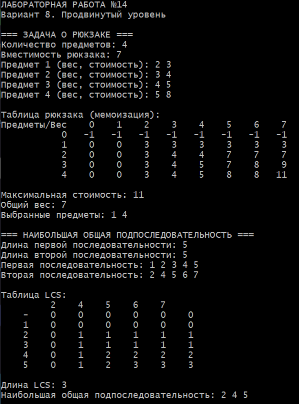

# Лабораторная работа №14
## Динамическое программирование. Задача о рюкзаке. Наибольшая общая подпоследовательность (LCS)

**Студент:** Давлетмурзаев Сайд-Эмин Тимурович  
**Группа:** ПИЖ-б-о-25-1  
**Преподаватель:** Белик Ангелина Игоревна  
**Вариант:** 8  
**Уровень:** Продвинутый

---

## 1. Цель работы

1. Изучить основные принципы динамического программирования.
2. Реализовать задачу о рюкзаке 0/1 с помощью рекурсии и мемоизации.
3. Реализовать восстановление выбранных предметов.
4. Реализовать алгоритм поиска наибольшей общей подпоследовательности (LCS) для двух массивов чисел.
5. Научиться восстанавливать найденную подпоследовательность.

## 2. Теоретическая часть

**Динамическое программирование (ДП)** — метод решения задач, при котором сложная задача разбивается на более простые подзадачи, результаты которых сохраняются для повторного использования.

Основные принципы:

- **Оптимальная подструктура** — оптимальное решение задачи содержит оптимальные решения подзадач.
- **Перекрывающиеся подзадачи** — одни и те же подзадачи возникают многократно.
- **Мемоизация** — сохранение результатов вычислений для предотвращения повторных вычислений.

Существуют два основных подхода:

- **Top-down** — рекурсивное решение с мемоизацией.
- **Bottom-up** — последовательное заполнение таблицы динамического программирования.

### 2.1. Задача о рюкзаке 0/1

Дано N предметов. Каждый предмет имеет вес и стоимость. Необходимо выбрать предметы так, чтобы суммарный вес не превышал вместимость рюкзака, а суммарная стоимость была максимальной.

Каждый предмет можно взять только один раз.

Рекуррентное соотношение:

\[
DP(i,W)=\max(DP(i-1,W),\ value_i+DP(i-1,W-w_i))
\]

Если предмет не помещается, он пропускается.

### 2.2. Наибольшая общая подпоследовательность (LCS)

LCS — наибольшая последовательность элементов, которая встречается в двух исходных последовательностях в одинаковом порядке, но не обязательно подряд.

Рекуррентное соотношение:

\[
DP(i,j)=
\begin{cases}
DP(i-1,j-1)+1, & a_i=b_j\\
\max(DP(i-1,j),DP(i,j-1)), & a_i\ne b_j
\end{cases}
\]

Для восстановления результата используется обратный проход по заполненной таблице.

## 3. Постановка задачи

Согласно варианту 8 необходимо выполнить следующие задания.

**Часть 1. Задача о рюкзаке:**
- использовать рекурсию с мемоизацией (top-down);
- найти максимальную стоимость предметов;
- восстановить выбранные предметы;
- вывести общий вес выбранных предметов.

**Часть 2. LCS:**
- использовать табличный метод (bottom-up);
- выполнять поиск для массивов чисел;
- определить длину наибольшей общей подпоследовательности;
- восстановить найденную последовательность.

**Общая часть:**
- запросить у пользователя входные данные;
- вывести таблицы динамического программирования;
- вывести результаты вычислений.

## 4. Реализация программы

```cpp
#ifdef _WIN32
#define NOMINMAX
#include <windows.h>
#endif

#include <iostream>
#include <vector>
#include <functional>
#include <algorithm>
#include <iomanip>
#include <limits>

using namespace std;

int main() {
    #ifdef _WIN32
        SetConsoleOutputCP(CP_UTF8);
        SetConsoleCP(CP_UTF8);
    #endif
    cout << "ЛАБОРАТОРНАЯ РАБОТА №14\n";
    cout << "Вариант 8. Продвинутый уровень\n";

    // ===== ЗАДАЧА О РЮКЗАКЕ =====
    int n, W;

    cout << "\n=== ЗАДАЧА О РЮКЗАКЕ ===\n";
    cout << "Количество предметов: ";
    cin >> n;
    cout << "Вместимость рюкзака: ";
    cin >> W;

    if (!cin || n <= 0 || W < 0) {
        cout << "Некорректные входные данные.\n";
        return 1;
    }

    vector<int> weight(n), value(n);

    for (int i = 0; i < n; ++i) {
        cout << "Предмет " << i + 1 << " (вес, стоимость): ";
        cin >> weight[i] >> value[i];

        if (!cin || weight[i] <= 0 || value[i] < 0) {
            cout << "Некорректные данные предмета.\n";
            return 1;
        }
    }

    // Top-down: рекурсия с мемоизацией.
    vector<vector<long long>> dp(n + 1,
        vector<long long>(W + 1, -1));

    function<long long(int, int)> solve = [&](int i, int cap) {
        if (i == 0) return 0LL;

        long long& ans = dp[i][cap];
        if (ans != -1) return ans;

        ans = solve(i - 1, cap);

        if (weight[i - 1] <= cap) {
            ans = max(ans, value[i - 1] +
                solve(i - 1, cap - weight[i - 1]));
        }

        return ans;
    };

    for (int cap = 0; cap <= W; ++cap)
        solve(n, cap);

    cout << "\nТаблица рюкзака (мемоизация):\n";
    cout << "Предметы/Вес";

    for (int j = 0; j <= W; ++j)
        cout << setw(5) << j;
    cout << "\n";

    for (int i = 0; i <= n; ++i) {
        cout << setw(12) << i;
        for (int j = 0; j <= W; ++j)
            cout << setw(5) << dp[i][j];
        cout << "\n";
    }

    long long best = solve(n, W);
    int totalWeight = 0;
    vector<int> selected;

    // Восстановление выбранных предметов.
    int cap = W;

    for (int i = n; i > 0; --i) {
        if (solve(i, cap) != solve(i - 1, cap)) {
            selected.push_back(i);
            totalWeight += weight[i - 1];
            cap -= weight[i - 1];
        }
    }

    reverse(selected.begin(), selected.end());

    cout << "\nМаксимальная стоимость: " << best << "\n";
    cout << "Общий вес: " << totalWeight << "\n";
    cout << "Выбранные предметы: ";

    if (selected.empty()) cout << "нет";
    for (int id : selected) cout << id << " ";
    cout << "\n";

    // ===== НАИБОЛЬШАЯ ОБЩАЯ ПОДПОСЛЕДОВАТЕЛЬНОСТЬ =====
    cout << "\n=== НАИБОЛЬШАЯ ОБЩАЯ ПОДПОСЛЕДОВАТЕЛЬНОСТЬ ===\n";

    int m, k;
    cout << "Длина первой последовательности: ";
    cin >> m;
    cout << "Длина второй последовательности: ";
    cin >> k;

    if (!cin || m < 0 || k < 0) {
        cout << "Некорректные размеры последовательностей.\n";
        return 1;
    }

    vector<int> a(m), b(k);

    cout << "Первая последовательность: ";
    for (int& x : a) cin >> x;

    cout << "Вторая последовательность: ";
    for (int& x : b) cin >> x;

    if (!cin) {
        cout << "Ошибка ввода последовательностей.\n";
        return 1;
    }

    // Bottom-up: табличное динамическое программирование.
    vector<vector<int>> lcs(m + 1, vector<int>(k + 1, 0));

    for (int i = 1; i <= m; ++i) {
        for (int j = 1; j <= k; ++j) {
            if (a[i - 1] == b[j - 1])
                lcs[i][j] = lcs[i - 1][j - 1] + 1;
            else
                lcs[i][j] = max(lcs[i - 1][j], lcs[i][j - 1]);
        }
    }

    cout << "\nТаблица LCS:\n";
    cout << setw(5) << " ";

    for (int x : b) cout << setw(5) << x;
    cout << "\n";

    for (int i = 0; i <= m; ++i) {
        if (i == 0) cout << setw(5) << "-";
        else cout << setw(5) << a[i - 1];

        for (int j = 0; j <= k; ++j)
            cout << setw(5) << lcs[i][j];
        cout << "\n";
    }

    // Восстановление LCS.
    vector<int> result;
    int i = m, j = k;

    while (i > 0 && j > 0) {
        if (a[i - 1] == b[j - 1]) {
            result.push_back(a[i - 1]);
            --i;
            --j;
        } else if (lcs[i - 1][j] >= lcs[i][j - 1]) {
            --i;
        } else {
            --j;
        }
    }

    reverse(result.begin(), result.end());

    cout << "\nДлина LCS: " << lcs[m][k] << "\n";
    cout << "Наибольшая общая подпоследовательность: ";

    for (int x : result) cout << x << " ";
    if (result.empty()) cout << "нет";
    cout << "\n";

    return 0;
}

```

Язык программирования: C++17.

Основной файл: [main.cpp](main.cpp).

В программе реализованы:

1. Ввод количества предметов и вместимости рюкзака.
2. Ввод веса и стоимости каждого предмета.
3. Рекурсивная функция решения задачи о рюкзаке с мемоизацией.
4. Сохранение промежуточных результатов в двумерной таблице.
5. Восстановление выбранных предметов.
6. Вычисление общего веса и максимальной стоимости.
7. Ввод двух последовательностей чисел.
8. Построение таблицы LCS методом bottom-up.
9. Восстановление наибольшей общей подпоследовательности.
10. Вывод таблиц и итоговых результатов.

Полный листинг программы находится в `main.cpp`.

## 5. Результаты работы

Программа успешно скомпилирована и запущена.

Для проверки использовались следующие входные данные.

### 5.1. Задача о рюкзаке

Вместимость рюкзака: **7**.

| Предмет | Вес | Стоимость |
|---:|---:|---:|
| 1 | 2 | 3 |
| 2 | 3 | 4 |
| 3 | 4 | 5 |
| 4 | 5 | 8 |

Полученные результаты:

- Максимальная стоимость: **11**.
- Общий вес: **7**.
- Выбранные предметы: **1 и 4**.

Суммарный вес выбранных предметов равен 7, поэтому они помещаются в рюкзак.

### 5.2. Наибольшая общая подпоследовательность

Первая последовательность:

`1 2 3 4 5`

Вторая последовательность:

`2 4 5 6 7`

Результат:

- Длина LCS: **3**.
- Наибольшая общая подпоследовательность: **2 4 5**.

Таблица динамического программирования успешно построена, последовательность восстановлена.

### 5.3. Скриншот выполнения

**Рисунок 1 — Результат выполнения программы лабораторной работы №14.**



## 6. Анализ сложности алгоритмов

| Алгоритм | Временная сложность | Пространственная сложность |
|---|---|---|
| Рюкзак с мемоизацией | O(N × W) в худшем случае | O(N × W) |
| LCS | O(m × n) | O(m × n) |

Где:

- N — количество предметов;
- W — вместимость рюкзака;
- m и n — длины двух последовательностей.

Для задачи о рюкзаке дополнительно используется стек рекурсии глубиной до O(N).

Мемоизация позволяет не вычислять повторно уже найденные состояния. Табличный метод LCS последовательно рассчитывает значения для всех пар элементов двух последовательностей.

## 7. Ответы на контрольные вопросы

**1. Что такое динамическое программирование? Какие принципы лежат в его основе?**

Динамическое программирование — метод решения задач путём разбиения их на подзадачи с сохранением результатов вычислений. Основные принципы: оптимальная подструктура, перекрывающиеся подзадачи и мемоизация.

**2. В чём разница между рекурсивным подходом с мемоизацией (top-down) и табличным (bottom-up)?**

Top-down использует рекурсию и сохраняет результаты уже вычисленных подзадач. Bottom-up решает подзадачи последовательно, заполняя таблицу от базовых случаев к итоговому результату.

**3. Как формулируется задача о рюкзаке (0/1)?**

Дано N предметов с весами и стоимостями и рюкзак вместимостью W. Нужно выбрать набор предметов с максимальной суммарной стоимостью, не превышая вместимость. Каждый предмет разрешено взять не более одного раза.

**4. Какова временная сложность решения задачи о рюкзаке методом ДП?**

Временная сложность составляет O(N × W), где N — количество предметов, W — вместимость рюкзака.

**5. Почему для оптимизации памяти нужно проходить по весам в обратном порядке?**

При одномерной оптимизации веса перебираются в обратном порядке, чтобы один предмет не использовался несколько раз в рамках одной итерации. Это сохраняет условие задачи 0/1.

**6. Как восстановить выбранные предметы после заполнения таблицы ДП?**

Нужно сравнивать значение текущего состояния со значением состояния без текущего предмета. Если значения отличаются, предмет был выбран. После этого уменьшается оставшаяся вместимость и выполняется переход к предыдущему предмету.

**7. Как формулируется задача LCS?**

Необходимо найти самую длинную последовательность элементов, которая присутствует в двух исходных последовательностях в одинаковом порядке, но необязательно подряд.

**8. Какова временная сложность алгоритма LCS?**

Для стандартного табличного алгоритма сложность составляет O(m × n), где m и n — длины исходных последовательностей.

**9. В чём разница между подпоследовательностью и подстрокой?**

Подпоследовательность сохраняет порядок элементов, но допускает пропуски. Подстрока должна состоять из непрерывно расположенных элементов.

**10. Как восстановить LCS после заполнения таблицы?**

Необходимо начать с правого нижнего элемента таблицы. При совпадении элементов они добавляются в результат, после чего выполняется переход по диагонали. При несовпадении выполняется переход к соседнему состоянию с большим значением.

**11. Какие ещё задачи решаются с помощью ДП?**

Динамическое программирование применяется для вычисления чисел Фибоначчи, поиска кратчайших путей, задачи о размене монет, редакционного расстояния и оптимального разбиения последовательностей.

**12. В чём отличие задачи о рюкзаке от задачи о рюкзаке с повторениями?**

В задаче 0/1 каждый предмет можно взять только один раз. В задаче с повторениями один и тот же предмет разрешается выбирать несколько раз.

**13. Можно ли решить LCS за меньшее время, чем O(m × n)?**

Для некоторых специальных случаев существуют более быстрые алгоритмы, использующие особенности входных данных. Однако стандартный табличный алгоритм требует O(m × n).

**14. Как адаптировать ДП для LCS трёх строк?**

Нужно использовать трёхмерную таблицу DP[i][j][k], где каждое измерение соответствует позиции в одной из трёх строк. При совпадении всех трёх элементов значение увеличивается на единицу, иначе выбирается максимум из соседних состояний.

**15. Как модифицировать задачу о рюкзаке для случая, когда предмет можно взять несколько раз?**

При переходе для выбранного предмета нужно использовать состояние с той же группой предметов, а не переходить к предыдущему предмету. Это позволяет повторно выбирать один и тот же предмет.

## 8. Вывод

В ходе лабораторной работы были изучены основные принципы динамического программирования.

Для задачи о рюкзаке реализован рекурсивный подход с мемоизацией и восстановлением выбранных предметов. Для задачи LCS реализован табличный метод поиска наибольшей общей подпоследовательности массивов чисел.

Программа корректно определяет максимальную стоимость набора предметов, общий вес, длину LCS и восстанавливает найденные решения.

Поставленные цели лабораторной работы достигнуты.

## 9. Ссылка на GitHub

Репозиторий:  
https://github.com/saiddavletmurzaev91-boop/cpp-labs

Папка лабораторной работы: `lab-14/`
