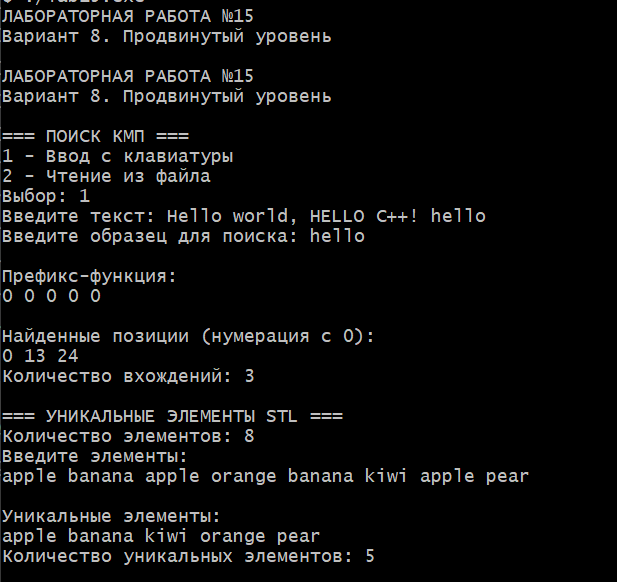

# Лабораторная работа №15
## Алгоритм Кнута — Морриса — Пратта. Обзор STL

**Студент:** Давлетмурзаев Сайд-Эмин Тимурович  
**Группа:** ПИЖ-б-о-25-1  
**Преподаватель:** Белик Ангелина Игоревна  
**Вариант:** 8  
**Уровень:** Продвинутый

---

## 1. Цель работы

1. Изучить алгоритм поиска подстроки Кнута — Морриса — Пратта (КМП).
2. Научиться вычислять префикс-функцию.
3. Реализовать поиск всех вхождений образца в текст.
4. Реализовать регистронезависимый поиск.
5. Изучить контейнер `unordered_set` из библиотеки STL.
6. Научиться определять количество уникальных элементов.

## 2. Теоретическая часть

### 2.1. Алгоритм Кнута — Морриса — Пратта

Алгоритм КМП предназначен для поиска всех вхождений образца в текст.

Его основное преимущество заключается в том, что при несовпадении символов алгоритм не начинает сравнение заново, а использует информацию о ранее совпавших символах.

Для этого применяется префикс-функция.

**Префикс-функция** — массив, в котором для каждой позиции хранится длина наибольшего собственного префикса строки, совпадающего с её суффиксом.

Алгоритм КМП имеет временную сложность:

`O(n + m)`

где:
- `n` — длина текста;
- `m` — длина образца.

### 2.2. Регистронезависимый поиск

Для выполнения поиска без учёта регистра текст и образец предварительно преобразуются к нижнему регистру.

Таким образом, слова `Hello`, `HELLO` и `hello` считаются одинаковыми.

### 2.3. Контейнер unordered_set

`unordered_set` — ассоциативный контейнер STL, который хранит только уникальные элементы.

Особенности:
- дубликаты автоматически исключаются;
- поиск и вставка в среднем выполняются за O(1);
- элементы не имеют гарантированного порядка хранения.

В программе уникальные элементы дополнительно сортируются для удобного вывода.

## 3. Постановка задачи

Для варианта 8 необходимо:

**Часть 1. Алгоритм КМП:**
- реализовать вычисление префикс-функции;
- выполнить поиск всех вхождений образца;
- обеспечить регистронезависимый поиск;
- вывести позиции найденных совпадений.

**Часть 2. STL:**
- использовать контейнер `unordered_set`;
- определить количество уникальных элементов;
- вывести уникальные значения.

**Дополнительные возможности:**
- предусмотреть ввод текста с клавиатуры или чтение из файла;
- вывести префикс-функцию;
- вывести количество найденных вхождений.

## 4. Реализация программы

```cpp
#ifdef _WIN32
#define NOMINMAX
#include <windows.h>
#endif
#include <limits>
#include <iostream>
#include <vector>
#include <string>
#include <fstream>
#include <unordered_set>
#include <algorithm>
#include <cctype>

using namespace std;

// Приведение строки к нижнему регистру.
string lower(string s) {
    for (char& c : s)
        c = static_cast<char>(tolower(static_cast<unsigned char>(c)));
    return s;
}

// Префикс-функция КМП.
vector<int> prefixFunction(const string& s) {
    vector<int> pi(s.size());

    for (int i = 1; i < static_cast<int>(s.size()); ++i) {
        int j = pi[i - 1];

        while (j > 0 && s[i] != s[j])
            j = pi[j - 1];

        if (s[i] == s[j]) ++j;
        pi[i] = j;
    }

    return pi;
}

// Поиск всех вхождений образца.
vector<int> KMP(const string& text, const string& pattern) {
    vector<int> result;

    if (pattern.empty()) return result;

    string t = lower(text);
    string p = lower(pattern);
    vector<int> pi = prefixFunction(p);

    int j = 0;

    for (int i = 0; i < static_cast<int>(t.size()); ++i) {
        while (j > 0 && t[i] != p[j])
            j = pi[j - 1];

        if (t[i] == p[j]) ++j;

        if (j == static_cast<int>(p.size())) {
            result.push_back(i - j + 1);
            j = pi[j - 1];
        }
    }

    return result;
}

int main() {
#ifdef _WIN32
    #define NOMINMAX
    SetConsoleOutputCP(65001);
    SetConsoleCP(65001);
#endif

    cout << "ЛАБОРАТОРНАЯ РАБОТА №15\n";
    cout << "Вариант 8. Продвинутый уровень\n";

    // ===== АЛГОРИТМ КМП =====
    cout << "\n=== ПОИСК КМП ===\n";
    cout << "1 - Ввод с клавиатуры\n";
    cout << "2 - Чтение из файла\n";
    cout << "Выбор: ";

    int choice;
    cin >> choice;
    cin.ignore(numeric_limits<streamsize>::max(), '\n');

    string text;

    if (choice == 2) {
        string filename;
        cout << "Имя файла: ";
        getline(cin, filename);

        ifstream file(filename);

        if (!file) {
            cout << "Ошибка открытия файла.\n";
            return 1;
        }

        string line;
        while (getline(file, line)) {
            text += line + "\n";
        }
    } else if (choice == 1) {
        cout << "Введите текст: ";
        getline(cin, text);
    } else {
        cout << "Неверный выбор.\n";
        return 1;
    }

    string pattern;
    cout << "Введите образец для поиска: ";
    getline(cin, pattern);

    if (pattern.empty()) {
        cout << "Образец не должен быть пустым.\n";
        return 1;
    }

    vector<int> pi = prefixFunction(lower(pattern));
    vector<int> positions = KMP(text, pattern);

    cout << "\nПрефикс-функция:\n";
    for (int x : pi) cout << x << " ";
    cout << "\n";

    cout << "\nНайденные позиции (нумерация с 0):\n";

    if (positions.empty()) {
        cout << "Совпадений нет.\n";
    } else {
        for (int pos : positions)
            cout << pos << " ";
        cout << "\n";
    }

    cout << "Количество вхождений: " << positions.size() << "\n";

    // ===== UNORDERED_SET =====
    cout << "\n=== УНИКАЛЬНЫЕ ЭЛЕМЕНТЫ STL ===\n";

    int n;
    cout << "Количество элементов: ";
    cin >> n;

    if (!cin || n < 0) {
        cout << "Некорректное количество.\n";
        return 1;
    }

    unordered_set<string> unique;
    cout << "Введите элементы:\n";

    for (int i = 0; i < n; ++i) {
        string x;
        cin >> x;
        unique.insert(x);
    }

    vector<string> sorted(unique.begin(), unique.end());
    sort(sorted.begin(), sorted.end());

    cout << "\nУникальные элементы:\n";
    for (const string& x : sorted)
        cout << x << " ";

    cout << "\nКоличество уникальных элементов: "
         << unique.size() << "\n";

    return 0;
}

```

Язык программирования: C++17.

Основной файл: [main.cpp](main.cpp).

В программе реализованы:

1. Функция преобразования строки к нижнему регистру.
2. Вычисление префикс-функции.
3. Алгоритм Кнута — Морриса — Пратта.
4. Поиск всех вхождений образца, включая пересекающиеся.
5. Регистронезависимое сравнение текста и образца.
6. Ввод текста с клавиатуры.
7. Чтение текста из файла.
8. Вывод позиций совпадений с нумерацией от нуля.
9. Подсчёт уникальных элементов с помощью `unordered_set`.
10. Сортировка уникальных элементов перед выводом.

## 5. Результаты работы

Программа успешно скомпилирована и запущена.

### 5.1. Проверка алгоритма КМП

Входные данные:

**Текст:**
```text
Hello world, HELLO C++! hello
```

**Образец:**
```text
hello
```

Полученные результаты:

| Показатель | Результат |
|---|---|
| Префикс-функция | 0 0 0 0 0 |
| Найденные позиции | 0, 13, 24 |
| Количество вхождений | 3 |

Поиск выполнен без учёта регистра. Все три вхождения образца успешно обнаружены.

### 5.2. Проверка unordered_set

Входные данные:

```text
apple banana apple orange banana kiwi apple pear
```

Всего введено 8 элементов.

Результат:

```text
apple banana kiwi orange pear
```

Количество уникальных элементов: **5**.

Повторяющиеся значения автоматически исключены контейнером `unordered_set`.

### 5.3. Скриншот выполнения

**Рисунок 1 — Результат выполнения лабораторной работы №15.**



## 6. Анализ сложности алгоритмов

| Операция | Временная сложность |
|---|---|
| Вычисление префикс-функции | O(m) |
| Поиск КМП | O(n + m) |
| Преобразование строки к нижнему регистру | O(n) |
| Вставка в unordered_set | O(1) в среднем |
| Поиск в unordered_set | O(1) в среднем |
| Сортировка уникальных элементов | O(k log k) |

Где:
- `n` — длина текста;
- `m` — длина образца;
- `k` — количество уникальных элементов.

Пространственная сложность алгоритма КМП составляет O(m) для префикс-функции и O(r) для хранения найденных позиций, где `r` — количество совпадений.

## 7. Ответы на контрольные вопросы

**1. Для чего предназначен алгоритм Кнута — Морриса — Пратта?**

Для эффективного поиска всех вхождений заданного образца в текст.

**2. В чём заключается основное преимущество алгоритма КМП?**

При несовпадении символов алгоритм использует ранее вычисленную информацию и не возвращается к уже проверенным символам текста.

**3. Что такое префикс-функция?**

Это массив значений, каждое из которых показывает длину наибольшего собственного префикса подстроки, совпадающего с её суффиксом.

**4. Какова временная сложность алгоритма КМП?**

O(n + m), где n — длина текста, m — длина образца.

**5. Для чего используется префикс-функция?**

Она определяет, насколько далеко можно сдвинуть образец после несовпадения, не выполняя повторные сравнения.

**6. Чем КМП отличается от наивного алгоритма поиска?**

Наивный алгоритм может повторно сравнивать одни и те же символы. КМП использует префикс-функцию для сокращения количества сравнений.

**7. Что такое STL в C++?**

STL — стандартная библиотека шаблонов C++, предоставляющая контейнеры, итераторы и алгоритмы для работы с данными.

**8. Что такое контейнер unordered_set?**

Это ассоциативный контейнер, который хранит уникальные элементы и использует хеширование для быстрого доступа.

**9. Чем unordered_set отличается от set?**

`set` хранит элементы в отсортированном порядке, обычно используя сбалансированное дерево. `unordered_set` использует хеш-таблицу и не гарантирует порядок элементов.

**10. Какова средняя сложность вставки элемента в unordered_set?**

В среднем O(1), в худшем случае O(n).

**11. Может ли unordered_set хранить одинаковые элементы?**

Нет. При попытке добавить уже существующий элемент новый экземпляр не создаётся.

**12. Для чего используется хеширование в unordered_set?**

Хеширование позволяет определять расположение элемента в хеш-таблице и ускоряет поиск, вставку и удаление.

**13. Как реализовать регистронезависимый поиск?**

Необходимо привести текст и образец к одному регистру перед сравнением символов.

**14. Можно ли с помощью КМП найти все вхождения образца?**

Да. После обнаружения совпадения алгоритм продолжает поиск с использованием префикс-функции, благодаря чему находятся и пересекающиеся вхождения.

**15. Какие преимущества предоставляет использование STL?**

STL предоставляет готовые структуры данных и алгоритмы, сокращает объём программного кода и упрощает разработку эффективных программ.

## 8. Вывод

В ходе лабораторной работы был изучен и реализован алгоритм Кнута — Морриса — Пратта для поиска подстроки в тексте.

Реализовано вычисление префикс-функции, регистронезависимый поиск всех вхождений образца и вывод их позиций.

Также был изучен контейнер `unordered_set`, с помощью которого реализован подсчёт уникальных элементов.

В ходе тестирования алгоритм КМП обнаружил три вхождения образца, а контейнер `unordered_set` выделил пять уникальных элементов из восьми введённых.

Поставленные цели лабораторной работы достигнуты.

## 9. Ссылка на GitHub

Репозиторий:  
https://github.com/saiddavletmurzaev91-boop/cpp-labs

Папка лабораторной работы: `lab-15/`
