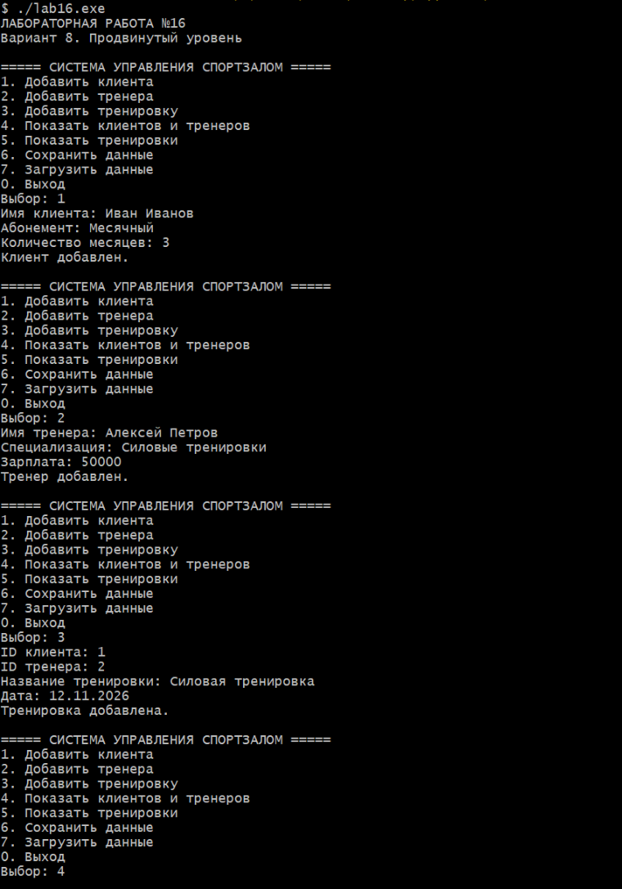
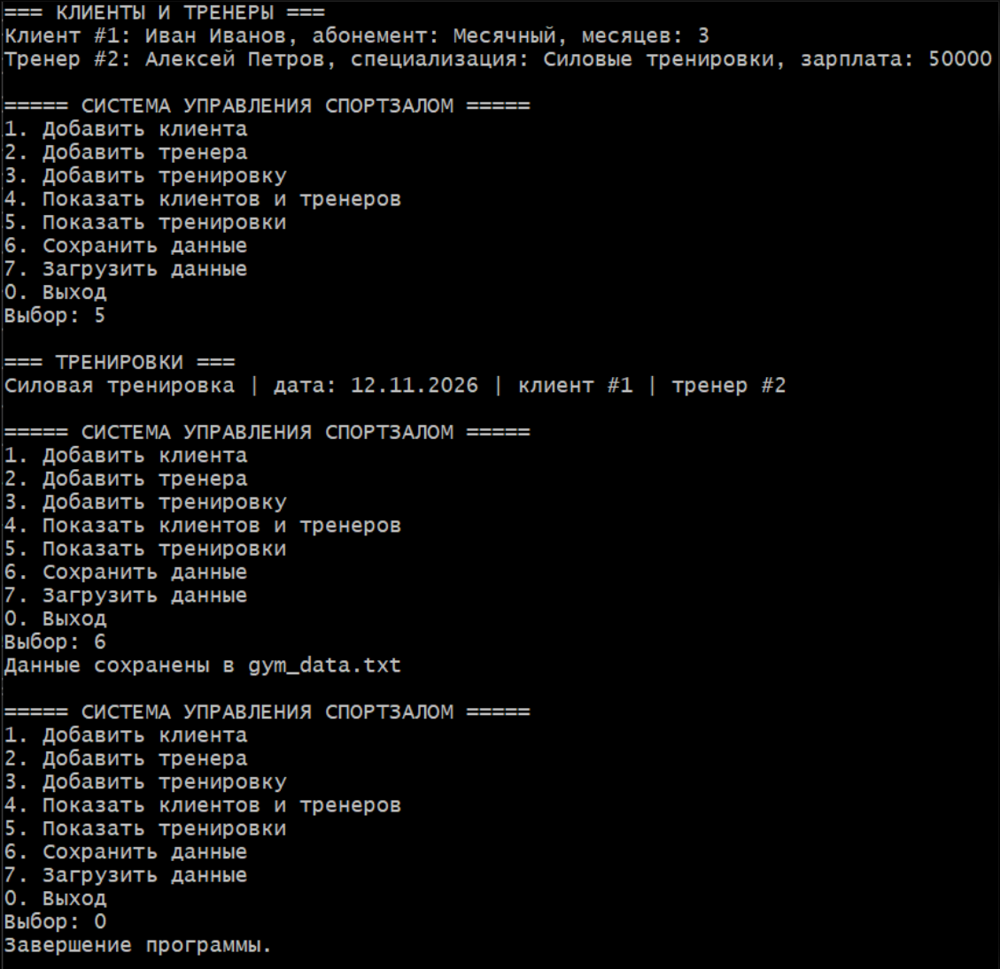
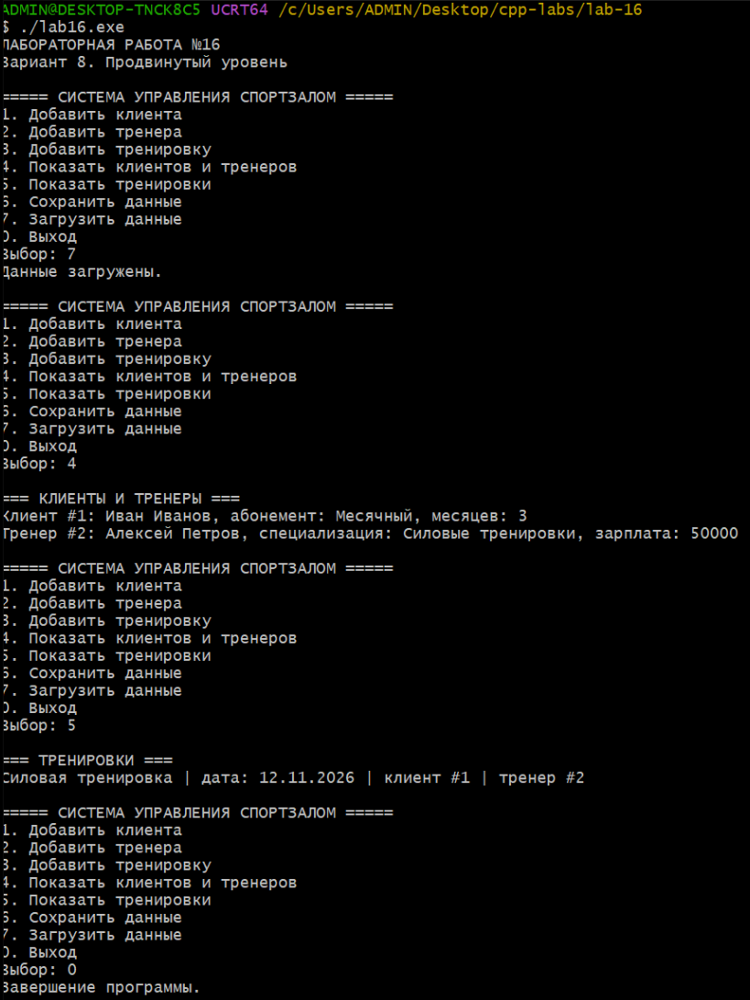

# Лабораторная работа №16
## Проектирование иерархии классов. Наследование и полиморфизм

**Студент:** Давлетмурзаев Сайд-Эмин Тимурович  
**Группа:** ПИЖ-б-о-25-1  
**Преподаватель:** Белик Ангелина Игоревна  
**Вариант:** 8  
**Уровень:** Продвинутый

---

## 1. Цель работы

1. Освоить принципы объектно-ориентированного проектирования.
2. Научиться использовать наследование для создания родственных классов.
3. Изучить виртуальные методы и динамический полиморфизм.
4. Освоить абстрактные классы и чисто виртуальные методы.
5. Изучить UML-диаграммы классов.
6. Разработать систему управления спортзалом с сохранением и загрузкой данных.

## 2. Теоретическая часть

### 2.1. Наследование

Наследование — механизм ООП, позволяющий создавать новые классы на основе существующих. Производные классы получают поля и методы базового класса и могут дополнять или переопределять их.

В программе используется открытое наследование (`public`).

### 2.2. Полиморфизм

Полиморфизм позволяет обращаться к объектам разных классов через общий интерфейс базового класса.

В C++ динамический полиморфизм реализуется с помощью виртуальных методов (`virtual`) и их переопределения (`override`).

### 2.3. Абстрактные классы

Абстрактный класс содержит хотя бы один чисто виртуальный метод. Создать экземпляр такого класса нельзя.

В программе базовый класс `Person` является абстрактным благодаря чисто виртуальным методам `type()`, `info()` и `save()`.

### 2.4. Паттерн Factory

Фабричный метод (Factory Method) позволяет создавать объекты, не связывая клиентский код напрямую с конкретными классами.

В программе класс `PersonFactory` отвечает за создание объектов `Client` и `Trainer`.

### 2.5. Сериализация

Сериализация — процесс преобразования объектов в формат, пригодный для сохранения. В программе данные записываются в текстовый файл `gym_data.txt` и восстанавливаются при загрузке.

## 3. Постановка задачи

Согласно варианту 8 необходимо разработать систему управления спортзалом.

Система должна обеспечивать:

- учёт клиентов;
- учёт тренеров;
- хранение информации об абонементах;
- регистрацию тренировок;
- проверку существования клиента и тренера;
- отображение информации;
- сохранение данных в файл;
- загрузку данных из файла;
- работу через консольное меню.

Для продвинутого уровня дополнительно реализуются наследование, полиморфизм и паттерн проектирования.

## 4. Листинг кода

```cpp
#ifdef _WIN32
#define NOMINMAX
#include <windows.h>
#endif
#include <iostream>
#include <vector>
#include <memory>
#include <fstream>
#include <string>
#include <iomanip>
#include <limits>

using namespace std;

// ===== БАЗОВЫЙ КЛАСС =====
class Person {
protected:
    int id;
    string name;
public:
    Person(int i, string n) : id(i), name(n) {}
    virtual ~Person() = default;
    int getId() const { return id; }
    virtual string type() const = 0;
    virtual void info() const = 0;
    virtual void save(ofstream& f) const = 0;
};

// ===== КЛИЕНТ =====
class Client : public Person {
    string plan;
    int months;
public:
    Client(int i, string n, string p, int m)
        : Person(i, n), plan(p), months(m) {}

    string type() const override { return "CLIENT"; }

    void info() const override {
        cout << "Клиент #" << id << ": " << name
             << ", абонемент: " << plan
             << ", месяцев: " << months << '\n';
    }

    void save(ofstream& f) const override {
        f << type() << ' ' << id << ' '
          << quoted(name) << ' ' << quoted(plan)
          << ' ' << months << '\n';
    }
};

// ===== ТРЕНЕР =====
class Trainer : public Person {
    string specialization;
    double salary;
public:
    Trainer(int i, string n, string s, double sal)
        : Person(i, n), specialization(s), salary(sal) {}

    string type() const override { return "TRAINER"; }

    void info() const override {
        cout << "Тренер #" << id << ": " << name
             << ", специализация: " << specialization
             << ", зарплата: " << salary << '\n';
    }

    void save(ofstream& f) const override {
        f << type() << ' ' << id << ' '
          << quoted(name) << ' '
          << quoted(specialization) << ' '
          << salary << '\n';
    }
};

// ===== ТРЕНИРОВКА =====
struct Workout {
    int clientId, trainerId;
    string date, title;

    void info() const {
        cout << title << " | дата: " << date
             << " | клиент #" << clientId
             << " | тренер #" << trainerId << '\n';
    }
};

// ===== ФАБРИКА ОБЪЕКТОВ =====
class PersonFactory {
public:
    static unique_ptr<Person> create(const string& t, int id,
                                     const string& n,
                                     const string& extra,
                                     double value) {
        if (t == "CLIENT")
            return make_unique<Client>(
                id, n, extra, static_cast<int>(value));
        if (t == "TRAINER")
            return make_unique<Trainer>(
                id, n, extra, value);
        return nullptr;
    }
};

// ===== СИСТЕМА СПОРТЗАЛА =====
class Gym {
    vector<unique_ptr<Person>> people;
    vector<Workout> workouts;
    int nextId = 1;

public:
    void addClient() {
        string n, p;
        int m;
        cout << "Имя клиента: ";
        getline(cin, n);
        cout << "Абонемент: ";
        getline(cin, p);
        cout << "Количество месяцев: ";
        cin >> m;
        cin.ignore(numeric_limits<streamsize>::max(), '\n');

        if (m <= 0) {
            cout << "Некорректный срок.\n";
            return;
        }

        people.push_back(
            PersonFactory::create("CLIENT", nextId++, n, p, m));
        cout << "Клиент добавлен.\n";
    }

    void addTrainer() {
        string n, s;
        double salary;
        cout << "Имя тренера: ";
        getline(cin, n);
        cout << "Специализация: ";
        getline(cin, s);
        cout << "Зарплата: ";
        cin >> salary;
        cin.ignore(numeric_limits<streamsize>::max(), '\n');

        if (salary < 0) {
            cout << "Некорректная зарплата.\n";
            return;
        }

        people.push_back(
            PersonFactory::create("TRAINER", nextId++, n, s, salary));
        cout << "Тренер добавлен.\n";
    }

    void addWorkout() {
        Workout w;
        cout << "ID клиента: ";
        cin >> w.clientId;
        cout << "ID тренера: ";
        cin >> w.trainerId;
        cin.ignore(numeric_limits<streamsize>::max(), '\n');

        if (!findPerson(w.clientId, "CLIENT") ||
            !findPerson(w.trainerId, "TRAINER")) {
            cout << "Клиент или тренер не найден.\n";
            return;
        }

        cout << "Название тренировки: ";
        getline(cin, w.title);
        cout << "Дата: ";
        getline(cin, w.date);

        workouts.push_back(w);
        cout << "Тренировка добавлена.\n";
    }

    Person* findPerson(int id, const string& t) const {
        for (const auto& p : people)
            if (p->getId() == id && p->type() == t)
                return p.get();
        return nullptr;
    }

    void showPeople() const {
        cout << "\n=== КЛИЕНТЫ И ТРЕНЕРЫ ===\n";
        for (const auto& p : people)
            p->info();
        if (people.empty()) cout << "Записей нет.\n";
    }

    void showWorkouts() const {
        cout << "\n=== ТРЕНИРОВКИ ===\n";
        for (const auto& w : workouts)
            w.info();
        if (workouts.empty()) cout << "Тренировок нет.\n";
    }

    void save() const {
        ofstream f("gym_data.txt");
        if (!f) {
            cout << "Ошибка сохранения.\n";
            return;
        }

        f << nextId << '\n' << people.size() << '\n';
        for (const auto& p : people)
            p->save(f);

        f << workouts.size() << '\n';
        for (const auto& w : workouts)
            f << w.clientId << ' ' << w.trainerId << ' '
              << quoted(w.date) << ' ' << quoted(w.title) << '\n';

        cout << "Данные сохранены в gym_data.txt\n";
    }

    void load() {
        ifstream f("gym_data.txt");
        if (!f) {
            cout << "Файл сохранения не найден.\n";
            return;
        }

        size_t count;
        f >> nextId >> count;
        if (!f || count > 100000) {
            cout << "Ошибка формата файла.\n";
            return;
        }

        vector<unique_ptr<Person>> loaded;
        vector<Workout> loadedWorkouts;

        for (size_t i = 0; i < count; ++i) {
            string t, n, extra;
            int id;
            double value;
            f >> t >> id >> quoted(n) >> quoted(extra) >> value;

            if (!f) {
                cout << "Ошибка чтения данных.\n";
                return;
            }

            auto p = PersonFactory::create(t, id, n, extra, value);
            if (!p) {
                cout << "Неизвестный тип объекта.\n";
                return;
            }
            loaded.push_back(move(p));
        }

        size_t wc;
        f >> wc;
        if (!f || wc > 100000) {
            cout << "Ошибка чтения тренировок.\n";
            return;
        }

        for (size_t i = 0; i < wc; ++i) {
            Workout w;
            f >> w.clientId >> w.trainerId
              >> quoted(w.date) >> quoted(w.title);
            if (!f) {
                cout << "Ошибка чтения тренировки.\n";
                return;
            }
            loadedWorkouts.push_back(w);
        }

        people = move(loaded);
        workouts = move(loadedWorkouts);
        cout << "Данные загружены.\n";
    }

    void menu() {
        int c;
        do {
            cout << "\n===== СИСТЕМА УПРАВЛЕНИЯ СПОРТЗАЛОМ =====\n"
                 << "1. Добавить клиента\n"
                 << "2. Добавить тренера\n"
                 << "3. Добавить тренировку\n"
                 << "4. Показать клиентов и тренеров\n"
                 << "5. Показать тренировки\n"
                 << "6. Сохранить данные\n"
                 << "7. Загрузить данные\n"
                 << "0. Выход\n"
                 << "Выбор: ";

            if (!(cin >> c)) {
                cin.clear();
                cin.ignore(numeric_limits<streamsize>::max(), '\n');
                cout << "Введите номер пункта.\n";
                continue;
            }
            cin.ignore(numeric_limits<streamsize>::max(), '\n');

            switch (c) {
                case 1: addClient(); break;
                case 2: addTrainer(); break;
                case 3: addWorkout(); break;
                case 4: showPeople(); break;
                case 5: showWorkouts(); break;
                case 6: save(); break;
                case 7: load(); break;
                case 0: cout << "Завершение программы.\n"; break;
                default: cout << "Неверный пункт меню.\n";
            }
        } while (c != 0);
    }
};

int main() {
#ifdef _WIN32
    SetConsoleOutputCP(CP_UTF8);
    SetConsoleCP(CP_UTF8);
#endif
    cout << "ЛАБОРАТОРНАЯ РАБОТА №16\n"
         << "Вариант 8. Продвинутый уровень\n";

    Gym gym;
    gym.menu();
    return 0;
}

```

### 4.1. Структура классов

В программе реализованы следующие классы:

| Класс | Назначение |
|---|---|
| `Person` | Абстрактный базовый класс |
| `Client` | Хранение информации о клиенте |
| `Trainer` | Хранение информации о тренере |
| `Workout` | Представление тренировки |
| `PersonFactory` | Создание объектов клиентов и тренеров |
| `Gym` | Управление системой спортзала |

### 4.2. UML-диаграмма

```text
              <<abstract>>
                 Person
          ---------------------
          # id: int
          # name: string
          ---------------------
          + type()
          + info()
          + save()
                 / \
                /   \
               /     \
          Client     Trainer
          -------    ----------
          - plan     - specialization
          - months   - salary
          -------    ----------
          + info()   + info()
          + save()   + save()

       PersonFactory
       -------------
       + create()

       Workout
       -------------
       - clientId
       - trainerId
       - date
       - title

       Gym
       -------------
       - people
       - workouts
       - nextId
       -------------
       + addClient()
       + addTrainer()
       + addWorkout()
       + showPeople()
       + showWorkouts()
       + save()
       + load()
       + menu()
```

`Client` и `Trainer` наследуются от `Person`. Класс `Gym` управляет объектами этих классов и тренировками.

## 5. Реализация программы

Язык программирования: C++17.

Основной файл: [main.cpp](main.cpp).

В программе реализованы:

1. Абстрактный базовый класс `Person`.
2. Производные классы `Client` и `Trainer`.
3. Виртуальный деструктор и виртуальные методы.
4. Переопределение методов с помощью `override`.
5. Фабрика объектов `PersonFactory`.
6. Хранение объектов через `unique_ptr`.
7. Добавление клиентов и тренеров.
8. Регистрация тренировок с проверкой ID.
9. Просмотр информации о клиентах и тренерах.
10. Просмотр списка тренировок.
11. Сохранение данных в `gym_data.txt`.
12. Загрузка данных из файла.
13. Консольное меню управления системой.

## 6. Результаты работы

Программа успешно скомпилирована и запущена с использованием C++17.

### 6.1. Добавление данных

В систему добавлены:

**Клиент:**
- Имя: Иван Иванов.
- Абонемент: Месячный.
- Срок: 3 месяца.

**Тренер:**
- Имя: Алексей Петров.
- Специализация: Силовые тренировки.
- Зарплата: 50000.

Также создана тренировка:
- Название: Силовая тренировка.
- Дата: 12.11.2026.
- ID клиента: 1.
- ID тренера: 2.

### 6.2. Сохранение данных

После добавления записей выполнено сохранение в файл `gym_data.txt`.

Программа подтвердила успешное сохранение.

### 6.3. Загрузка данных

После повторного запуска программы выполнена загрузка данных из файла.

Клиент, тренер и тренировка успешно восстановлены. Проверка отображения показала сохранность всех записей.

### 6.4. Скриншоты

**Рисунок 1 — Добавление клиента, тренера и тренировки.**



**Рисунок 2 — Просмотр записей и сохранение данных.**



**Рисунок 3 — Загрузка и восстановление данных после перезапуска.**



## 7. Ответы на контрольные вопросы

**1. Что такое наследование? Какие виды наследования есть в C++?**

Наследование — механизм ООП, позволяющий создавать производные классы на основе базовых. В C++ существуют открытое (`public`), защищённое (`protected`) и закрытое (`private`) наследование.

**2. Что такое открытое (public) наследование? Какое отношение оно реализует?**

Открытое наследование сохраняет доступность открытых и защищённых членов базового класса в соответствии с правилами доступа. Оно реализует отношение «является» (`is-a`).

**3. Что такое виртуальный метод? Для чего он нужен?**

Виртуальный метод — метод базового класса, который может быть переопределён в производном классе. Он обеспечивает динамический полиморфизм.

**4. Что такое чисто виртуальный метод и абстрактный класс?**

Чисто виртуальный метод объявляется с `= 0`. Класс, содержащий хотя бы один такой метод, является абстрактным и не может иметь экземпляров.

**5. Почему деструктор базового класса должен быть виртуальным?**

Виртуальный деструктор обеспечивает корректное уничтожение производного объекта при удалении через указатель на базовый класс.

**6. Что такое позднее связывание (динамический полиморфизм)?**

Позднее связывание — выбор реализации виртуального метода во время выполнения программы в зависимости от фактического типа объекта.

**7. Как переопределить метод в производном классе? Что такое override?**

Метод переопределяется в производном классе с той же сигнатурой. Ключевое слово `override` указывает компилятору, что метод должен переопределять виртуальный метод базового класса.

**8. Что такое RTTI? Как работает dynamic_cast?**

RTTI — механизм получения информации о типе объекта во время выполнения. `dynamic_cast` выполняет безопасное приведение типов в иерархии полиморфных классов.

**9. Как вызвать метод базового класса из производного?**

Для этого используется оператор разрешения области видимости. Например: `Base::method()`.

**10. Что такое диаграмма классов UML? Какие основные элементы?**

Диаграмма классов UML — графическое представление структуры системы. Она отображает классы, атрибуты, методы и связи между классами, включая наследование, агрегацию и композицию.

**11. Что такое паттерн «Стратегия»? Где он применяется?**

Стратегия — поведенческий паттерн, который позволяет инкапсулировать семейство алгоритмов и взаимозаменять их независимо от использующего кода. Применяется, когда необходимо выбирать разные способы выполнения одной операции.

**12. Что такое виртуальный деструктор? Почему он важен?**

Виртуальный деструктор — деструктор, объявленный с ключевым словом `virtual`. Он гарантирует вызов деструкторов производных классов при уничтожении объекта через указатель на базовый класс.

## 8. Вывод

В ходе лабораторной работы были изучены принципы объектно-ориентированного программирования, наследование, полиморфизм, абстрактные классы и виртуальные методы.

Разработана система управления спортзалом с учётом клиентов, тренеров и тренировок. Реализована фабрика объектов, а также сохранение и загрузка данных из файла.

В процессе тестирования подтверждена корректная работа основных функций программы и восстановление данных после повторного запуска.

Поставленные цели лабораторной работы достигнуты.

## 9. Ссылка на GitHub

Репозиторий:  
https://github.com/saiddavletmurzaev91-boop/cpp-labs

Папка лабораторной работы: `lab-16/`
