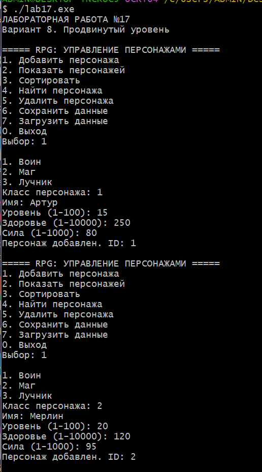
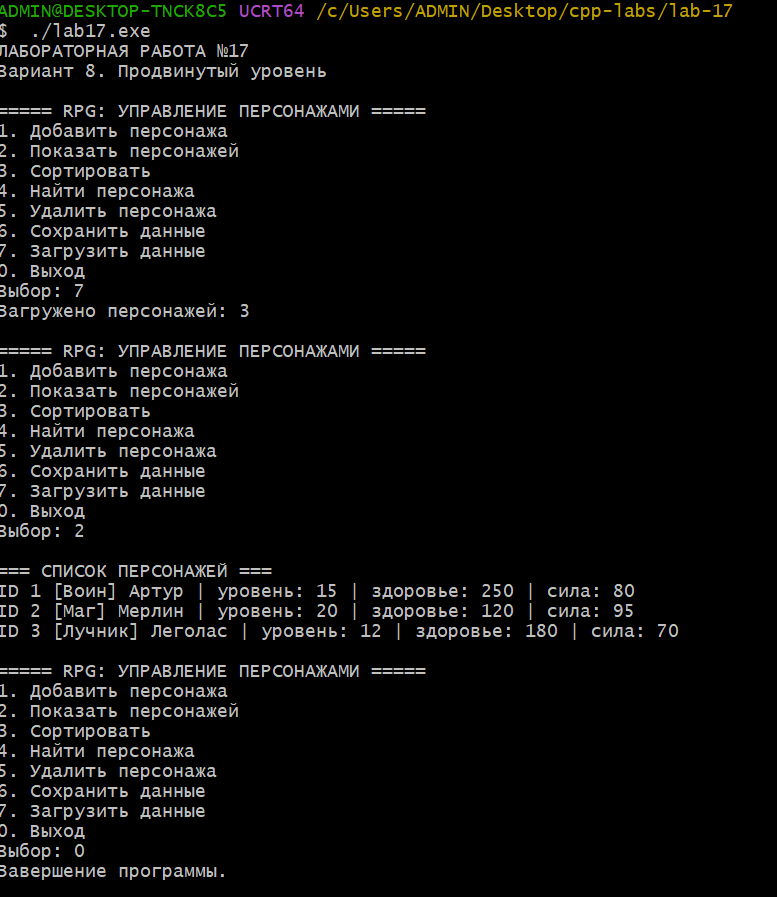
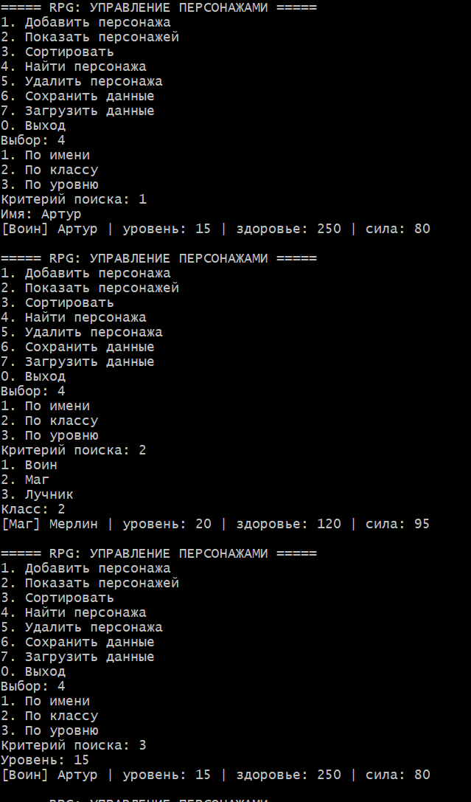
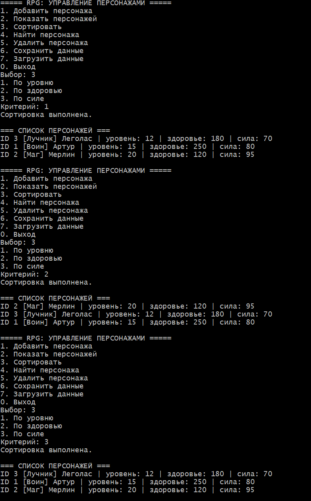
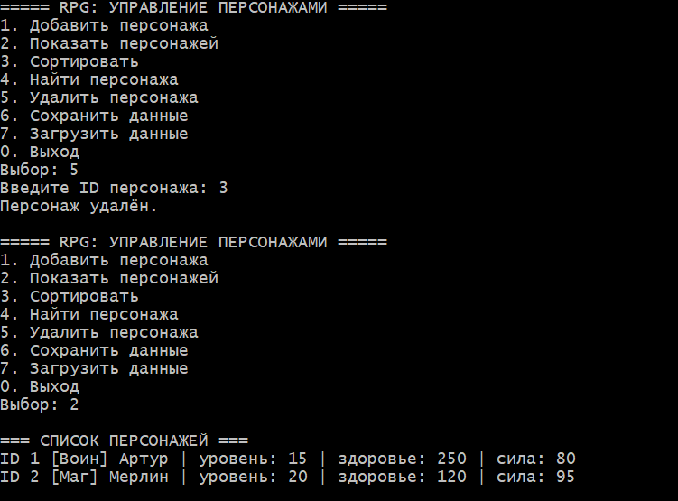
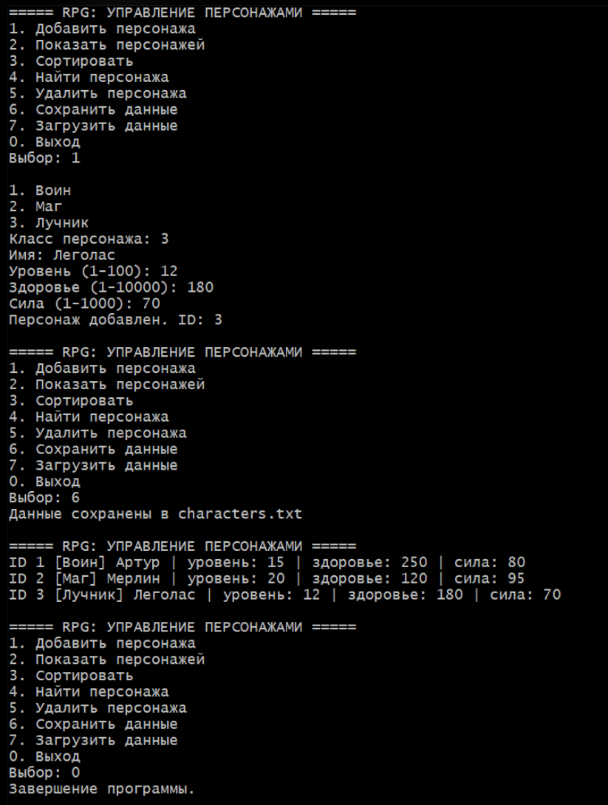

# Лабораторная работа №17
## RPG: управление персонажами

**Студент:** Давлетмурзаев Сайд-Эмин Тимурович  
**Группа:** ПИЖ-б-о-25-1  
**Преподаватель:** Белик Ангелина Игоревна  
**Вариант:** 8  
**Уровень:** Продвинутый

---

## 1. Цель работы

Разработать консольную программу для управления персонажами RPG с использованием возможностей языка C++. Реализовать добавление, просмотр, сортировку, поиск, удаление персонажей, а также сохранение и загрузку данных из файла.

## 2. Теоретическая часть

В работе используются следующие средства языка C++:

- структуры и классы для представления персонажей;
- перечисления для определения классов персонажей;
- контейнеры STL для хранения данных;
- алгоритмы сортировки;
- поиск элементов по заданным критериям;
- файловые потоки для сохранения и загрузки информации.

## 3. Постановка задачи

Разработать систему управления RPG-персонажами со следующими возможностями:

1. Добавление персонажей с указанием класса, имени, уровня, здоровья и силы.
2. Просмотр списка всех персонажей.
3. Сортировка персонажей по уровню, здоровью и силе.
4. Поиск персонажей по имени, классу и уровню.
5. Удаление персонажа по идентификатору.
6. Сохранение данных в файл `characters.txt`.
7. Загрузка ранее сохранённых данных.

## 4. Листинг программы

```cpp

#ifdef _WIN32
#define NOMINMAX
#include <windows.h>
#endif

#include <iostream>
#include <vector>
#include <memory>
#include <string>
#include <fstream>
#include <algorithm>
#include <iomanip>
#include <limits>
#include <stdexcept>

using namespace std;

// ===== АБСТРАКТНЫЙ БАЗОВЫЙ КЛАСС =====
class Character {
protected:
    int id, level, health, power;
    string name;

public:
    Character(int i, string n, int l, int h, int p)
        : id(i), name(n), level(l), health(h), power(p) {}

    virtual ~Character() = default;

    int getId() const { return id; }
    int getLevel() const { return level; }
    int getHealth() const { return health; }
    int getPower() const { return power; }
    string getName() const { return name; }

    virtual string type() const = 0;
    virtual void info() const = 0;

    virtual void save(ofstream& f) const {
        f << type() << ' ' << id << ' ' << quoted(name) << ' '
          << level << ' ' << health << ' ' << power << '\n';
    }
};

// ===== ПРОИЗВОДНЫЕ КЛАССЫ =====
class Warrior : public Character {
public:
    using Character::Character;
    string type() const override { return "Warrior"; }

    void info() const override {
        cout << "[Воин] ";
        show();
    }

private:
    void show() const {
        cout << name << " | уровень: " << level
             << " | здоровье: " << health
             << " | сила: " << power << '\n';
    }
};

class Mage : public Character {
public:
    using Character::Character;
    string type() const override { return "Mage"; }

    void info() const override {
        cout << "[Маг] ";
        show();
    }

private:
    void show() const {
        cout << name << " | уровень: " << level
             << " | здоровье: " << health
             << " | сила: " << power << '\n';
    }
};

class Archer : public Character {
public:
    using Character::Character;
    string type() const override { return "Archer"; }

    void info() const override {
        cout << "[Лучник] ";
        show();
    }

private:
    void show() const {
        cout << name << " | уровень: " << level
             << " | здоровье: " << health
             << " | сила: " << power << '\n';
    }
};

// ===== ФАБРИКА ПЕРСОНАЖЕЙ =====
class CharacterFactory {
public:
    static unique_ptr<Character> create(
        const string& t, int id, const string& n,
        int l, int h, int p) {

        if (t == "Warrior")
            return make_unique<Warrior>(id, n, l, h, p);
        if (t == "Mage")
            return make_unique<Mage>(id, n, l, h, p);
        if (t == "Archer")
            return make_unique<Archer>(id, n, l, h, p);

        throw invalid_argument("Неизвестный класс персонажа");
    }
};

// ===== ВВОД ДАННЫХ =====
int readInt(const string& prompt, int min, int max) {
    cout << prompt;
    int x;
    if (!(cin >> x)) {
        cin.clear();
        cin.ignore(numeric_limits<streamsize>::max(), '\n');
        throw invalid_argument("Необходимо ввести целое число");
    }
    cin.ignore(numeric_limits<streamsize>::max(), '\n');
    if (x < min || x > max)
        throw out_of_range("Значение вне допустимого диапазона");
    return x;
}

string readText(const string& prompt) {
    cout << prompt;
    string s;
    getline(cin, s);
    if (s.empty()) throw invalid_argument("Строка не должна быть пустой");
    return s;
}

// ===== СИСТЕМА УПРАВЛЕНИЯ =====
class Game {
    vector<unique_ptr<Character>> characters;
    int nextId = 1;

    Character* getById(int id) const {
        for (const auto& c : characters)
            if (c->getId() == id) return c.get();
        return nullptr;
    }

public:
    void add() {
        cout << "\n1. Воин\n2. Маг\n3. Лучник\n";
        int t = readInt("Класс персонажа: ", 1, 3);

        string type = t == 1 ? "Warrior" :
                      t == 2 ? "Mage" : "Archer";

        string name = readText("Имя: ");
        int level = readInt("Уровень (1-100): ", 1, 100);
        int health = readInt("Здоровье (1-10000): ", 1, 10000);
        int power = readInt("Сила (1-1000): ", 1, 1000);

        characters.push_back(CharacterFactory::create(
            type, nextId++, name, level, health, power));

        cout << "Персонаж добавлен. ID: " << nextId - 1 << '\n';
    }

    void show() const {
        if (characters.empty())
            throw runtime_error("Список персонажей пуст");

        cout << "\n=== СПИСОК ПЕРСОНАЖЕЙ ===\n";
        for (const auto& c : characters) {
            cout << "ID " << c->getId() << " ";
            c->info();
        }
    }

    void remove() {
        if (characters.empty())
            throw runtime_error("Удалять нечего: список пуст");

        int id = readInt("Введите ID персонажа: ", 1, 1000000000);
        auto it = find_if(characters.begin(), characters.end(),
            [id](const auto& c) { return c->getId() == id; });

        if (it == characters.end())
            throw out_of_range("Персонаж с таким ID не найден");

        characters.erase(it);
        cout << "Персонаж удалён.\n";
    }

    void sort() {
        if (characters.empty())
            throw runtime_error("Список персонажей пуст");

        cout << "1. По уровню\n2. По здоровью\n3. По силе\n";
        int key = readInt("Критерий: ", 1, 3);

        std::sort(characters.begin(), characters.end(),
            [key](const auto& a, const auto& b) {
                if (key == 1) return a->getLevel() < b->getLevel();
                if (key == 2) return a->getHealth() < b->getHealth();
                return a->getPower() < b->getPower();
            });

        cout << "Сортировка выполнена.\n";
        show();
    }

    void search() const {
        cout << "1. По имени\n2. По классу\n3. По уровню\n";
        int key = readInt("Критерий поиска: ", 1, 3);
        bool found = false;

        if (key == 1) {
            string n = readText("Имя: ");
            for (const auto& c : characters)
                if (c->getName() == n) {
                    c->info();
                    found = true;
                }
        } else if (key == 2) {
            cout << "1. Воин\n2. Маг\n3. Лучник\n";
            int t = readInt("Класс: ", 1, 3);
            string type = t == 1 ? "Warrior" :
                          t == 2 ? "Mage" : "Archer";

            for (const auto& c : characters)
                if (c->type() == type) {
                    c->info();
                    found = true;
                }
        } else {
            int level = readInt("Уровень: ", 1, 100);
            for (const auto& c : characters)
                if (c->getLevel() == level) {
                    c->info();
                    found = true;
                }
        }

        if (!found) cout << "Совпадений не найдено.\n";
    }

    void save() const {
        ofstream f("characters.txt");
        if (!f) throw runtime_error("Не удалось открыть файл для записи");

        f << nextId << '\n' << characters.size() << '\n';
        for (const auto& c : characters) c->save(f);

        if (!f) throw runtime_error("Ошибка записи файла");
        cout << "Данные сохранены в characters.txt\n";
    }

    void load() {
        ifstream f("characters.txt");
        if (!f) throw runtime_error("Не удалось открыть файл для чтения");

        int idCounter;
        size_t count;
        f >> idCounter >> count;

        if (!f || count > 100000)
            throw runtime_error("Некорректный формат файла");

        vector<unique_ptr<Character>> temp;

        for (size_t i = 0; i < count; ++i) {
            string type, name;
            int id, level, health, power;

            f >> type >> id >> quoted(name)
              >> level >> health >> power;

            if (!f || id <= 0 || level < 1 || level > 100 ||
                health < 1 || health > 10000 ||
                power < 1 || power > 1000)
                throw runtime_error("Ошибка чтения персонажа");

            temp.push_back(CharacterFactory::create(
                type, id, name, level, health, power));
        }

        if (idCounter <= 0)
            throw runtime_error("Некорректный счётчик ID");

        characters = move(temp);
        nextId = idCounter;
        cout << "Загружено персонажей: " << characters.size() << '\n';
    }

    void menu() {
        while (true) {
            cout << "\n===== RPG: УПРАВЛЕНИЕ ПЕРСОНАЖАМИ =====\n"
                 << "1. Добавить персонажа\n"
                 << "2. Показать персонажей\n"
                 << "3. Сортировать\n"
                 << "4. Найти персонажа\n"
                 << "5. Удалить персонажа\n"
                 << "6. Сохранить данные\n"
                 << "7. Загрузить данные\n"
                 << "0. Выход\n";

            try {
                int choice = readInt("Выбор: ", 0, 7);

                switch (choice) {
                    case 1: add(); break;
                    case 2: show(); break;
                    case 3: sort(); break;
                    case 4: search(); break;
                    case 5: remove(); break;
                    case 6: save(); break;
                    case 7: load(); break;
                    case 0:
                        cout << "Завершение программы.\n";
                        return;
                }
            } catch (const exception& e) {
                cout << "Ошибка: " << e.what() << '\n';
            }
        }
    }
};

int main() {
#ifdef _WIN32
    SetConsoleOutputCP(CP_UTF8);
    SetConsoleCP(CP_UTF8);
#endif

    cout << "ЛАБОРАТОРНАЯ РАБОТА №17\n"
         << "Вариант 8. Продвинутый уровень\n";

    try {
        Game game;
        game.menu();
    } catch (const bad_alloc&) {
        cerr << "Недостаточно памяти.\n";
        return 1;
    }

    return 0;
}

```

Полный исходный код программы находится в файле [`main.cpp`](main.cpp).

## 5. Результаты работы

В ходе выполнения лабораторной работы программа была запущена и протестирована.

### 5.1. Добавление персонажей



### 5.2. Просмотр списка персонажей



### 5.3. Поиск персонажей



Проверен поиск по имени, классу и уровню.

### 5.4. Сортировка персонажей



Проверена сортировка по уровню, здоровью и силе.

### 5.5. Удаление персонажа



Проверено удаление персонажа по ID. После удаления список корректно обновляется.

### 5.6. Сохранение и загрузка данных



Проверено сохранение данных в файл и восстановление персонажей после повторного запуска программы.

## 6. Тестирование

В качестве тестовых данных были использованы три персонажа:

| ID | Имя | Класс | Уровень | Здоровье | Сила |
|---:|---|---|---:|---:|---:|
| 1 | Артур | Воин | 15 | 250 | 80 |
| 2 | Мерлин | Маг | 20 | 120 | 95 |
| 3 | Леголас | Лучник | 12 | 180 | 70 |

Результаты тестирования:

- добавление персонажей — успешно;
- отображение списка — успешно;
- поиск по трём критериям — успешно;
- сортировка по трём критериям — успешно;
- удаление персонажа — успешно;
- сохранение и загрузка — успешно.

## 7. Заключение

В ходе лабораторной работы была разработана консольная RPG-система управления персонажами на языке C++.

Реализованы основные операции добавления, просмотра, поиска, сортировки и удаления персонажей. Также реализовано сохранение информации в файл и последующая загрузка данных.

Поставленные задачи выполнены. Работоспособность программы проверена на тестовых данных.

## 8. Репозиторий GitHub

[cpp-labs — лабораторные работы](https://github.com/saiddavletmurzaev91-boop/cpp-labs)
